# Storage and execution illustrations

Measured examples are scoped in [Selected measurements](PERFORMANCE.md).

Use these pictures alongside the [book](WORKING-DOC.md). Names such as K1 and
file X are illustrative. Measured charts identify their sample limits; the
remaining pictures show possible execution sequences rather than timings.

<!-- review-figure:figure-1-manifest:start -->
#### Figure 1.1 · A manifest is one record with named fields

<!-- visual-summary:start -->
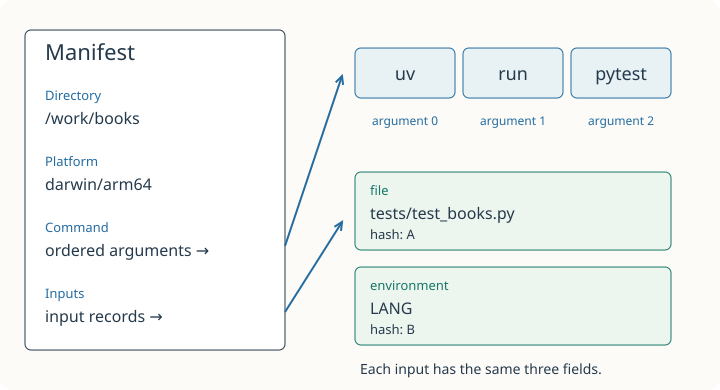

Follow the two arrows: Command is a sequence of words; Inputs is a sequence of records. This shows selected fields, not a memory-address layout.
<!-- visual-summary:end -->

<!-- review-figure:figure-1-manifest:end -->

<!-- review-figure:figure-1-key-change:start -->
#### Figure 1.2 · An edited file leads to a different lookup

<!-- visual-summary:start -->
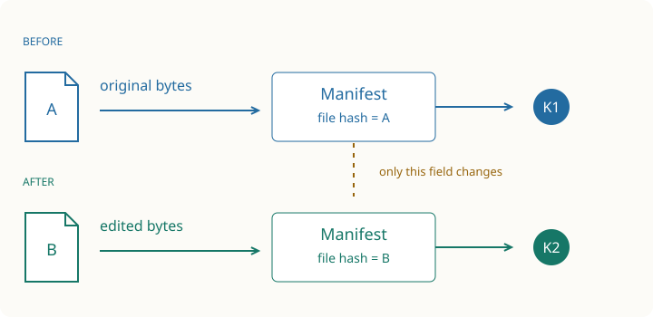

Trace each row from left to right. The command stays the same; the recorded file hash and lookup key change. Matching keys still say nothing about unrecorded website responses.
<!-- visual-summary:end -->

<!-- review-figure:figure-1-key-change:end -->

<!-- review-figure:figure-1-local-flow:start -->
#### Figure 1.3 · A hit and a miss do different work

<!-- visual-summary:start -->
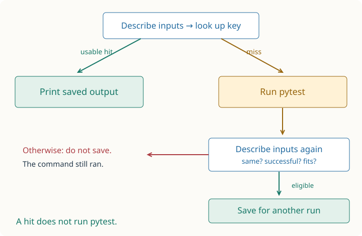

Follow the split. A hit skips command execution, not input discovery. A miss runs the command and checks its inputs again before deciding whether to save. This is the ordinary local path; verification and quarantine add further decisions.
<!-- visual-summary:end -->

<!-- review-figure:figure-1-local-flow:end -->

<!-- review-figure:figure-1-scan-gap:start -->
#### Figure 1.4 · Matching scans can miss a change in between

<!-- visual-summary:start -->
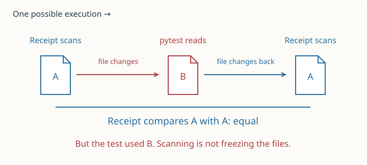

Look at the middle file, then the two endpoints. Both Receipt scans can agree while the command reads different bytes between them. A and B label file contents, not filenames.
<!-- visual-summary:end -->

<!-- review-figure:figure-1-scan-gap:end -->

<!-- review-figure:figure-2-storage:start -->
#### Figure 2.1 · The server joins a database record to output files

<!-- visual-summary:start -->
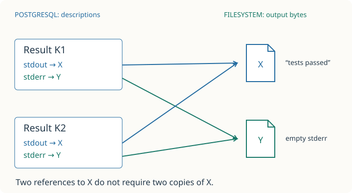

Follow both blue arrows. Different input keys can point to the same output bytes. The server reads a description, follows its hashes to files, and sends the outputs back; it does not run pytest.
<!-- visual-summary:end -->

<!-- review-figure:figure-2-storage:end -->

<!-- review-figure:figure-2-interrupted-write:start -->
#### Figure 2.2 · A failed database save can leave a complete output file

<!-- visual-summary:start -->
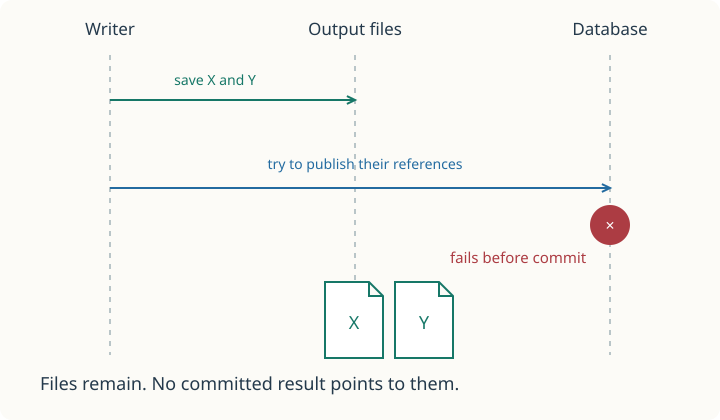

Step through the two different stores. Watch the files remain after the database step fails. This example is not an uncertain commit acknowledgement.

1. The writer saves complete output files first.
2. In this example, database publication definitely fails before commit.
3. Rolling back SQL does not remove files. Later collection can find them.
<!-- visual-summary:end -->

<!-- review-figure:figure-2-interrupted-write:end -->

<!-- review-figure:figure-2-admission:start -->
#### Figure 2.3 · Full slots refuse another request

<!-- visual-summary:start -->
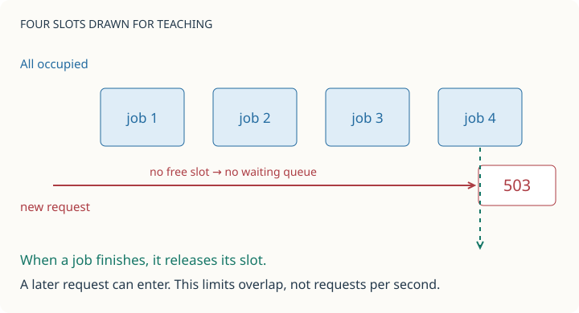

Count occupied slots. The actual default storage admission limit is 16; four are drawn to keep the mechanism visible. Being admitted does not mean a request is already using a database connection or holding a storage lock.
<!-- visual-summary:end -->

<!-- review-figure:figure-2-admission:end -->

<!-- review-figure:figure-2-conflict-state:start -->
#### Figure 2.4 · A conflict error must leave a warning behind

<!-- visual-summary:start -->
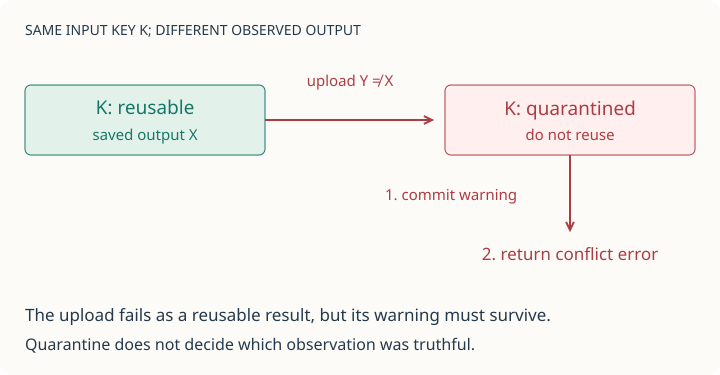

Follow the change to K before the error is returned. Rolling back the warning simply because the operation returns an error would let clients keep reusing a disputed result.
<!-- visual-summary:end -->

<!-- review-figure:figure-2-conflict-state:end -->

<!-- review-figure:figure-3-reader-cleanup:start -->
#### Figure 3.1 · The lock protects the gap before opening the file

<!-- visual-summary:start -->
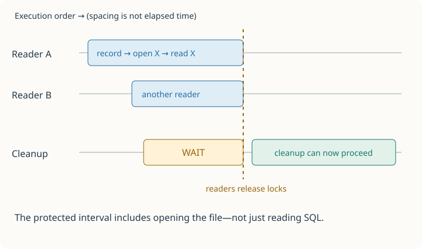

Read across each lane. The amber interval is waiting, not cleanup work. Without coordination, retention and collection could remove X after a reader found its description but before it opened X.

1. Two readers can hold shared locks together.
2. Cleanup needs exclusive access. It waits for both readers to finish.
3. After the readers release their locks, cleanup can proceed; readers and writers wait while it holds exclusive access.
<!-- visual-summary:end -->

<!-- review-figure:figure-3-reader-cleanup:end -->

<!-- review-figure:figure-3-upload-cost:start -->
#### Figure 3.2 · Earlier uploads recounted the whole store

<!-- visual-summary:start -->
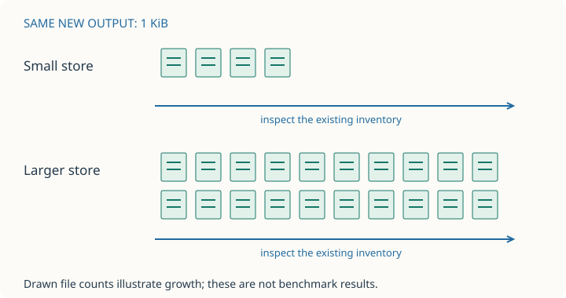

The earlier accounting algorithm inspected existing files and database records on each upload. Receipt now maintains running totals; maintenance still inspects the inventory. See the selected measurements for the comparison.
<!-- visual-summary:end -->

<!-- review-figure:figure-3-upload-cost:end -->

<!-- review-figure:figure-3-collection-map:start -->
#### Figure 3.3 · Two records can share the same “still needed” entries

<!-- visual-summary:start -->
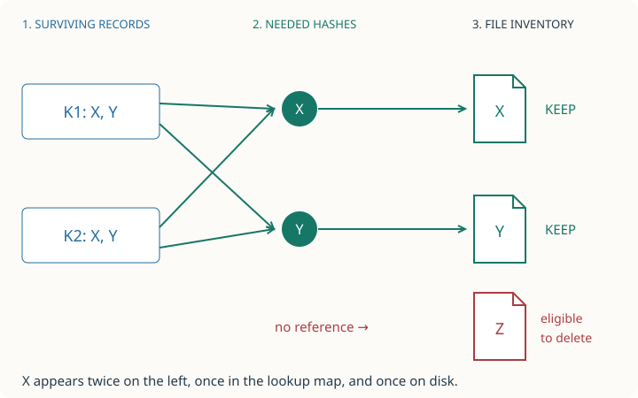

Trace X from both records into one map entry. Collection checks every inventoried file against that map. Z is a deletion candidate; a dry run reports it, while --apply may delete it. Quarantined records with references also keep their files.
<!-- visual-summary:end -->

<!-- review-figure:figure-3-collection-map:end -->

<!-- review-figure:figure-4-validation:start -->
#### Figure 4.1 · Each check answers a different question

<!-- visual-summary:start -->
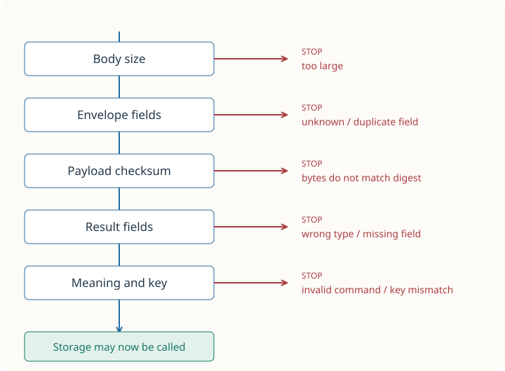

Follow the blue route for a valid upload. Each red exit shows a different invalid request—not one request that fails repeatedly. Authentication and permission checks happen before this sequence; a checksum does not establish truth.

1. Reject a body that exceeds the byte limit.
2. Check the envelope fields, including duplicate and unknown names.
3. Check that the payload bytes match their checksum.
4. Decode the result and its nested records using their field rules.
5. Check valid values, the manifest-derived key and the requested URL key.
6. Only a request that passes every check reaches storage.
<!-- visual-summary:end -->

<!-- review-figure:figure-4-validation:end -->

<!-- review-figure:figure-4-failed-save-states:start -->
#### Figure 4.2 · What remains after a failed save?

<!-- visual-summary:start -->
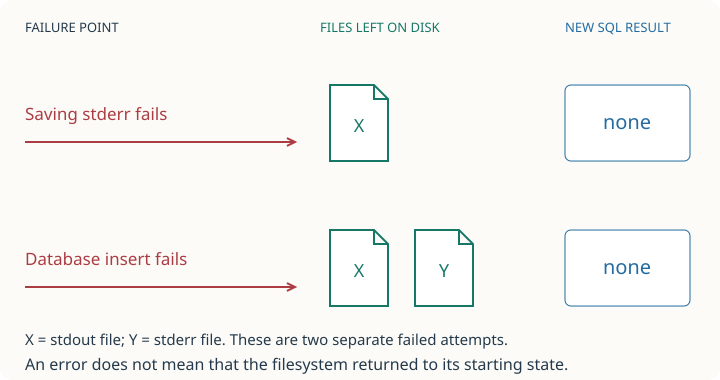

Compare what remains, not just the error returned. Assume these are new outputs with no other references. In the first example, stderr fails before publishing its file; in the second, both files exist before the database insert fails. Temporary files are omitted.
<!-- visual-summary:end -->

<!-- review-figure:figure-4-failed-save-states:end -->

<!-- review-figure:figure-4-cleanup-retry:start -->
#### Figure 4.3 · Cleanup retries from the state that remains

<!-- visual-summary:start -->
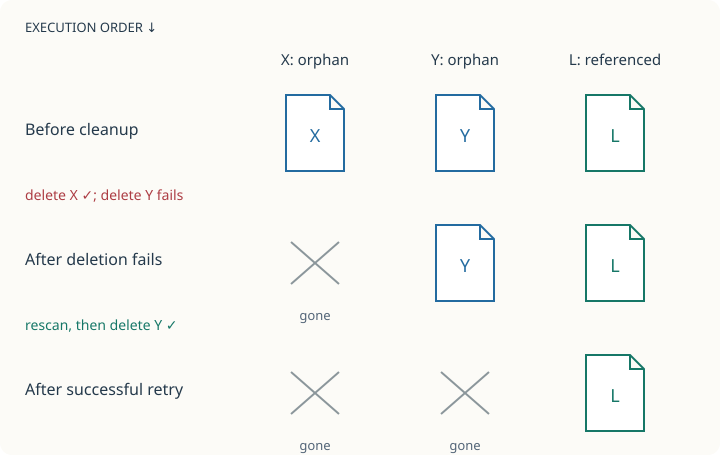

Read downward. The crossed-out X never returns. The retry makes a fresh decision from surviving records and files; it does not resume an old deletion list blindly. This example assumes references do not change between attempts.

1. X and Y are unreferenced files. A surviving result still needs L.
2. Cleanup deletes X, then fails to delete Y. X stays deleted; Y and L remain.
3. A retry rebuilds the reference map and file inventory. If Y is still unreferenced and deletion succeeds, only L remains.
<!-- visual-summary:end -->

<!-- review-figure:figure-4-cleanup-retry:end -->

<!-- review-figure:figure-5-permissions:start -->
#### Figure 5.1 · A valid credential can still be refused an upload

<!-- visual-summary:start -->
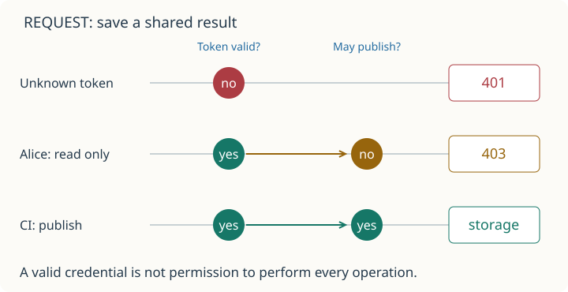

Compare Alice and CI: both tokens are valid, but only CI has publish permission. An authentication-backend failure is different again: the server returns 503, not a verdict that the token is invalid. These labels are not verified human identities.
<!-- visual-summary:end -->

<!-- review-figure:figure-5-permissions:end -->

<!-- review-figure:figure-5-revocation:start -->
#### Figure 5.2 · Revocation changes the next credential check

<!-- visual-summary:start -->
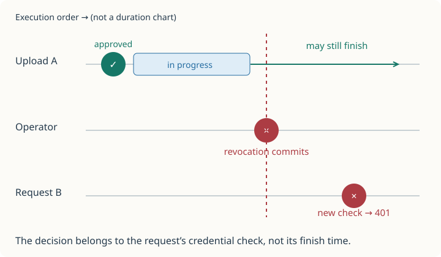

Watch the vertical red line. It changes later checks; it does not reach back and cancel Upload A. The timeline shows one possible execution, not a guarantee about network arrival order.

1. Upload A passes its credential check and continues.
2. The operator revokes the credential; the database change commits.
3. A may finish. Request B checks the now-revoked credential and is refused.
<!-- visual-summary:end -->

<!-- review-figure:figure-5-revocation:end -->

<!-- review-figure:figure-5-issuance-failure:start -->
#### Figure 5.3 · Saving a credential and delivering it are separate steps

<!-- visual-summary:start -->
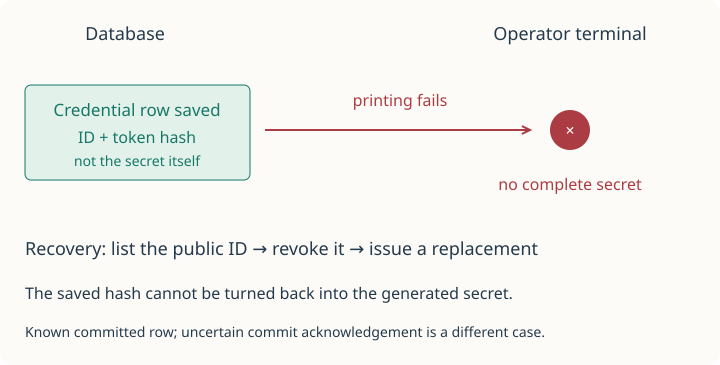

Watch which side succeeded. Failure to deliver the secret does not undo the committed credential. This is why issuance errors need recovery steps, not just a retry with no inspection.

1. Issuance commits the credential row before printing its secret.
2. Printing fails. The row remains even if the operator never receives a usable token.
3. Use the public ID to revoke that row, then issue a replacement.
<!-- visual-summary:end -->

<!-- review-figure:figure-5-issuance-failure:end -->

<!-- review-figure:figure-6-local-measurements:start -->
#### Figure 6.1 · A hit saves work, not all work

<!-- visual-summary:start -->
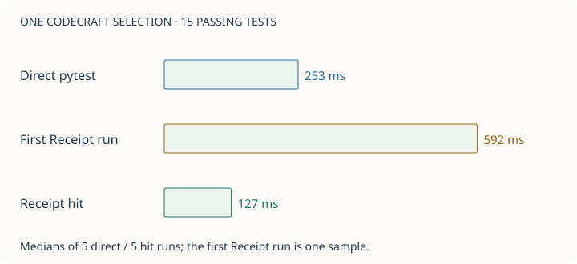

Compare the bars on one duration scale. The miss pays for execution and two input scans. The hit avoids pytest but still scans inputs. Ordered local samples with warm OS caches are not a general speedup guarantee.
<!-- visual-summary:end -->

<!-- review-figure:figure-6-local-measurements:end -->

<!-- review-figure:figure-6-measured-wait:start -->
#### Figure 6.2 · A small upload can spend time waiting

<!-- visual-summary:start -->
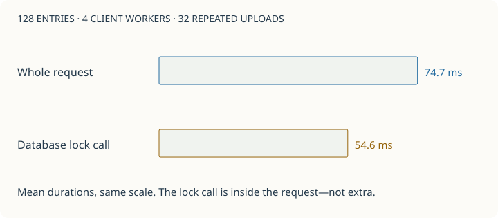

The shorter bar measures the advisory-lock call, including its database round trip and wait. Do not add it to the whole-request bar. These were duplicate uploads on one local server; this is evidence of waiting in this experiment, not a production throughput limit.
<!-- visual-summary:end -->

<!-- review-figure:figure-6-measured-wait:end -->

<!-- review-figure:figure-7-cargo-graph:start -->
#### Figure 7.1 · Two arrows can lead to one dependency

<!-- visual-summary:start -->
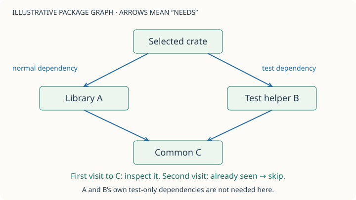

Follow both branches down to C. A map of visited IDs prevents repeated inspection; a pending slice holds the remaining packages. This graph is illustrative, not regex-syntax’s actual dependency graph.
<!-- visual-summary:end -->

<!-- review-figure:figure-7-cargo-graph:end -->

<!-- review-figure:figure-7-cargo-refusal:start -->
#### Figure 7.2 · Refusal happens before cache lookup

<!-- visual-summary:start -->
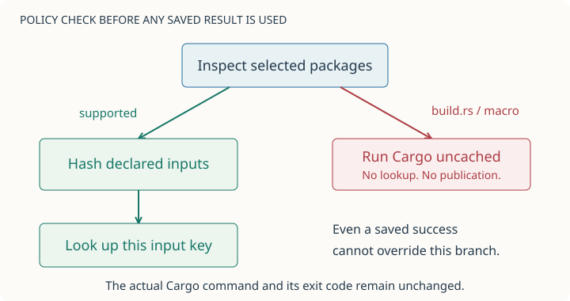

The red branch does not reach the saved-result lookup. A transitive dependency with a build script is enough to take it. This protects the refusal policy; it is not a sandbox for the command that runs.
<!-- visual-summary:end -->

<!-- review-figure:figure-7-cargo-refusal:end -->

<!-- review-figure:figure-7-cargo-cost:start -->
#### Figure 7.3 · A real hit can still be slower than a direct run

<!-- visual-summary:start -->
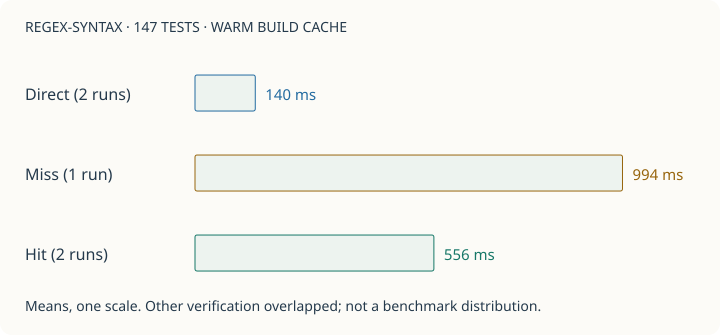

A hit skipped the tests but still paid for tool and input checks. For these short tests, that was more work than running Cargo directly. The small, partly overlapping sample does not establish typical latency or a general slowdown.
<!-- visual-summary:end -->

<!-- review-figure:figure-7-cargo-cost:end -->

<!-- review-figure:figure-7-cargo-mutation:start -->
#### Figure 7.4 · The lockfile stays the same; the dependency does not

<!-- visual-summary:start -->
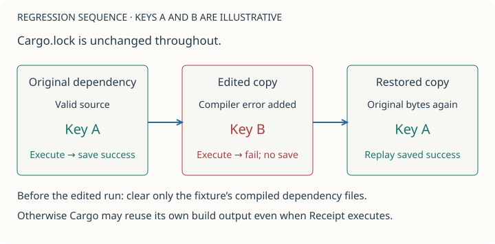

The middle state cannot reuse key A. The test keeps the lockfile unchanged and edits only an isolated dependency copy. Restoring the original bytes brings key A back. Clearing temporary build artifacts makes Cargo compile the deliberate error; Receipt does not automatically clean Cargo builds.
<!-- visual-summary:end -->

<!-- review-figure:figure-7-cargo-mutation:end -->

<!-- review-figure:figure-7-cargo-hardening-cost:start -->
#### Figure 7.5 · The same checks can hurt a short suite and help a longer one

<!-- visual-summary:start -->
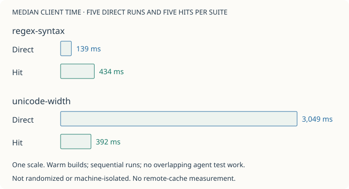

Regex-syntax was quicker directly: 139 ms versus a 434 ms hit. Unicode-width took 3,049 ms directly versus a 392 ms hit. Each hit still checks inputs, so the benefit depends on how much execution it skips. Source: the linked raw sequential measurement record.
<!-- visual-summary:end -->

<!-- review-figure:figure-7-cargo-hardening-cost:end -->
