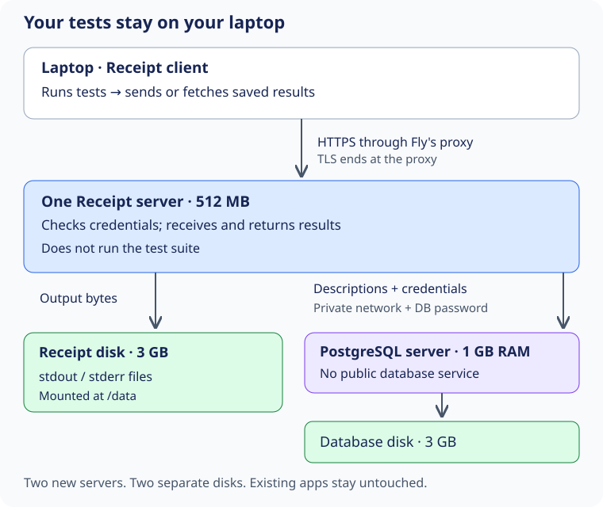

# Receipt on Fly: preparation, not a live deployment

Prepared 9 October 2026. No cloud resources have been created. These templates
still need container startup checks and Fly validation before use.

## What we would run

You run tests on your laptop. Receipt sends the saved result to a small server
on Fly. Another client can fetch that result if it calculates the same key.
The server does **not** run your test suites, so a large Rust repository does not
require a large server just to store its test output.



There are two new Machines—Fly's name for virtual servers:

| Resource | Starting size | Job |
| --- | --- | --- |
| Receipt server | One shared CPU, 512 MB RAM | Check credentials, receive results, return saved output |
| Receipt disk | 3 GB persistent volume | Keep stdout and stderr files across restarts |
| PostgreSQL server | One shared CPU, 1 GB RAM | Keep result descriptions, credentials and quarantine records |
| PostgreSQL disk | 3 GB persistent volume | Keep the database across restarts |

Both servers would start in San Jose (`sjc`). These are starting sizes, not
measured capacity guarantees. Your existing database and other apps stay untouched.
The database is self-managed: we are responsible for updates, backups and recovery.

Why two servers? Receipt and PostgreSQL can restart independently, and each has a
clear place to keep its data. Putting both in one server could save money, but
would require us to manage two processes and their shutdown together. Fly's
managed database would reduce some operational work, but its current base price
starts at $38/month before storage—too much for this first experiment.

## Why only one Receipt server?

Suppose result A points to output file X. Receipt writes X onto **its own disk**.
A second Receipt server with another disk would not automatically have X, even
if it could read A from PostgreSQL. Adding a server is therefore not enough to
make this design safely serve requests from both places.

### What two Receipt Machines would actually do

Each Fly Machine gets its own volume, so a second Receipt Machine mounts a new,
empty disk at the same path, `/data`. Follow one result through both Machines.

1. Machine A starts first. [`initializePolicy`](https://github.com/sidsharma96/receipt/blob/main/internal/cache/maintenance.go#L129-L169)
   records the blob directory `/data/cache/blobs` and a random store identity in
   PostgreSQL, and [`FileBlobs.Bind`](https://github.com/sidsharma96/receipt/blob/main/internal/cache/blob_binding.go#L13-L71)
   writes that identity into a `.store-id` file on A's volume.
2. Machine B starts against the same database. Its blob directory has the same
   path, so the path check passes. Its volume has no `.store-id` file yet, so
   `Bind` creates one holding the **same** identity it read from the database.
   The binding check therefore passes on both Machines. It cannot notice that
   they hold different disks, because it compares a path and a marker, and both
   match.
3. A client uploads result A through Machine A. The output file X lands on A's
   volume and the record lands in the shared database.
4. Another client asks for result A, and Fly routes the request to Machine B.
   B finds the record, then fails to open X on its own disk.
   [`Postgres.Get`](https://github.com/sidsharma96/receipt/blob/main/internal/cache/shared.go#L146-L189)
   returns a wrapped cache miss, and [`getEntry`](https://github.com/sidsharma96/receipt/blob/main/internal/cache/http.go#L319-L325)
   answers HTTP 404.
5. The client treats the 404 as an ordinary miss: it runs the tests and uploads
   again. That upload writes X onto B's volume. If the new output has the same
   digest as the stored record, the upload succeeds and nothing is quarantined.
   If the output differs, for example because `go test` printed a different
   timing, the key is quarantined for everyone.

Other parts degrade in the same way. A status check (`GET /v1/status/<key>`)
reads only the database, so it answers the same on both Machines. The upload
quota check in [`checkBlobQuota`](https://github.com/sidsharma96/receipt/blob/main/internal/cache/maintenance.go#L337-L380)
reads one running total in the shared database, but each Machine's startup
recount sets that total to the files on its own volume only. `shared gc` on either Machine
([`Postgres.Collect`](https://github.com/sidsharma96/receipt/blob/main/internal/cache/maintenance.go#L382-L451))
deletes only local files that no record references, so it does not delete the
other Machine's output. The PostgreSQL advisory lock still serializes writers
across both Machines, because the database is shared. The `flock` on the
lifecycle lock file is different: each volume has its own lock file, and
`flock` coordinates only processes on one host. It gives no protection across
Machines.

In short, two Machines do not corrupt data, but they turn many hits into misses
and re-runs, store the same output on both volumes over time and add quarantines from
timing text. That is why [`min_machines_running = 1`](https://github.com/sidsharma96/receipt/blob/main/deploy/fly/api.toml#L33)
and a single volume are part of the design, not a starting size.

This is also why the template has no Fly `release_command` (see the comment
beside [`release_command`](https://github.com/sidsharma96/receipt/blob/main/deploy/fly/api.toml#L12)).
Receipt's startup migration writes the `.store-id` marker onto the mounted
volume. A Fly release Machine has no volume, so migration must run inside the
serving Machine when it starts.

### How requests reach the server

Receipt itself speaks plain HTTP. The container starts it with
[`--listen 0.0.0.0:7777`](https://github.com/sidsharma96/receipt/blob/main/deploy/fly/Dockerfile#L20),
so it accepts connections on every interface inside the Machine, and it serves
without TLS ([`srv.Serve`](https://github.com/sidsharma96/receipt/blob/main/internal/app/app.go#L556-L556)).
Fly's proxy accepts HTTPS on port 443, terminates TLS
([`handlers`](https://github.com/sidsharma96/receipt/blob/main/deploy/fly/api.toml#L41-L42)),
and forwards plain HTTP to port 7777. Clients therefore use an `https://` URL,
which the Receipt client requires for any host other than loopback. Fly's proxy,
like Caddy on the DigitalOcean server, can read every request, including tokens.

### What one server means

For now, deploy exactly one Receipt Machine and one PostgreSQL Machine. Expect
interruptions during restarts and updates. A Fly volume is local storage, not a
replicated network disk. [Fly volume documentation](https://docs.fly.io/volumes/overview/)

Moving the files to S3 or R2 is a later step. It also requires revisiting cleanup,
publication and locking; replacing a filesystem interface alone is not enough.
That work becomes worthwhile when we need multiple servers, independent file
storage, or recovery that does not depend on one Machine's volume.

## What it might cost

Use **$20/month as a proposed planning budget**, not a spending cap or a quote.
We must confirm the San Jose rates and your remaining account allowances before
creating anything billable.

For orientation, Fly's published lowest-region rates give this 30-day,
always-running example. **These are not confirmed San Jose prices.**

| Item | Reference monthly cost |
| --- | ---: |
| Shared CPU, 512 MB | $3.69 |
| Shared CPU, 1 GB | $6.70 |
| Two 3 GB volumes, at $0.15 per GB | $0.90 |
| Resource subtotal before allowances | **$11.29** |

Transfer, snapshots beyond free allowances, taxes and other account usage are
outside that subtotal. Allocated volume space costs money even when a Machine
is stopped. We do not need a paid dedicated IPv4 address for the HTTPS service.
Rates checked against [Fly pricing](https://docs.fly.io/about/pricing/).

Your screenshots show a $5 Hobby subscription with legacy free allowances and
included usage. The September invoice ended at $5 after credits. That does not
mean every new deployment is free, or that September's unused credit carries
forward. Other apps share the allowances. Roughly, the bill is the $5 plan fee
plus eligible usage left over after free allowances and the plan's included
credit, plus any charges that the credit does not cover. Confirm how the larger
Machines are credited before relying on a net estimate.
[Legacy plan details](https://docs.fly.io/about/discontinued-plans/)

## What the templates do

The files are under [`deploy/fly`](https://github.com/sidsharma96/receipt/tree/main/deploy/fly):

- `Dockerfile` builds Receipt and gives it a small Linux runtime.
- `entrypoint.sh` refuses to start without a mounted disk at `/data`. It prepares
  `/data/cache`, then runs Receipt as user 10001 rather than as root.
- `api.toml` exposes HTTPS on port 443. It keeps the Machine awake and starts
  with at most two admitted storage operations at a time.
- `Postgres.Dockerfile` uses the official PostgreSQL 17 image.
- `postgres.toml` gives PostgreSQL its own disk and no public service.

The app names are deliberately placeholders. Database passwords and Receipt
tokens do not belong in these files or in Git.

The database listens on the organization's private network. Fly encrypts that
network with WireGuard. Other apps on the same private network may still reach
the database, so PostgreSQL password checks remain necessary. Private does not
mean “only Receipt can connect.” [Private networking](https://docs.fly.io/networking/private-networking/)

The first deployment can use PostgreSQL without its own TLS inside that encrypted
network, provided we explicitly accept that boundary. If we require independently
verified database TLS, provision certificates and use `sslmode=verify-full`;
do not pretend the default image already provides that setup.

## Before creating anything

1. Approve the budget and choose two unused app names in the intended organization.
   Check current regional prices and account allowances. Do not reuse an existing
   project's app, database, volume or secret.
2. Start Docker locally and build both images from the repository root:

   ```sh
   docker build -f deploy/fly/Dockerfile -t receipt-fly:local .
   docker build -f deploy/fly/Postgres.Dockerfile -t receipt-postgres:local .
   ```

3. Test the containers with disposable mounted volumes: database initialization,
   Receipt startup, credential issuance, save/fetch, shutdown and restart. Check
   that starting Receipt without a volume fails. Test storage permissions using
   the same non-root user as the service.
4. Check image security updates and pin reviewed image digests before deployment.
   Current tags are not immutable. The container compiler is Go 1.27.2; the host
   cross-build used Go 1.22.1, so it does not verify that container toolchain.
5. After Fly login, run its validator for each template, with the chosen names:

   ```sh
   fly config validate --strict --config deploy/fly/api.toml
   fly config validate --strict --config deploy/fly/postgres.toml
   ```

These are preflight instructions, not evidence that those checks have passed.

## Deployment order, after approval

Create the two new apps and their respective volumes. Start PostgreSQL first,
with a generated administrator password supplied as a Fly runtime secret—not
in a command saved in shell history. Create a separate `receipt` database role
that owns the Receipt database/schema but has no superuser, role-creation or
database-creation privileges. Receipt needs permission to run its migrations.
Do not give it the PostgreSQL administrator password.

Set `RECEIPT_DATABASE_URL` on the Receipt app using that role and the new database
app's private `.internal` hostname. The official PostgreSQL image's initialization
variables apply to an empty data directory; changing `POSTGRES_PASSWORD` later
does not by itself rotate an existing database password.

Deploy Receipt with one Machine, avoiding Fly's extra high-availability Machine
creation (`--ha=false`). Check the actual Machine count afterwards: the
configuration's `min_machines_running = 1` is a minimum, **not a maximum**.
Give only Receipt a public HTTPS address; do not allocate a public database IP.

Do not add a Fly `release_command`. Receipt startup migrations also check the
mounted file directory, while Fly release-command Machines do not receive those
volumes. [Fly configuration reference](https://docs.fly.io/reference/configuration/)

Issue the first scoped credential in a private administrative session on the
Receipt Machine, running the CLI as the `receipt` user with `/data/cache`.
Follow [the credential guide](SERVICE-CREDENTIALS.md). Keep the printed secret
out of deployment logs and screenshots. Use separate client credentials where
appropriate; the server does not need a shared fallback `RECEIPT_TOKEN`.

## What would prove the deployment works?

Try a small known workload first. Publish its result, use a fresh local cache,
and confirm Receipt fetches it remotely instead of rerunning the tests. Keep
the declared environment stable: different checkout paths or credentials can
change the key. A second laptop is not guaranteed to calculate the same key.

Also check that a missing credential is denied, a read-only credential cannot
publish, and a revoked credential stops working. Restart both servers and
repeat the fetch. Measure memory and response times before increasing load.

The configured TCP health check only proves that Receipt accepts connections.
It does not prove database health or a successful authenticated fetch. We need
both kinds of checks before calling this a working remote cache.

## Backups and failure cases

Imagine PostgreSQL remembers result A, but a disk failure loses its output file
X. Restoring only the database does not restore X. Conversely, restoring only
output files loses credentials and quarantine records that tell Receipt what
must not be trusted.

For the first backup procedure, stop Receipt and maintenance writers, then save
both the database and the file directory, including its `.store-id` marker.
Record database roles and file ownership too. Keep the backup encrypted outside
these Machines, restart service, and test a restore onto disposable resources.
Independent volume snapshots are not proof of a consistent, tested backup.

An image rollback also does not undo a database migration. Review schema changes
and backup/restore steps before each update. A full disk, failed database or
lost volume can make this single-server deployment unavailable.

## Preparation checks and remaining work

Local checks cover TOML parsing, intended configuration relationships, shell
syntax and Linux amd64 cross-compilation. Documentation generation and local
document checks cover links and generated output. They do not validate Fly's
runtime behavior.

All 11 documentation/template tests passed, generated HTML matched its source,
and the deployment illustration was rendered and inspected. Full browser and
phone layout inspection remains outstanding.

Docker's daemon was unavailable during preparation. Fly validation required
login and did not run successfully. Container builds/startup, actual regional
pricing, image digests, cloud networking, memory sizing, backup restore and live
remote reuse all remain pre-deployment or deployment checks. The TCP check and
the Go memory target are not availability or memory-usage guarantees.

No live deployment phase is complete. No existing app has been changed.
