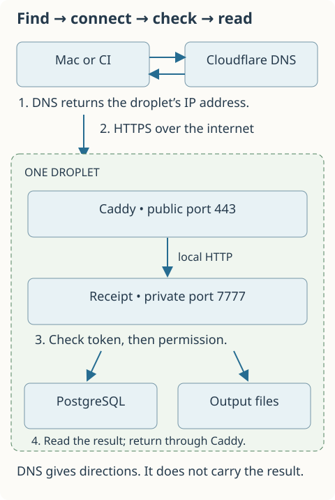
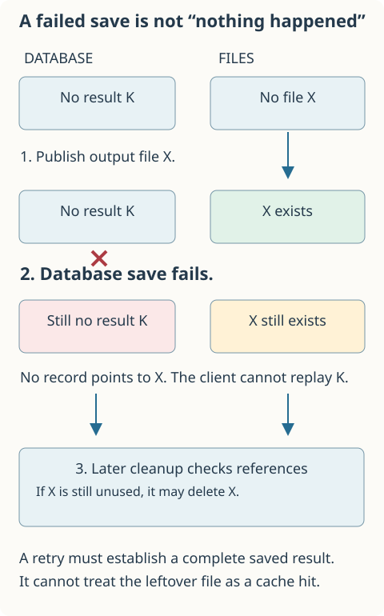
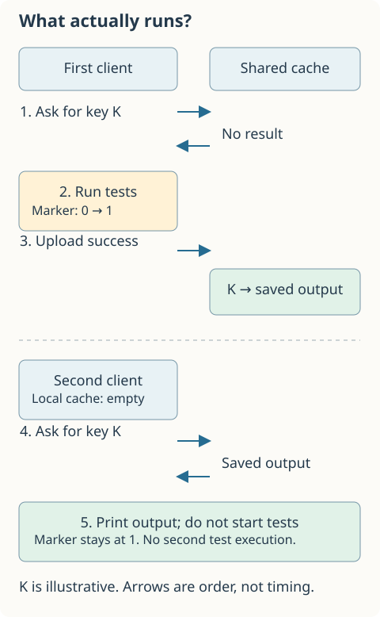

# Receipt: dated phase reviews and implementation evidence

This is the detailed reference record, preserved during the 2026-10-09 documentation revamp. Start with [the working guide](WORKING-DOC.md) for the current explanation. These reviews describe decisions and evidence at their recorded dates; later amendments may supersede earlier behavior. They are not the required reading order for learning Receipt.

Illustrations added 9 October 2026: [A manifest is one record with named fields](#figure-1-manifest) · [An edited file leads to a different lookup](#figure-1-key-change) · [The server joins a database record to output files](#figure-2-storage) · [A failed database save can leave a complete output file](#figure-2-interrupted-write) · [The lock protects the gap before opening the file](#figure-3-reader-cleanup) · [The same upload can require more inspection](#figure-3-upload-cost) · [Two records can share the same “still needed” entries](#figure-3-collection-map) · [Each check answers a different question](#figure-4-validation) · [A valid credential can still be refused an upload](#figure-5-permissions) · [Revocation changes the next credential check](#figure-5-revocation) · [A hit and a miss do different work](#figure-1-local-flow) · [Full slots refuse another request](#figure-2-admission) · [Figure 1.4 · Matching scans can miss a change in between](#figure-1-scan-gap) · [Figure 2.4 · A conflict error must leave a warning behind](#figure-2-conflict-state) · [Figure 4.2 · What remains after a failed save?](#figure-4-failed-save-states) · [Figure 4.3 · Cleanup retries from the state that remains](#figure-4-cleanup-retry) · [Figure 5.3 · Saving a credential and delivering it are separate steps](#figure-5-issuance-failure) · [Measured local runs](#figure-6-local-measurements) · [Measured lock waiting](#figure-6-measured-wait).

Updated 2026-10-09. Phases 1–3 describe the implementation at ff45e74; Phase 4 describes validation and failure testing committed in 90564c3. The appended Phase 5 review records scoped service credentials. Later amendments take precedence where earlier reviews describe decoding, local publication or shared-token access.

Suppose you run the same Python tests twice without editing anything. Running them again may repeat work you have already done. Receipt tries to save that work: it remembers a successful run and can print its saved output the next time the recorded inputs match.

That sounds simple. The interesting questions begin when a test reads something we did not record, two users get different outputs, or cleanup deletes a file another command still needs. This guide follows those questions from a personal command-line tool to a small shared service.

## Corrections, 15 October 2026

A documentation audit against `main` at commit `5f5794f` found the factual errors below. The reviews keep their original wording, with a "Corrected on 15 October 2026" link beside each sentence that this section corrects. The [design defense](DESIGN-DEFENSE.md) explains the current behaviour in full.

- Phase 1, question 3, says the command's standard input is closed. Go's `os/exec` connects a nil `Stdin` to `/dev/null`, so a test that reads input gets end of file, not a closed-descriptor error. The code comment inside the excerpt had the same inaccuracy until 15 October 2026, when the comment was corrected.
- Phase 2, question 3, calls the 16-connection pool the maintenance CLI's pool. `receipt serve` opens the same pool through `openShared`. Each storage operation pins one connection, so at most 16 storage operations run at once, whatever `--max-inflight` allows.
- Phase 2, question 3, says the row-level rules remain useful. Since Phase 3, every caller of that row lock already holds the exclusive lifecycle lock, so `SELECT … FOR UPDATE` never waits. It is defence in depth only.
- Phase 2, question 6, says the bearer token grants shared read and write access. That describes legacy shared-token mode. Phase 5 added scoped credentials, which the deployed server uses.
- The coding-quality review calls strict result and report decoding proposed work. Phase 4 implemented it, as Phase 4's amendments already note.
- Phase 5, question 3, says a dedicated advisory lock serializes issuance. Issuance and the credential-table migration use key 72656365697075, the same key as the storage lifecycle lock. Issuing a credential therefore waits for in-flight cache reads and uploads, and new ones queue behind it. CODING-PRACTICES.md and SERVICE-CREDENTIALS.md made the same claim and are corrected.
- Phase 6, question 9, plans Cargo and Vitest adapters next. Cargo support shipped in Phase 7. No Vitest adapter exists.
- The deployment review, question 4, says the local checkout has uncommitted deployment work on an older branch. Since 13 October, local `main` contains the merged HTTPS work, and the deployment files are tracked.
- The deployment review, question 8, mentions a renewal procedure for the November CI token. The token expires on 12 November 2026 at 03:28 UTC. [RECEIPT-CI.md](RECEIPT-CI.md#secrets-and-renewal) lists the renewal steps.
- Verification entries give different counts of attributed Go excerpts: 19, 20 and 22. Each count was correct on its date. The reference now has 22, and `docs/test_working_doc.py` checks that number.

## Documentation book, 15 October 2026

The documentation became an mdBook later on 15 October. This Markdown file is now the only copy of the reviews: the hand-maintained `PHASE-REVIEWS.html` and the generated `WORKING-DOC.html` were retired after a comparison confirmed that every review paragraph, code excerpt and figure already appeared here. Relative links to source files now point at GitHub, and each figure keeps an anchor named after it.

Entries below that name `docs/render_working_doc.py`, `docs/render_review_figures.py` or `docs/test_working_doc.py` describe the tooling on their date. Today the figures are drawn by `scripts/docs/review_figures.py`, the checks live in `scripts/docs/test_docs.py`, and `make docs` builds the book and runs them. The 22 attributed Go excerpts are still checked against the source.

## Known-gap fixes, 15 October 2026

These code changes fixed items from the design defense's
[known gaps](DESIGN-DEFENSE.md#part-4-known-gaps-and-pitfalls). Each one has a
regression test that failed before the change. Earlier reviews keep their
original wording.

- Credential issuance and the credential-table migration take advisory lock
  72656365697076 (`credentialLock`) instead of the storage lifecycle key
  72656365697075. Issuing a credential no longer waits for, or pauses, cache
  reads and uploads. Test: `TestCredentialIssuanceDoesNotWaitForStorageLock`.
  `receipt auth` commands still take the storage lock once while opening the
  store (G1 now records that).
- The client leaves `RECEIPT_TOKEN` out of every manifest and removes it from
  the test command's environment. Renewing a credential no longer changes keys,
  and manifests no longer carry the credential's stored digest. This changed,
  once, the key of every run made with the token set; runs without it kept their
  keys. Phase 5's statement that the token is fingerprinted and passed to tests
  is superseded. Tests: `TestClientTokenIsNotAnInput`,
  `TestChildDoesNotInheritClientToken`.
- Uploads check quotas against running totals in a new table,
  `receipt_storage_usage_v6`, instead of walking every output file and
  scanning every result and evidence row. Every insert, expiry and collection
  updates the totals in its own transaction; every startup and CLI command
  recounts. `Put` now inserts the record before writing the output files and
  commits after them, so a quota refusal writes no files. Phase 3's description
  of write admission as O(B + M) is superseded. Measured on one laptop, the
  median upload at about 4,045 results fell from 131.8 ms to 19.9 ms (see
  [D15](DESIGN-DEFENSE.md#d15-what-does-one-upload-cost-and-how-does-that-grow)).
  Tests: `TestUploadDoesNotWalkTheStore`, `TestUsageCountersFollowEveryChange`,
  `TestRejectedUploadWritesNoFiles`.
- New cache and shard directories are created by `MakeDirs`, which syncs the
  parent of each one; quarantine markers and entry removals sync their
  directory; and `receipt cache prune` deletes `entries/.pending-*` files older
  than an hour. Tests: `TestNewDirectoriesAndRemovalsAreSynced`,
  `TestQuarantineMarkerIsSynced`, `TestPruneRemovesStalePendingEntries`. The
  tests observe which directories are synced; a real power loss was not tested.
- The blob directory's lock file is opened with `O_NOFOLLOW` and checked with
  `fstat`, instead of an `Lstat` check followed by an open that would follow a
  symlink swapped in between. Test: `TestLockFileOpenRefusesSymlink`.
- Cancellation sends SIGTERM to the command's process group and SIGKILL only
  to what remains after 5 seconds. A command killed by a signal that Receipt
  did not send reports 128 plus the signal number; a command Receipt cancelled
  reports 130. Tests: `TestSignalDeathReportsSignalNumber`,
  `TestCancellationReportsInterruptAndAllowsCleanup`,
  `TestCancellationKillsCommandsThatIgnoreTermination`.
- `stableGoEnvironment` normalises every adjacent prefix-map flag, not only
  every other one, and the stdin comment in `Run` now says `/dev/null`. Test:
  `TestAdjacentScratchFlagsAreBothNormalized`. Real `go env -json` output on the
  development Mac normalises to the same bytes as before, so Go keys did not
  change.
- `receipt-ci.yml` no longer runs, or gives the cache secret to, the finished
  rollout branch `codex/receipt-https-ci`. Test: `deploy/ci/test_workflow.py`.

## How to read this guide

Start with Phase 1. It explains how Receipt describes a command and remembers its result. Phase 2 adds a server so several clients can share results. Phase 3 adds limits and cleanup. Phase 4 checks the incoming data and deliberately interrupts storage operations to inspect what remains. Phase 5 separates caller credentials and operation permissions.

Each phase answers the same nine review questions. The answers explain the current code, including later changes where they affect an earlier phase. This is not a claim that earlier implementations already had every current safeguard. Earlier committed document versions are available through Git history.

A code excerpt is copied from the attributed source file. Examples that invent file names, counts or output are labelled illustrative. They show the reasoning, not a measurement.

For phone reading, use [this reference's Markdown companion](PHASE-REVIEWS.md) if your file viewer displays HTML as text. In a browser, wide code blocks and comparison tables scroll inside their own boxes. The page itself should fit the screen.

The writing rules are in [PROSE-STYLE-GUIDE.md](PROSE-STYLE-GUIDE.md). In short: explain a situation and its sequence before naming the concept. A reader should be able to describe what happens, not just recognize the terms.

## What exists now?

Receipt has seven implemented parts:

- Phase 1 saves successful command results on the user's computer, explains input changes, reruns results for verification and prunes old local entries.
- Phase 2 shares results through HTTP, stores result descriptions in PostgreSQL, stores output in content-named files and remembers conflicting observations.
- Phase 3 limits selected storage quantities and provides maintenance commands that coordinate with readers and writers.
- Phase 4 defines accepted JSON fields and values, rejects malformed entries and reports before storage, and tests selected interrupted storage operations.
- Phase 5 adds opt-in scoped service credentials with expiry and revocation, local credential administration and authenticated identity inspection.
- Phase 6 adds opt-in timing summaries, server-generated request IDs, and repeatable local/shared measurements; it does not add runner adapters or durable caller history.
- Phase 7 adds bounded Cargo reuse, with dependency inspection and explicit refusal before lookup for unsupported cases.

The code also has typed command names, automated lint checks and selected error-handling helpers. These are implementation conventions, not another product phase.

There are still important unfinished areas. Receipt does not discover every dependency a test might read. Legacy server mode still trusts one shared token; opt-in credential mode separates operation permissions, not private tenants or verified human accounts. Multi-machine output storage, durable upload-actor history and production deployment measurements remain future work. Phase 4 implements the documented JSON contract, not a universal guarantee about every input source or reported observation.

## One command, from the user's perspective

Imagine running pytest in a Git repository. Git is used to discover files in the working tree; Receipt reads their current contents, not just the latest commit.

Receipt records those files together with the command arguments, environment-value hashes and supported runtime information. It gives that record a content-derived name, called an input key. If it finds a usable saved result under that key, it prints the result. Otherwise it runs pytest.

A usable saved result is a cache hit. Having to execute the command is a cache miss. Those names describe whether earlier work can be reused.

The distinction matters: printing a saved result is not running the tests again. If the tests normally write a report file or send a network request, replay does not repeat that side effect.

To try the personal tool, build it in the Receipt repository with “make build”, then invoke the built executable from the Git repository containing your tests. These are illustrative invocations, not a new smoke-test record:

~~~sh
/Users/siddharthsharma/Desktop/projects/receipt/receipt run -- uv run pytest
/Users/siddharthsharma/Desktop/projects/receipt/receipt explain -- uv run pytest
/Users/siddharthsharma/Desktop/projects/receipt/receipt run --verify -- uv run pytest
~~~

The double dash separates Receipt's options from the test command. “explain” compares recorded inputs with the last run. “--verify” reruns a saved result and compares its output. See the [README](https://github.com/sidsharma96/receipt/blob/main/README.md) for configuration, supported commands and setup.

## Phase 1 review: remembering a local run

Reviewed 2026-10-08; explanations revised using the style guide on the same date.

### 1. What data structures are used, and why?

Imagine writing down everything Receipt needs to identify a run: its command, its working directory and the files it depends on. We need to keep those pieces together without confusing one with another.

Go's struct does that. It groups named fields with known types. Receipt calls this record a Manifest. From [internal/fingerprint/manifest.go](https://github.com/sidsharma96/receipt/blob/main/internal/fingerprint/manifest.go):

~~~go
type Manifest struct {
	Version   int      `json:"version"`
	Root      string   `json:"root"`
	Directory string   `json:"directory"`
	Platform  string   `json:"platform"`
	Command   []string `json:"command"`
	Inputs    []Input  `json:"inputs"`
}
~~~

Command holds the arguments in order. Inputs holds individual records describing an input's kind, name and hash. Root and Directory are paths; Platform records the operating system and CPU architecture. Version identifies the format of this record so future changes can be distinguished from the current format. JSON is a text format for structured data; the labels beside the fields say which names to use when encoding this struct as JSON.

<!-- review-figure:figure-1-manifest:start -->
<a id="figure-1-manifest"></a>

#### Figure 1.1 · A manifest is one record with named fields

<!-- visual-summary:start -->


Follow the two arrows: Command is a sequence of words; Inputs is a sequence of records. This shows selected fields, not a memory-address layout.
<!-- visual-summary:end -->

Illustration added 9 October 2026.

Imagine Alice runs uv run pytest in /work/books. The manifest keeps the command and its recorded surroundings together. This picture shows selected fields; bracketed hash labels stand in for full hashes.

Selected fields in this illustrative manifest:

- Command: ["uv", "run", "pytest"]. The argument order matters.
- Directory: /work/books. The location is part of the description.
- Platform: darwin/arm64. This identifies the operating system and CPU architecture.
- First input: kind=file, name=/work/books/tests/test_books.py, hash=[file hash A].
- Second input: kind=environment, name=LANG, hash=[value hash B].

The struct groups different kinds of information. Its Inputs slice holds a variable number of records, each with the same field structure.

Source: [Manifest and Input](https://github.com/sidsharma96/receipt/blob/main/internal/fingerprint/manifest.go).
<!-- review-figure:figure-1-manifest:end -->

The square brackets in “[]string” and “[]Input” mean slices: sequences whose length can vary. One command may have three arguments; another may have ten. One repository may contain fifty inputs; another may contain thousands. A fixed-size array would force us to choose a length in advance.

Order has different meanings in these two slices. Rearranging command arguments can change the command. Rearranging the discovered input records should not change which run they describe. Receipt therefore keeps argument order but sorts the inputs before calculating the key.

From Manifest.Key in the same file:

~~~go
m.Inputs = append([]Input(nil), m.Inputs...)
sort.Slice(m.Inputs, func(i, j int) bool {
	if m.Inputs[i].Kind != m.Inputs[j].Kind {
		return m.Inputs[i].Kind < m.Inputs[j].Kind
	}
	return m.Inputs[i].Name < m.Inputs[j].Name
})
~~~

Here m is the manifest being named. The first line makes a new slice containing the input records. Why copy before sorting? A slice refers to an underlying array. Sorting that array could otherwise rearrange the caller's inputs too. The remaining lines order records first by kind and then by name.

During file discovery, Receipt also uses a map to remember paths it has already seen. A map is a lookup table. If Git and an explicit extra-input setting both identify the same file, the map helps avoid including it twice.

A list could also remember those paths. But each new path would have to search the existing list for a duplicate. The map is a better fit for repeated membership questions; the slice is a better fit for the final ordered record. Neither is universally better.

A linked list could hold the inputs, but Receipt does not need frequent insertion in the middle of a sequence. Extra nodes and pointers would add work to an operation that mostly appends, sorts and scans. A generic JSON map could hold the manifest fields, but then code would have to check what type each value contains. Named struct fields make the intended shape easier to inspect.

<!-- review-figure:figure-1-key-change:start -->
<a id="figure-1-key-change"></a>

#### Figure 1.2 · An edited file leads to a different lookup

<!-- visual-summary:start -->


Trace each row from left to right. The command stays the same; the recorded file hash and lookup key change. Matching keys still say nothing about unrecorded website responses.
<!-- visual-summary:end -->

Illustration added 9 October 2026.

Keep the command, directory, and other recorded inputs the same. In this example Alice edits one test file. K1 and K2 are illustrative labels, not actual Receipt keys.

Before the edit:
1. The test file contains its original bytes.
2. The manifest records file hash A.
3. Receipt looks up K1 and can find the previously saved run.

After the edit:
1. The test file contains changed bytes.
2. The manifest records file hash B.
3. Receipt looks up K2, which does not select the saved run under K1.

This explains a changed lookup. Matching recorded inputs still cannot reveal an unrecorded dependency such as a website response.

Source: [Build and Manifest.Key](https://github.com/sidsharma96/receipt/blob/main/internal/fingerprint/manifest.go).
<!-- review-figure:figure-1-key-change:end -->

### 2. What is the overall flow, and where can it be extended?

A Go package groups related source files and functions. Follow one run through those packages:

~~~text
app: read the user's command and options
  → fingerprint: describe inputs and calculate their key
  → cache: look for a saved result
       found → app validates and prints it
       missing → runner executes the command
                   → fingerprint describes inputs again
                   → app saves an eligible successful result
~~~

<!-- review-figure:figure-1-local-flow:start -->
<a id="figure-1-local-flow"></a>

#### Figure 1.3 · A hit and a miss do different work

<!-- visual-summary:start -->


Follow the split. A hit skips command execution, not input discovery. A miss runs the command and checks its inputs again before deciding whether to save. This is the ordinary local path; verification and quarantine add further decisions.
<!-- visual-summary:end -->

Illustration added 9 October 2026.

The ordinary local path looks up recorded inputs. A usable hit prints saved output. A miss executes the command, scans inputs again and saves only an eligible successful result.

Source: [implementation](https://github.com/sidsharma96/receipt/blob/main/internal/app/app.go).
<!-- review-figure:figure-1-local-flow:end -->

The arrows show who calls whom; they are not separate services. All of this can happen inside one Receipt process on the user's computer.

The fingerprint package answers “What inputs are we recording?” The runner answers “How do we launch this command and capture its output?” The cache package answers “How do we store and retrieve a result?” The app package combines those operations according to the user's options.

Keeping these jobs separate makes a change easier to place. A new pytest-like tool might need a new input probe in fingerprint. A new result store belongs behind the cache methods. A new CLI option belongs in app.

That does not mean extensions are automatic. A store with basic Get and Put methods still needs correct publication and failure behaviour. A new tool adapter still needs to understand what the tool reads. Later phases add requirements that are not captured by the original two storage methods.

The [directory overview](#where-to-find-the-implementation) maps these responsibilities to files.

### 3. Which basic execution and coordination tools are used?

On a miss, Receipt must start another program. That program is a subprocess: a separate process launched by Receipt. Starting it directly avoids an extra shell interpreting the arguments.

From Run in [internal/runner/process.go](https://github.com/sidsharma96/receipt/blob/main/internal/runner/process.go):

~~~go
stdout, stderr := &limitedBuffer{limit: 8 << 20}, &limitedBuffer{limit: 8 << 20}
c := exec.CommandContext(ctx, args[0], args[1:]...)
c.Dir = dir
c.Env = withoutToken(c.Environ())
configureProcess(c)
// Stdin is left nil, so os/exec connects it to the null device: reads see
// end of file at once, because a cached run cannot replay interactive input.
c.Stdout = io.MultiWriter(out, stdout)
c.Stderr = io.MultiWriter(errOut, stderr)
~~~

args[0] is the executable; the remaining arguments are passed to it. Dir selects the working directory. Env, added on 15 October 2026, is the caller's environment without `RECEIPT_TOKEN`; see [the known-gap fixes](#known-gap-fixes-15-october-2026). stdout and stderr are buffers for the command's normal-output and error-output streams.

MultiWriter copies each stream to two destinations: the user's output writer and the capture buffer. You see a miss's output as it arrives rather than waiting until the command finishes.

Each capture buffer stops growing at 8 MiB. The expression “8 << 20” calculates that number of bytes. The user can still receive later output, but a result whose capture overflowed is not saved for reuse. This bounds Receipt's capture memory; it does not bound the test program's own memory. The command's standard input, stdin, is closed: interactive answers cannot be replayed from a saved result. [Corrected on 15 October 2026](#corrections-15-october-2026).

The context passed to CommandContext carries a cancellation signal. On supported Unix systems, Receipt also targets the launched process group during cancellation so children in that group are not left running unnecessarily. That is process management, not isolation from the user's files or network.

Saving the result has its own sequence: write a temporary file, sync and close it, then create the final filename only if absent. Sync asks the operating system to persist writes. Creating the final name after writing prevents readers from seeing a partly written final record.

Two Receipt processes may still run the same tests at once. Only one can first publish at a given final name, but safe publication of one file does not eliminate duplicate execution or coordinate every other operation.

### 4. What can go wrong, and how would we investigate it?

Suppose a test reads a CSV file that Git ignores. If we do not declare that file as an extra input, its contents may change without the key changing. Receipt can then reuse a result whose tests would behave differently now.

This is why dependency discovery matters more than simply choosing a good hash function. Receipt includes tracked and nonignored untracked working-tree files, explicit extras, environment-value hashes, executable bytes and supported runtime/package information. It does not automatically record external databases, network responses, time, randomness or every installed-package byte.

A hash is a fixed-size value calculated from bytes. Receipt uses the SHA-256 algorithm for these hashes. The same manifest bytes produce the same input key. But that tells us only that the recorded inputs match. It does not prove that they are every input the program uses.

Receipt scans inputs before and after execution. A changed file normally prevents saving the result. But imagine the file contains A before the run, changes to B while the test reads it, then returns to A before the second scan. Receipt sees A twice. Two scans do not freeze the filesystem.

<!-- review-figure:figure-1-scan-gap:start -->
<a id="figure-1-scan-gap"></a>

#### Figure 1.4 · Matching scans can miss a change in between

<!-- visual-summary:start -->


Look at the middle file, then the two endpoints. Both Receipt scans can agree while the command reads different bytes between them. A and B label file contents, not filenames.
<!-- visual-summary:end -->

Illustration added 9 October 2026.

A file contains A at the first scan, changes to B while pytest reads it, and returns to A before the second scan. Both recorded scans agree, but they do not describe what the test read.

Source: [implementation](https://github.com/sidsharma96/receipt/blob/main/internal/app/app.go).
<!-- review-figure:figure-1-scan-gap:end -->

Symbolic links—paths pointing to another path—and Git submodules are not treated as fully understood inputs. Unsupported cases run without caching rather than creating a result from an incomplete description.

When debugging an unexpected hit or miss, start with “explain”, then inspect argument, environment, path and tool information. Absolute checkout paths are part of the key, so moving a repository can cause a miss even if its source files are unchanged.

Finally, replay prints saved stdout followed by saved stderr. If the original run alternated between them, replay does not reconstruct that alternation. That can explain apparent changes in message order without implying that the stored stream bytes changed.

### 5. Which work happens often, and what does it cost?

Looking for a usable result happens on ordinary runs. This is the hot path: frequently performed work. Pruning old cache entries is occasional work, or a cold path. “Cold” does not mean free.

A hit skips pytest, but still describes the inputs, reads file contents, probes supported tool information, reads the saved result and prints the output. If describing the inputs costs almost as much as the tests themselves, the cache may offer little benefit.

As an illustrative example, a one-file test in a thousand-file repository still uses the broader recorded input set. Receipt may inspect many files even though the test command names only one. This favours a conservative description over finely targeted reuse.

If T is the total file content read and F is the number of input records, hashing includes work proportional to T. Sorting the records adds roughly O(F log F) work. Big O describes how work grows with input size; it is not a measured duration. Disk speed and runtime probes also matter.

A miss pays that preparation cost, the test execution and another input scan before saving. Large captured output adds encoding, hashing and disk-writing work.

Local pruning reads the entry inventory, sorts by file modification time and removes old entries until the approximate entry-byte budget is met. Hits touch those times to record recent use. With E entries, sorting adds O(E log E) work. Separate processes can overlap, so this is not a perfectly ordered global history or a strict instantaneous byte limit.

### 6. What does the local design ensure, and what does it assume?

A saved result is checked before reuse: its payload digest must match the stored bytes, its manifest must produce the claimed key and its exit status must indicate success. This catches a changed or malformed record rather than blindly trusting its filename.

That is useful protection, but consider a dishonest person who changes the result and recalculates all its hashes. Hash checks alone do not identify the producer. They are integrity checks, not signatures.

The main assumption is that the recorded inputs adequately describe the command. If a test reads the current time, the same recorded key can produce different outputs. Deterministic execution means the same inputs always give the same output; Receipt does not establish that property.

Verification reruns and compares exit status plus output bytes. If pytest prints a different elapsed time, verification can find a conflict even if all assertions passed. The comparison means “these observations matched exactly,” not “these test outcomes were semantically equivalent.”

The local entry budget excludes history and quarantine records. Quarantine means a recorded instruction not to reuse a key after conflicting observations. It persists rather than automatically trusting the key again after some time.

Hashing environment values avoids storing their plaintext values, but hashing is not encryption. Someone may guess a simple value and hash the guess. Captured output can also contain secrets. Share results only within the trust assumptions of the tool.

### 7. What other approaches could solve these problems?

These are comparisons added to explain the design, not claims that every alternative was debated before implementation.

For input preparation, an incremental tree of hashes could help avoid reprocessing unchanged portions of a large repository. Such a structure is called a Merkle tree: parent hashes summarize child hashes. It would require rules for detecting changes reliably. It would not discover the ignored CSV file from the earlier example or make a time-dependent test deterministic.

For eviction, consider three saved entries A, B and C. If A was saved first but read most recently, deleting the oldest saved entry is not the same as deleting the least recently used entry. FIFO—first in, first out—would remove A by age. Receipt instead uses touched file times as an approximation to recent use.

A linked list plus a map can track exact recent use within one process. A heap can keep the oldest candidate readily available: it is a structure organized around finding a highest-priority item. Both approaches need maintained state if we want the benefit across many separate CLI processes. Rebuilding and sorting an on-disk inventory is simpler for a small personal cache.

For targeted reuse, a full build system could track which tests depend on which files. That could avoid a miss after an unrelated edit. But we would have to obtain reliable dependency information first. Hashing the broader declared input set accepts extra misses instead of claiming that narrow relationship.

### 8. What evidence supports the design?

[The fingerprint tests](https://github.com/sidsharma96/receipt/blob/main/internal/fingerprint/manifest_test.go) check canonical key behaviour, working-tree/environment changes and unsupported-input cases. [The runner tests](https://github.com/sidsharma96/receipt/blob/main/internal/runner/process_test.go) check output streaming, exit status, cancellation and capture limits. Local-store tests also exercise malformed and corrupted records.

The historical review records one CodeCraft pytest comparison: about 1.69 seconds for a miss and 0.22 seconds for a hit. That shows the particular invocation benefited. It does not establish typical speedups across repository sizes or commands.

We have not shown that all dependencies are discoverable. Systematic power-loss and disk-full testing also remain unfinished. The verification ledger later in this guide distinguishes recorded implementation checks from checks performed for this documentation update.

### 9. What would make us change these decisions?

If input scanning takes most of an ordinary run, measure where it spends time before adding incremental hashing. If users need reuse across different checkout paths, define when those paths are equivalent before removing them from identity.

If byte comparisons quarantine many useful results because of timing text, investigate explicit output normalization. That means specifying which differences can be ignored, with tests showing that meaningful differences are still caught.

If local pruning becomes slow, revisit the maintained eviction structures above. If inputs frequently change during execution, revisit the two-scan model; a stronger execution environment may be needed rather than another hash function.

## Phase 2 review: sharing results between clients

Reviewed 2026-10-08; explanations revised using the style guide on the same date. Phase 3 later adds the broader coordination used by current shared storage.

### 1. What data structures are used, and why?

Suppose Alice and Bob run different commands that both print the same output. Saving a complete copy of that output inside every result would waste space.

The shared server separates the description of a result from its output bytes. PostgreSQL stores rows describing which input key produced which result. Files hold the stdout and stderr bytes. We call a stored chunk of bytes a blob; here it means one output stream.

A row refers to its output through BlobRef. From [internal/cache/blob.go](https://github.com/sidsharma96/receipt/blob/main/internal/cache/blob.go):

~~~go
type BlobRef struct {
	Hash string `json:"hash"`
	Size int    `json:"size"`
}
~~~

Hash identifies the exact expected bytes. Size records their expected length. A reader checks both when opening the file. The filename is based on the content hash, so identical output can be stored once and referenced by several results.

For illustration, 100 different input keys with the same 1 MiB stdout can reference one stdout file. There are still 100 result descriptions, and clients still upload the output. Deduplication saves repeated server-side storage; it does not automatically save upload bandwidth.

The database also stores conflict evidence. Its action table identifies an input key; its evidence table identifies distinct observations for that key. A primary key is the table's uniqueness rule. Repeating the same observation does not create another identical evidence row.

There are three different identities to keep separate:

| Identity | Example question it answers |
| --- | --- |
| Input key, calculated from the manifest | Are Alice and Bob describing the same recorded inputs? |
| Blob hash, calculated from output bytes | Is this exactly the output file the record expects? |
| Observation digest, calculated from exit status and output hashes | Did the two runs have the same recorded outcome? |

Elapsed execution duration and creation time are excluded from the observation digest. But a timing value printed inside stdout is still output, so it can make the observations differ.

### 2. How do clients and the server work together?

A client is the Receipt program making requests. The server is the Receipt process accepting those requests. PostgreSQL is the database service the server uses.

A client first describes its inputs. It can check the server's status for the key and fetch a shared result, or execute the command when no usable result is available. After a successful run, it can upload the result.

The server checks the access token and request bounds, then asks shared storage to publish or retrieve the result. Storage reads/writes the database description and the output files.

~~~text
client → HTTP request → Receipt server
                           → PostgreSQL: result description and conflict state
                           → files: stdout and stderr bytes
client ← HTTP response ← reconstructed result
~~~

The server's description uses format version 2 with file references. The HTTP result and local-cache result remain version 1 with the full output. The server reconstructs that result for the client, so a client does not need to understand the server's file layout.

<!-- review-figure:figure-2-storage:start -->
<a id="figure-2-storage"></a>

#### Figure 2.1 · The server joins a database record to output files

<!-- visual-summary:start -->


Follow both blue arrows. Different input keys can point to the same output bytes. The server reads a description, follows its hashes to files, and sends the outputs back; it does not run pytest.
<!-- visual-summary:end -->

Illustration added 9 October 2026.

Follow a shared lookup from the client to the two places that store a result. The boxes show responsibilities, not a required layout of physical machines.

1. The Receipt client asks the server for an input key.
2. The server reads the result description and quarantine state from PostgreSQL.
3. References in that record identify the stdout and stderr files in the output directory.
4. The server reads and checks the files, then returns the reconstructed result to the client.

Different records can reference the same output file. Deleting one record therefore does not automatically make that file disposable.

Source: [Postgres.Get](https://github.com/sidsharma96/receipt/blob/main/internal/cache/shared.go).
<!-- review-figure:figure-2-storage:end -->

<!-- review-figure:figure-2-interrupted-write:start -->
<a id="figure-2-interrupted-write"></a>

#### Figure 2.2 · A failed database save can leave a complete output file

<!-- visual-summary:start -->


Step through the two different stores. Watch the files remain after the database step fails. This example is not an uncertain commit acknowledgement.

1. The writer saves complete output files first.
2. In this example, database publication definitely fails before commit.
3. Rolling back SQL does not remove files. Later collection can find them.
<!-- visual-summary:end -->

Illustration added 9 October 2026.

Consider a new result whose output files have been written, but whose database transaction definitely fails before committing. Assume no other result references these files. This is an illustrative failure sequence, not a power-loss test.

1. Complete stdout and stderr files are written.
2. Saving the database record fails before commit. No new result record becomes visible.
3. The files remain: rolling back SQL does not undo filesystem writes.
4. Later collection can remove the files after confirming that no surviving record references them.

Writing files before the record avoids publishing a record before its output exists. It also creates a cleanup obligation when a later database step fails. Collection and broader coordination were added in Phase 3.

Source: [Postgres.Put and publication](https://github.com/sidsharma96/receipt/blob/main/internal/cache/shared.go).
<!-- review-figure:figure-2-interrupted-write:end -->

Now imagine Alice publishes one output for key K and Bob later publishes a different output for K. The server records the conflict and quarantines K. Quarantine says “do not reuse this key”; it does not say which client was right.

A conflict report can also create that prohibition before any successful result has been saved. In that case the database remembers the warning without a reusable result. This small record is sometimes called a tombstone.

### 3. How does it handle overlapping requests and network work?

The server may receive many requests at once. Go runs request handlers using goroutines: independently scheduled activities inside one process.

Unrestricted handlers could start more work than the service can reasonably handle. Receipt uses a buffered channel as a limited collection of admission slots. A request puts an item into the channel when admitted and removes it when finished.

The following excerpt is from serveHTTP in [internal/cache/http.go](https://github.com/sidsharma96/receipt/blob/main/internal/cache/http.go):

~~~go
select {
case slots <- struct{}{}:
default:
	metrics.rejected.Add(1)
	w.Header().Set("Retry-After", "1")
	http.Error(w, "busy", http.StatusServiceUnavailable)
	return
}
~~~

The empty struct is a token representing one occupied slot; its contents are irrelevant. If all slots are occupied, default rejects this request with HTTP 503 instead of starting more API work. The default capacity is 16. Each admitted operation also receives a 25-second context deadline.

The database connection pool has a separate purpose: reuse connections while limiting how many are open. The shared maintenance CLI allows up to 16 open connections, four idle connections and a five-minute lifetime. A request slot and a database connection are not the same resource. [Corrected on 15 October 2026](#corrections-15-october-2026).

Database updates use transactions. A transaction groups changes so they commit together or are rolled back together. Row locks make conflicting updates wait rather than both modifying a selected row independently.

Current shared writers also take the broader locks added in Phase 3. Different keys therefore do not imply concurrent writes. The row-level rules remain useful, but the complete current sequence serializes shared writers. [Corrected on 15 October 2026](#corrections-15-october-2026).

HTTP describes requests and responses. HTTPS adds transport encryption and server-certificate checks. An access token is separate: it shows that the request possesses the configured credential. Encryption alone does not decide whether the caller may upload a result.

<!-- review-figure:figure-2-admission:start -->
<a id="figure-2-admission"></a>

#### Figure 2.3 · Full slots refuse another request

<!-- visual-summary:start -->


Count occupied slots. The actual default storage admission limit is 16; four are drawn to keep the mechanism visible. Being admitted does not mean a request is already using a database connection or holding a storage lock.
<!-- visual-summary:end -->

Illustration added 9 October 2026.

A buffered channel represents occupied admission slots. If every slot is occupied, the server refuses new work with 503 rather than putting it into a waiting queue. Finishing work releases a slot.

Source: [implementation](https://github.com/sidsharma96/receipt/blob/main/internal/cache/http.go).
<!-- review-figure:figure-2-admission:end -->

### 4. Which cases are easy to misunderstand?

A conflicting upload is supposed to fail as a reusable publication, but its warning must still be saved.

If we automatically rolled back every database change whenever returning an error, we could report “conflict” while forgetting that K should no longer be reused. The implementation therefore commits the conflict state before returning the conflict error.

<!-- review-figure:figure-2-conflict-state:start -->
<a id="figure-2-conflict-state"></a>

#### Figure 2.4 · A conflict error must leave a warning behind

<!-- visual-summary:start -->


Follow the change to K before the error is returned. Rolling back the warning simply because the operation returns an error would let clients keep reusing a disputed result.
<!-- visual-summary:end -->

Illustration added 9 October 2026.

A stored observation for K has output X. A new upload for K reports Y. Receipt commits quarantine before returning the conflict error, so future checks know not to reuse K.

Source: [implementation](https://github.com/sidsharma96/receipt/blob/main/internal/cache/shared.go).
<!-- review-figure:figure-2-conflict-state:end -->

A client with a shared server configured also checks status before replaying its local copy. If the status request fails, it runs the command rather than replaying a result whose shared status it cannot check.

That check has a limit. Alice can check K, then Bob can quarantine K just before Alice finishes replaying. One status response cannot recall output Alice already read. Older clients that do not check status also do not follow this rule.

When debugging conflicting results, look at the exit status and exact output, not only whether both test suites passed. Timing text or random ordering can differ. When debugging rejected uploads, distinguish a conflict from a storage-budget failure or an unavailable server; they mean different things.

### 5. Which paths are frequent, and what do they cost?

A client fetching a shared result sends a network request, waits for the response and receives the saved output. The server reads the result description, reads the two output files, verifies them and encodes the response.

A local hit with a shared server configured still needs the status request. Thus “the bytes are already on my laptop” does not mean “no network work.” Network latency can matter even when the server has little computation to do.

Uploading involves output hashing, file work and database updates. If the output is already stored, the server still checks that existing file's bytes rather than accepting its name blindly. The current file implementation can do temporary-file work for a duplicate too.

Metrics are occasional operational requests. They report aggregate counters such as requests and failures, not a history of individual executions. The counters reset when the server restarts.

Phase 3 adds whole-store accounting to writes. That is a current cost of publication, described in its review below, not an optimization we already solved.

### 6. What can clients rely on, and who must they trust?

The server checks stored output against its expected length and hash. A malformed or changed file is not returned as a valid result simply because its name matches.

It also records conflicting observations and refuses reuse of quarantined keys. This is stronger than silently keeping the first result after learning that another observation disagrees.

But an authorized client can lie about what it ran. Conflict reports are assertions from trusted clients, not verified execution proofs. Someone with the token can prevent useful reuse by submitting false conflicting observations.

The bearer token grants shared read/write access. Receipt does not yet distinguish users, organizations, administrative roles or private tenants. It should not be exposed to unrelated untrusted writers as if those rules existed. [Corrected on 15 October 2026](#corrections-15-october-2026).

Clients require HTTPS for non-loopback URLs. Loopback is the local machine's network interface. That client rule does not mean a production TLS server and certificate setup are already deployed. Deployment and untrusted-code execution are separate unfinished problems.

### 7. What other storage and conflict designs could work?

The comparisons below explain current choices after implementation. The decision summary later in this guide identifies the recorded decisions; new comparisons are not claims about earlier debates.

Putting output inside every metadata record is simpler: one record contains everything. But repeated large output then consumes repeated storage. Keeping PostgreSQL descriptions and content-named files separates those costs.

Putting output bytes directly in PostgreSQL could keep their publication and the result description in one database transaction. It would also enlarge the database and change write, backup and retrieval costs. That is a plausible alternative, not inherently bad.

SQLite could reduce setup for a local deployment. Before substituting it in a shared server, we would need to test its write behaviour and operating assumptions for that deployment. PostgreSQL was chosen for shared metadata and transaction coordination; it is not established as optimal for every workload.

An object-storage service could hold bytes for servers on different machines. It adds network failures and different rules for writing, reading and deleting objects. Current local filesystem locks would not carry over automatically.

For evidence, storing every run would give more history than storing distinct observations. It would also grow faster. Ignoring conflicts would be cheaper still, but would knowingly allow reuse of contradictory results. The present design chooses distinct evidence plus quarantine within the Phase 3 budgets.

### 8. What tests and measurements support this?

[The shared-store tests](https://github.com/sidsharma96/receipt/blob/main/internal/cache/shared_test.go) exercise publication, concurrent conflicts, reports, missing/corrupted output and HTTP handling. TestHTTPAdmissionAndMetricsAuth checks bounded admission and metrics access.

The historical review describes 32 equal and 20 differing concurrent uploads, six independent blob-writer processes and fetching results after a database restart. These are specific scenarios, not a proof covering every sequence of distributed events.

Production TLS, malicious token holders, multi-machine filesystem behaviour and sustained server load remain unestablished. The current tests are useful evidence for the cases they execute, not a deployment certificate.

### 9. When should the shared design change?

If output bandwidth dominates, measure uploads before changing the wire format. Server-side deduplication does not solve repeated network transfer.

Before allowing unrelated users, specify ownership and access rules. Adding a login page without authorization checks would not make one user's results private from another.

Before running independent server machines, revisit where output lives and how cleanup coordinates with every instance. If strict immediate revocation becomes necessary, the status-then-replay approach needs a different protocol; another status endpoint alone will not close that timing gap.

## Phase 3 review: limits and cleanup without deleting needed files

Reviewed 2026-10-08; explanations revised using the style guide on the same date.

### 1. What data structures are used, and why?

Suppose we want the shared cache to stop growing indefinitely. Limiting only output bytes is not enough: a large number of tiny results can still create many database rows.

Receipt stores four budgets in Limits. From [internal/cache/maintenance.go](https://github.com/sidsharma96/receipt/blob/main/internal/cache/maintenance.go):

~~~go
type Limits struct {
	MaxBlobBytes     int64 `json:"max_blob_bytes"`
	MaxMetadataBytes int64 `json:"max_metadata_bytes"`
	MaxEntries       int64 `json:"max_entries"`
	MaxEvidence      int64 `json:"max_evidence"`
}
~~~

The first field limits inventoried blob bytes. The second limits the measured JSON representation of metadata. The other two limit the number of result rows and distinct evidence rows.

Initial limits are 1 GiB, 64 MiB, 10,000 result rows and 100,000 evidence rows respectively. MiB and GiB are byte units: 1 MiB is 1,048,576 bytes; 1 GiB is 1,073,741,824 bytes. These are defaults, not measured capacity recommendations.

Cleanup needs a different structure: a set of output hashes still referenced by saved results. Consider this illustrative state:

~~~text
result A → stdout X, stderr Y
result B → stdout X, stderr Z
files on disk: X, Y, Z, W
~~~

X is needed twice, but the collector only needs to know that it is needed at least once. Y and Z are needed too. W has no reference.

Collect builds the set with a map. Two separate excerpts from the function in the same source file:

~~~go
live := map[string]bool{}
~~~

~~~go
live[ref.Hash] = true
~~~

The second line records the hash from one stdout/stderr reference. In our example, adding X twice still leaves one X entry with value true. During inspection, the collector can ask whether a file's hash is in this map. Missing hashes identify unreferenced candidates, after the other safety checks described below.

A slice of referenced hashes would work too. But checking W could require scanning the whole slice; repeating that for every file does more work. A sorted slice could use binary search, repeatedly halving the search range. A map directly supports the repeated lookup we need, with memory overhead for its lookup structure.

The collector also keeps an inventory slice of files. Both the map and the inventory grow with the store. They are not fixed-memory structures.

A stored reference count could avoid rebuilding the set. That changes the problem from “what do surviving records reference now?” to “did every earlier update maintain the count correctly?” We return to that trade-off in question 7.

### 2. What happens during retention and collection?

Two commands remove different kinds of things.

Retention, called “prune”, removes old nonquarantined database records and their evidence. Garbage collection, called “gc”, removes output files no surviving record needs.

Return to results A and B above. If retention removes A, file X is still needed by B. Deleting A's output files blindly would break B. Collection therefore looks at the references that remain after retention, rather than assuming each result owns a private copy.

Follow the shared references in [Figure 3.3](#figure-3-collection-map). For the separate question of what remains after deletion fails, see the before/after states in [Figure 4.3](#figure-4-cleanup-retry).

The collector's sequence is:

1. Take the maintenance locks.
2. Read and validate surviving result descriptions.
3. Build the map of referenced output hashes.
4. Inspect and validate the recognized file layout.
5. Report eligible deletions, or delete them if “--apply” was supplied.
6. Release the locks.

Quarantined records survive retention. If they contain saved output references, those references remain in the live map too. A known conflict is not forgotten just because the result becomes old.

Dry-run is the default for requested maintenance changes. However, opening shared storage can initialize database tables, policy and directory binding. Dry-run does not promise that first-time setup changes nothing.

These methods currently require filesystem operations such as directory inventory and removal. ManagedBlobs expresses that requirement. Postgres still accepts the broader BlobStore interface and checks this capability at runtime. A future constructor should make that requirement clearer; a cloud backend is not a plug-in replacement just because it can Get and Put bytes.

### 3. Why do readers, writers and cleanup need locks?

Safe publication of a complete file solves one problem: another process should not see half its bytes. It does not make “publish the file, then update the database” a single operation.

Without the current locks, the following sequence could occur. This is an illustrative failure trace, not a claim that current tests found this exact execution in production:

1. An upload writes and publishes output file X.
2. Before the upload commits a database record referencing X, cleanup reads the database.
3. Cleanup sees no reference to X and deletes it.
4. The upload commits its record. That record now points to a missing file.

Every individual step can succeed while the final result is wrong. We need cleanup to wait until publication has finished.

A reader has a similar problem. It may read a database record naming X before it opens X. If retention removes the record and collection deletes X in between, the later open fails. On Unix, an already-open file descriptor can remain usable after its pathname is removed; our example deliberately concerns the interval before opening.

<!-- review-figure:figure-3-reader-cleanup:start -->
<a id="figure-3-reader-cleanup"></a>

#### Figure 3.1 · The lock protects the gap before opening the file

<!-- visual-summary:start -->


Read across each lane. The amber interval is waiting, not cleanup work. Without coordination, retention and collection could remove X after a reader found its description but before it opened X.

1. Two readers can hold shared locks together.
2. Cleanup needs exclusive access. It waits for both readers to finish.
3. After the readers release their locks, cleanup can proceed; readers and writers wait while it holds exclusive access.
<!-- visual-summary:end -->

Illustration added 9 October 2026.

Read each timeline from top to bottom. The example uses an old, nonquarantined result whose output file X has no other references. Retention removes the database record; a later collection removes X. The rows show order, not elapsed time.

Without coordination, this failure is possible:
1. The reader loads the record referring to X.
2. The reader pauses before opening X. Retention removes the old record, then collection deletes X.
3. The reader tries to open X and finds that it is missing.

With the current locks:
1. The reader holds a shared lock while loading the record. Maintenance waits for exclusive access.
2. The reader opens, reads, and checks X while maintenance continues waiting.
3. The reader releases its lock. Retention can proceed, and later collection can delete X if it is unused.

All participating readers and maintenance processes must follow these rules. A slow protected read can make maintenance wait; a long maintenance operation can make later readers wait.

Source: [lifecycle, Collect, and Expire](https://github.com/sidsharma96/receipt/blob/main/internal/cache/maintenance.go).
<!-- review-figure:figure-3-reader-cleanup:end -->

Receipt coordinates these sequences with shared and exclusive locks. A lock is a rule for who must wait while another operation uses the resource.

Several readers may hold a shared lock together. They keep it while reading the description and output files. A writer or cleanup needs an exclusive lock: it waits for readers to finish, then makes new readers and other writers wait until its own operation ends.

The lock is therefore held across the sequence that needs protection, not merely around a single file write. This also means that a long cleanup can delay ordinary requests.

Current storage uses two lock mechanisms:

- A PostgreSQL advisory transaction lock coordinates operations through the database.
- A native filesystem lock on the directory's lifecycle lock file protects file work across cooperating processes.

Why isn't the database lock enough? Suppose a writer's database connection dies while file work is still running. PostgreSQL releases the database lock. The filesystem lock is still held until that file operation returns and cleanup releases its resources. Other participating processes cannot begin deletion just because the database connection disappeared.

Why not use only a Go mutex? A mutex coordinates activities sharing it inside one process. A separate maintenance CLI process does not share that in-memory mutex. The filesystem lock supplies process-to-process coordination for this directory.

The SQL lock choice in lifecycle, [internal/cache/maintenance.go](https://github.com/sidsharma96/receipt/blob/main/internal/cache/maintenance.go), is:

~~~go
function := "pg_advisory_xact_lock_shared"
if exclusive {
	function = "pg_advisory_xact_lock"
}
~~~

“Shared” selects the reader-compatible mode; exclusive selects the mode used by publication and maintenance. The function then obtains the filesystem lock.

Every operation uses that order: database first, filesystem second. Otherwise one operation could hold the database lock while waiting for the filesystem lock, while another holds the filesystem lock and waits for the database. Neither can finish. That is a deadlock.

These locks are cooperative, also called advisory. An old program or a person deleting files manually can bypass the rules. They are not filesystem permissions and are not claimed to behave identically on every network filesystem.

### 4. What partial failures make maintenance tricky?

A database transaction can undo database changes. It cannot undo an independently published file.

Suppose the writer saves X, then its metadata update fails. There is no successful result row, but X may still exist. It is an orphan: a file no saved result references. Collection can remove it later; until then it uses space.

Cancellation creates another subtlety. A context deadline says the caller wants work to stop. It does not instantly interrupt every operating-system file operation.

If database/sql automatically rolled back on cancellation while file work continued, the SQL lock could disappear too early. lifecycle therefore starts the transaction with context.WithoutCancel and uses the caller's context for individual SQL operations. Explicit Commit/Rollback and resource cleanup control the combined lock lifetime. The filesystem lock also protects the connection-loss case.

Cleanup validates the records and recognized directory layout before starting deletion. A malformed record could otherwise make a needed file look unreferenced. An unexpected symbolic link could point outside the intended directory. Rather than guess, collection stops on those unsafe conditions.

Another mistake would be pairing database A with database B's file directory. Database A would see no references to B's files and might delete them. Bind prevents this with a store-identity marker. From [internal/cache/blob_binding.go](https://github.com/sidsharma96/receipt/blob/main/internal/cache/blob_binding.go):

~~~go
if string(b) != id+"\n" {
	return fmt.Errorf("blob directory belongs to another metadata store")
}
~~~

b is the marker's bytes; id is the expected store identity. A valid marker is a regular 65-byte file: a 64-character identity plus a newline. A mismatch stops setup or maintenance.

When creating it, Bind writes a temporary marker, syncs and closes it, creates the final name only if absent, then syncs the directory. A hard link gives the already-written file its final name without copying its bytes; creating that link fails if the name already exists.

The marker checks pairing, not a person's identity. Adopting an unmarked directory still requires the operator to choose the right directory. Database and file backups must also be restored as a matching pair.

Finally, collection can fail after deleting some unused files. A database rollback will not bring those files back. Retrying can finish the remaining work, but this is not an all-or-nothing batch of file deletions.

### 5. Which work is frequent, what grows, and what makes requests wait?

Fetching and saving results happen during ordinary requests. These are the hot paths: work the service expects to do often. Removing old records and collecting unused files are cold paths because they happen occasionally. Either kind of operation can be slow.

Waiting is one reason. A fetch holds shared locks while it loads the description and output, so several readers can proceed together. Cleanup needs exclusive access. It waits for readers to finish; once cleanup has that access, other participating readers and writers must wait. Even a short read can spend time waiting behind a large cleanup.

Saving a result also needs exclusive access. Before adding data, Receipt calculates how much storage is already used. It inspects the file inventory and totals the stored result descriptions and conflict evidence in the database. It does not keep a few continuously updated numbers that make this check independent of store size.

<!-- review-figure:figure-3-upload-cost:start -->
<a id="figure-3-upload-cost"></a>

#### Figure 3.2 · The same upload can require more inspection

<!-- visual-summary:start -->


Compare the number of existing files, not the upload size. Storage accounting also examines database records and evidence. A short request can additionally wait behind an exclusive lock.
<!-- visual-summary:end -->

Illustration added 9 October 2026.

Both uploads contain 1 KiB of new output, about a thousand bytes. Only the amount already stored changes. The file symbols sketch a smaller and larger inventory; they are not measured counts or timings.

1. Both requests bring 1 KiB of new output.
2. In the small store, Receipt inspects a small file inventory and calculates usage from fewer database records.
3. In the larger store, Receipt inspects thousands of files and calculates usage over more stored data.
4. Only then can it compare current usage and the proposed addition with the limit.

The upload size alone does not describe this work. Existing storage matters too. This comparison does not predict a particular response time.

Source: [inventory, metadataUsage, and checkBlobQuota](https://github.com/sidsharma96/receipt/blob/main/internal/cache/maintenance.go).
<!-- review-figure:figure-3-upload-cost:end -->

Making other writers wait during this decision prevents two uploads from both claiming the same remaining space. The coordination is simple to follow, but it means a small upload can hold up other work while it inspects a large store.

Collection asks a different question: which existing files are still needed? It reads surviving result records, remembers their referenced hashes in a map, then checks the file inventory against that map. A map answers whether a hash is present without searching all the result records again for each file.

<!-- review-figure:figure-3-collection-map:start -->
<a id="figure-3-collection-map"></a>

#### Figure 3.3 · Two records can share the same “still needed” entries

<!-- visual-summary:start -->


Trace X from both records into one map entry. Collection checks every inventoried file against that map. Z is a deletion candidate; a dry run reports it, while --apply may delete it. Quarantined records with references also keep their files.
<!-- visual-summary:end -->

Illustration added 9 October 2026.

This example has two surviving result records and three complete output files. X, Y, and Z stand in for file hashes. Both records refer to X and Y; neither refers to Z.

1. Read result record 1: stdout refers to X, stderr refers to Y.
2. Read result record 2: it also refers to X and Y.
3. The map contains X=true and Y=true. Repeated references do not add duplicate map entries.
4. Inspect file X: it is in the map, so keep it.
5. Inspect file Y: it is in the map, so keep it.
6. Inspect file Z: it is absent from the map, so it is eligible for deletion. A dry run reports it; --apply permits deletion.

Receipt keeps both a map of referenced hashes and an inventory of files. Here those collections have two and three entries respectively. File contents and database records can have different byte sizes, so these counts do not specify exact memory use.

Source: [Collect](https://github.com/sidsharma96/receipt/blob/main/internal/cache/maintenance.go).
<!-- review-figure:figure-3-collection-map:end -->

In the second picture, collection reads two result records and inspects three files. For a larger store, call those counts A and B. The traversal is roughly O(A + B): work grows with the number of records plus the number of files. Parsing and validating the records, handling directories, and performing file operations add costs of their own. The notation is not a duration in seconds.

The map holds each unique referenced hash once. Call that count U. Receipt also keeps an inventory entry for each of the B files, so these two collections grow roughly with U + B. In the example, U is two and B is three. The current record being decoded and other working data require memory too.

Stats calculates usage from stored data as well, so asking for statistics can do substantial work. Retention finds and removes eligible database rows. Its duration depends on how many rows exist and how the database finds and deletes them.

We have not measured production request delays as the store grows. These choices currently suit a small deployment that favors straightforward coordination. If measurements show that scans or time spent waiting dominate requests, storage accounting and cleanup coordination would need another design.

### 6. What is protected, and where do those protections end?

For current operations that follow the lock rules, cleanup cannot enter between a writer publishing X and committing X's record. It also cannot enter between a reader finding X's record and finishing the output read. Those are the concrete failures the locks prevent.

The condition matters: every participant must use the rules. An older writer that ignores the locks can create a file while cleanup is deciding what to delete. A hostile local process can also change paths despite our checks. The current design assumes a controlled directory and a supported filesystem-lock implementation.

Storage limits cover selected quantities, not all physical host usage. For example, a small JSON record may occupy space in database pages and indexes too. Transaction logs, filesystem allocation and temporary copies can use additional space. A 64 MiB logical metadata budget therefore does not promise a 64 MiB PostgreSQL data directory.

There are two different “full evidence budget” cases. If a key already exists, Receipt can still mark it quarantined and mark that detailed evidence was capped. It can remember “do not reuse K” without saving another full observation.

If K is new, creating that warning record may itself exceed a budget. The shared report can fail. The client can keep local quarantine, but there is no durable retry queue guaranteeing that the shared server later receives the warning. Other clients may therefore not learn it from this failed report.

Retention also has a precise meaning. It removes old storage records; it does not revoke every client's local copy. Suppose the server deletes an old, nonquarantined result while Alice still has it locally. An absence of server quarantine is not a prohibition on Alice's replay. If we want deletion to mean revocation, we need another rule.

Known quarantine is retained rather than expired. Collection preserves its referenced output, but does not repair missing files or verify every retained file's full content. Reads do content verification when retrieving them.

These are deliberately separate promises: coordinated deletion, bounded selected quantities and remembered conflicts. There is no single rollback covering both SQL and files, no assumed network-filesystem guarantee and no claim of protection against arbitrary hostile local changes.

### 7. What could we do differently, and what would it change?

These comparisons explain the design after implementation. They are not claims that every alternative was debated before it was built.

First consider writer concurrency. We could lock by input key, letting uploads for A and B proceed together. But A and B may both reference X, and both consume one global remaining budget. Separate key locks alone do not settle who may delete X or who may claim the last available space. We would need additional coordination for those shared resources.

The current broader lock makes that reasoning simpler by letting writers take turns. The cost is waiting even when their output is unrelated.

Next consider collection. We could store a reference count beside X: the number of result records that need it. Removing A would decrease the count; saving B would increase it. A zero would be a deletion candidate.

Now imagine saving B succeeds but increasing the count does not. X can appear unused even though B needs it. A reference-count design therefore needs reliable updates through retries and failures, plus a way to check or repair counts. The current collector rebuilds its set from surviving records instead of trusting a maintained count.

We could delay deletion, perhaps by five minutes. That gives many normal uploads time to finish. It does not prove that a paused process has finished: a machine or operation can remain stuck longer. A grace period may help an existing coordination design, but is not a replacement for deciding which operations still use the file.

We could maintain running usage totals too, making admission cheaper than repeated scans. The difficult case is a file successfully published before metadata fails. The total must account for that orphan until collection removes it. Faster counters need reconciliation: a way to compare them with what is really stored and correct mismatches.

Finally, storing output in PostgreSQL could place output and metadata changes in one transaction. Moving output to an object-storage service could support independent server machines. These are distinct solutions with different costs and failure rules, not small variations of the current local-file lock.

### 8. Which tests support the important claims?

[The maintenance tests](https://github.com/sidsharma96/receipt/blob/main/internal/cache/maintenance_test.go) make the failure situations above executable.

TestRetentionWaitsForReaders pauses a reader and checks that retention waits. TestConcurrentUploadsAndCollection overlaps publication and collection. They test specific waiting/deletion behaviour rather than only checking that individual methods return success.

TestLifecycleCancellationKeepsFilesystemExclusion pauses blob work, cancels the upload and tries collection with a short deadline. Collection must not enter the still-active publication. After releasing the paused work, the test checks that the lock was not leaked.

TestDatabaseConnectionLossKeepsFilesystemExclusion goes further: it terminates the upload's PostgreSQL connection while blob work is paused. Collection must still wait on filesystem exclusion. This is the reason for the second lock, tested directly.

Other tests check quota/deduplication, evidence saturation, orphan collection, retained quarantine, corrupt descriptions, unsafe directory entries and wrong-store binding.

Recorded verification includes uncached, race-enabled integration tests using a disposable PostgreSQL 14 database. Race-enabled Go tests can detect some cases where goroutines access the same memory without safe coordination; the explicit scenario tests exercise database and file coordination that the race detector alone cannot certify.

We still lack systematic power-loss, disk-full and broad I/O-error testing. Multi-machine deployment, network filesystems, sustained load and hostile path mutation are also not established. Those gaps should remain visible when defending the design.

### 9. What observations would make us revisit these choices?

Measure time spent waiting for locks separately from time spent doing work. If ordinary uploads or reads wait too long, we can investigate shorter maintenance batches or more detailed coordination. The trigger should be measured behaviour, not the word “distributed.”

If most upload time goes into usage scans, investigate maintained counters with orphan accounting and reconciliation. If collection memory is too high, consider processing inventory in chunks—but retain a safe view of the references throughout deletion.

Before running server instances on independent machines, choose a shared output-storage protocol and test its failure rules. Do not assume a filesystem lock on one machine coordinates another machine's objects.

If quarantine accumulates indefinitely, define who may clear it and why clearing is safe. Automatic age-based deletion would change what the system remembers about conflicting results.

If users expect a physical disk ceiling or immediate revocation, those are different requirements from logical budgets and retention. Name them explicitly before changing the implementation.

## Coding-quality review: explaining our implementation conventions

These changes reorganize and check code; they do not add another product phase. Their detailed rules remain in [CODING-PRACTICES.md](CODING-PRACTICES.md).

### When should an error stop the next step?

Consider opening a file, writing it and publishing it. If opening fails, there is no valid file to write. If writing fails, we should not publish it as complete. Returning immediately after these errors keeps that dependency visible.

Printing several CLI lines is a narrower problem. If printing the first line fails, later printing is unlikely to help. A small helper remembers the first error and skips subsequent printing.

From [internal/app/printer.go](https://github.com/sidsharma96/receipt/blob/main/internal/app/printer.go):

~~~go
type printer struct {
	out io.Writer
	err error
}

func (p *printer) println(args ...any) {
	if p.err == nil {
		_, p.err = fmt.Fprintln(p.out, args...)
	}
}
~~~

out is the destination. err starts empty. Each println checks it; after a failed write, later calls do not write. The caller must still return/check err at the end.

This helper belongs to one command and is not safe for concurrent use. It must not become shared error state in a server: one user's failure should not stop another user's request. Closing files, unlocking and rolling back must also still run after failure; those are not optional later printing steps.

For independent validation, stopping early can be less useful. If two limits are negative, the user should be able to see both problems in one response. Limits.validate collects these field errors and finishes with this actual line from [internal/cache/maintenance.go](https://github.com/sidsharma96/receipt/blob/main/internal/cache/maintenance.go):

~~~go
return errors.Join(errs...)
~~~

errs is the slice of validation errors collected for the four budgets. Join combines them into one returned error, or returns nil when there are no errors. Here nil means no error was recorded. This is safe because checking one limit does not require another limit to be valid. Continuing a dependent file-writing sequence would be a different matter.

Must helpers turn failure into a panic. They can fit programmer-owned constants, such as a hard-coded regular expression that should never be invalid. Missing credentials or an unreachable database are normal operational failures; they should produce useful errors instead.

A general closure-chain framework was not added. Named operations keep sequencing, cancellation and cleanup explicit. It can be reconsidered for a genuinely uniform local sequence, not to hide necessary error checks.

### Why use typed command names?

A CLI receives strings such as “stats” and “gc”. We validate those strings, then represent known choices with named string types and constants. Later dispatch code uses the constants instead of independently spelling the same command everywhere.

Go still allows constructing an invalid value through a conversion. The type is not a completely closed set. The parser remains responsible for rejecting unrecognized input.

The exhaustive lint rule checks whether switches cover the known constants. Adding a new command should make missing dispatch cases visible. It does not prove that every received string is valid.

### What do the automated checks actually check?

Formatting gives code consistent layout. Lint tools inspect source for selected mistakes and maintainability problems. Tests execute selected behaviours. They answer different questions.

golangci-lint is the main engine. Enabled checks include govet, staticcheck, errcheck, goconst, revive, depguard, ineffassign, unused, nolintlint, exhaustive, gocognit, nestif and errorlint; gofumpt formats code.

errcheck flags ignored errors. errorlint checks common problems with wrapped errors. depguard restricts selected package imports. gocognit and nestif flag complicated branching/nesting, with thresholds of 30 and 5. The scores are review prompts, not proof that a function is well designed.

Some cleanup errors deliberately do not replace the main error, and tests currently have an explicit errcheck exception. These exceptions are documented; they are not claims that ignored operations cannot fail.

### Why isn't a struct enough to validate JSON?

Imagine a request repeats a field or omits a required value. Decoding into a struct may not reject every distinction the product cares about.

A schema is the set of rules for accepted fields and values. A strict decoder must define required fields, unknown fields, duplicates, nulls and limits, then test them. A named InputKind alone does not enforce those rules.

Configuration decoding rejects unknown fields and extra JSON values. Result/report decoding is not yet a complete strict firewall. Strengthening it is proposed work, with compatibility tests needed so intentional existing clients are not silently broken. [Corrected on 15 October 2026](#corrections-15-october-2026).

## Where to find the implementation

| Location | Question to ask when reading it |
| --- | --- |
| cmd/receipt | How does the executable start and return an exit status? |
| internal/app | How does one user's command combine lookup, execution and publication? |
| internal/fingerprint | What inputs are recorded, and how is their key calculated? |
| internal/runner | How is the subprocess started, streamed and cancelled? |
| internal/cache | How are results stored, served, quarantined and cleaned up? |
| docs | What did we decide, test and leave unfinished? |

Go's internal directory limits which Go packages may import these packages. It does not restrict a program's file or network permissions. The package layout organizes responsibilities inside the program; it is not a deployment diagram.

## Decision history and current explanations

Architecture decision records—ADRs—are short records of choices and reasons. Their current summary follows; earlier committed wording can be retrieved from Git history.

ADRs 001–004 chose Go, separated storage from HTTP transport, introduced content identity/first publication and selected pytest/CodeCraft as the first workload. The current shared conflict handling was added later; first publication never proved identical execution.

ADRs 005–009 described Git-aware inputs plus extras, sorted manifests and payload digests, environment/executable identity, bounded successful output and pre/post input scans. The limitations discussed in Phase 1 still apply: broad input discovery is not a snapshot or complete dependency discovery.

ADRs 010–011 covered a trusted HTTP service and approximate local pruning. The original shared-storage plans are now partly implemented by Phases 2–3, not all still future work.

ADRs 012–015 recorded PostgreSQL metadata with output references, conflict evidence/quarantine, shared status before local replay and bounded requests/aggregate metrics. The status check is not universal immediate revocation, and server-side file deduplication does not deduplicate every upload over the network.

Phase 3 adds full-store accounting, reference-based collection, combined database/filesystem coordination and preservation of quarantine during retention. Its review explains their costs. Newly added alternative comparisons are teaching material, not an invented account of earlier debates.

## Verification: implementation evidence versus documentation checks

The following implementation results were previously recorded for ff45e74:

| Check | What was exercised |
| --- | --- |
| make check | Formatting, lint configuration/checks and unit tests |
| make race | The race-enabled test suite |
| make build | Executable build, including the macOS linker setup |
| Fresh PostgreSQL 14 integration tests with race detection | Uncached shared-storage scenarios on a disposable database |
| CodeCraft smoke timing | One historical miss/hit comparison |
| Temporary added enum constant, removed afterwards | Lint caught missing switch coverage |

These are scoped observations. They do not establish crash recovery under every failure, universal deterministic outputs or performance at production load.

For this documentation update, checks cover the three nine-question reviews, twelve attributed Go excerpts, matching HTML/Markdown content, local links and the copies' integrity before their subsequent removal at the user's request. Browser checks at 320, 390 and 1200 pixels found no page-wide horizontal overflow; code and wide tables keep their own scrolling. Runtime tests are not being rerun for prose-only changes.

The style guide also requires a manual reading check. In this revision, the local input/slice explanation, the shared upload/conflict explanation and Phase 3 questions 5–7 were reviewed for named actors, concrete sequences and costs. Those are editorial checks, not evidence from a study of beginner readers.

## What should the next learning phases teach?

The original 10–12 week idea is a sequence for learning and useful product development, not a statement about elapsed weeks. The personal cache and small shared-store foundations already exist.

One useful next step is input explanation: help a user see which recorded change caused a miss. That makes dependency and serialization ideas visible through a real problem.

Another is stronger request validation and deliberate failure tests. For example, force a write failure after a temporary file exists and check what the next operation sees. That teaches recovery through observable behaviour rather than only reading error-handling rules.

Identity and security can remain a shared platform learning track across projects. Start with concrete access questions: who uploaded this result, who may read it, who may quarantine it and who may administer storage? Authentication establishes identity or possession of a credential; authorization decides what that identity may do.

WorkOS/Clerk-style topics would include sessions, organizations, token lifecycle and those access decisions. Infrastructure-oriented topics would include service credentials, TLS, network boundaries, deployment configuration and finding the cause of failed requests. These are future topics, not current features.

Before adding independent server machines, learn and specify the output-storage rules. Before claiming a performance improvement, measure representative runs and separate lock waiting, file work, database work and network time.

A module can be reused when its requirements fit the next project. The concepts may transfer sooner than the implementation: another project may need different ownership and access rules.

## Future updates

This revision follows [the prose style guide](PROSE-STYLE-GUIDE.md). Future phase reviews should use the same nine questions and explain the normal sequence before exceptions. Keep attributed code, evidence scope and revisit conditions.

Redundant document snapshots were removed from the repository at the user's request on 2026-10-08. Keep the current HTML and Markdown guides in agreement; use Git history for earlier committed versions.

A future handoff should let the user find both the explanation and its evidence. It should not describe a document as beginner-friendly simply because it has a glossary or because its links pass a check.

## Phase 4 review: checking incoming data and interrupted writes

Implemented and reviewed 2026-10-08. This is a behaviour change after e80950e, not another prose-only rewrite. It implements the validation/failure-testing phase agreed in chat. Identity, roles and multi-machine storage are not part of this phase.

Imagine Alice uploads a successful pytest result. Her request says exit_code is zero, but repeats that field later with the value one. Which value should Receipt believe? It now rejects the request. The client must supply one clear value rather than depend on how a decoder handles repeated names.

The exact acceptance rules are in [JSON-INPUT-CONTRACT.md](JSON-INPUT-CONTRACT.md). The review explains how those rules are applied and what the failure tests show.

### 1. What data structures are used, and why?

The decoder needs two small collections. One records which field names the type permits. Another records which names have already appeared in this object. Actual lines from [internal/strictjson/object.go](https://github.com/sidsharma96/receipt/blob/main/internal/strictjson/object.go):

```go
allowed := make(map[string]Field, len(fields))
for _, field := range fields {
	allowed[field.Name] = field
}
seen := make(map[string]bool, len(fields))
```

For Alice's result, allowed contains exit_code and its presence/null policy. After reading the first exit_code, seen records true for that name. Reading it again produces a duplicate-field error. A map lets the decoder ask about a name directly. These maps belong to one decode call; one request cannot add names to another request's map.

Field is a small struct describing a name and whether it is optional, nullable, a string or a string array. Most result fields are required and cannot be null. Empty output streams are an intentional exception: earlier Go writers used null for nil byte slices, so that spelling remains accepted. The output itself must otherwise be a base64 string—a text encoding of bytes—not a numeric JSON array.

A slice of field descriptions keeps required-field checks in a stable order. A slice alone could also track encountered names, but would need repeated searches. Reflection could discover struct tags automatically, but required/null rules would still need additional metadata. This phase chooses explicit declarations because a reader can inspect the contract beside the type's hook. These are comparisons made during this phase, not invented earlier decision history.

### 2. What is the architecture and flow? Where can it extend?

Alice's HTTP entry follows this sequence: bound the body size, check the envelope's fields, compare the checksum with the payload bytes, decode and validate the result, compare its key with the requested key, then call storage. A checksum catches changed bytes; it does not decide whether those bytes describe a valid result.

<!-- review-figure:figure-4-validation:start -->
<a id="figure-4-validation"></a>

#### Figure 4.1 · Each check answers a different question

<!-- visual-summary:start -->


Follow the blue route for a valid upload. Each red exit shows a different invalid request—not one request that fails repeatedly. Authentication and permission checks happen before this sequence; a checksum does not establish truth.

1. Reject a body that exceeds the byte limit.
2. Check the envelope fields, including duplicate and unknown names.
3. Check that the payload bytes match their checksum.
4. Decode the result and its nested records using their field rules.
5. Check valid values, the manifest-derived key and the requested URL key.
6. Only a request that passes every check reaches storage.
<!-- visual-summary:end -->

Illustration added 9 October 2026.

This shows an entry upload after access checks have succeeded. An envelope is the outer object containing the payload and its checksum. Each rejection example is a separate request that passed earlier checks. The short JSON examples are fragments, not complete uploads.

1. Bound the body. Too many incoming bytes stop the read.
2. Check the envelope's declared fields. A repeated digest field is rejected.
3. Compare the checksum with the payload bytes. Changed bytes with the old digest are rejected.
4. Decode the result's fields. Two exit_code fields are rejected.
5. Validate the meaning. A failed result or a key that disagrees with its manifest is rejected.
6. Compare the decoded key with the key in the URL. A mismatch is rejected.
7. Call storage, which still applies conflict, capacity, and other storage rules.

A matching checksum cannot prove that a caller ran the tests. It also cannot replace permission checks or validation of the result's values.

Source: [putEntry](https://github.com/sidsharma96/receipt/blob/main/internal/cache/http.go).
<!-- review-figure:figure-4-validation:end -->

Each important type has an UnmarshalJSON method. Go calls this method when decoding that type. The method first reads into a temporary value and assigns the real receiver only after its checks pass. These actual lines from Result.UnmarshalJSON in [internal/cache/json.go](https://github.com/sidsharma96/receipt/blob/main/internal/cache/json.go) show the final steps:

```go
if err := Validate(Result(next)); err != nil {
	return err
}
*r = Result(next)
return nil
```

Here next is the temporary decoded result. Validate checks its values and relationships. The assignment to r happens only after success, so a failed decode cannot leave a partly updated result that a caller might reuse.

Nested types have their own checks: Result contains Manifest, Manifest contains Input records, and shared metadata contains BlobRefs. The helper checks object shape; the owning type checks meaning. For example, a known input kind and a matching manifest/key are semantic rules—rules about what values mean—not just JSON syntax.

Direct Go struct construction does not invoke a JSON hook. Disk.Put, Postgres.Put and Postgres.Report therefore still validate values before storage. Configuration has optional fields and preserves defaults. It copies existing slices before decoding so even a late type error cannot mutate the caller's old list through a shared backing array.

To add a future report type, declare its fields and semantic rules without adding storage work to the decoder. Adding fields to an existing strict version is a compatibility change: old readers reject unknown names. That needs a version or migration decision rather than just a new Go field.

### 3. What concurrency, networking and fundamental primitives are used?

No new locks, goroutines or endpoints were needed for validation. The decoder's maps and temporary values belong to one request. Concurrent requests do not share that state. The existing HTTP body limits, admission slots and storage locks continue to do their separate jobs.

The shape check reads JSON tokens: names, delimiters and values in their received order. Reading names before converting the object to a map matters. If we first decoded Alice's repeated fields into a normal map, the earlier value could already have been replaced. Actual code from readField in [internal/strictjson/object.go](https://github.com/sidsharma96/receipt/blob/main/internal/strictjson/object.go):

```go
if seen[name] {
	return fmt.Errorf("duplicate field %q", name)
}
seen[name] = true
```

name is the decoded JSON field name, so an escaped spelling of the same name also counts as a repeat. Required names use exact case; Exit_Code is not treated as exit_code.

Independent semantic errors use errors.Join: checking a negative duration does not require the manifest to be valid first. Dependent operations still stop on failure. We do not continue writing files after a failed file operation merely to collect more errors. Existing shared-storage locks still make cleanup wait while an upload is publishing files and metadata; JSON validation does not replace that coordination.

### 4. What is tricky to implement or debug?

Missing, zero and null are different inputs. A success exit code of zero is valid; a missing exit_code is rejected. A null output stream remains valid; null duration_ns is rejected. A null member of a command array is rejected even though ordinary Go decoding can otherwise turn it into an empty string. An explicit empty string argument after the executable remains valid.

A hook calling json.Unmarshal directly into its own type would call itself again. Each hook uses a local named wire type with the same fields but without that outer method. Nested field types retain their own methods. This avoids recursion without turning off validation for nested inputs.

PostgreSQL JSONB keeps normalized JSON rather than the original text. Duplicate names from a manually inserted row are already gone by the time Receipt reads it. That is why incoming JSON must be checked before persistence. Read-time checks can reject an unknown field still present in a row; they cannot reconstruct erased information.

The local publication failure test found a real bug. Disk.Put used to treat an existing destination as success without reading it. A directory or corrupt file was therefore enough to produce a false acknowledgement. The changed branch in [internal/cache/store.go](https://github.com/sidsharma96/receipt/blob/main/internal/cache/store.go) now reads the existing result:

```go
if os.IsExist(e) {
	// First publication wins only if the existing entry is actually reusable.
	// A directory or corrupt file at the destination is not a successful Put.
	_, e = d.Get(ctx, r.Key)
	return e
}
```

This does not overwrite or repair a damaged destination. It reports the failure, removes the temporary file through existing cleanup, and lets the caller decide what to do next. A valid earlier result still wins even if a later local observation differs; shared conflict handling remains a separate policy.

### 5. What are the hot and cold paths? What do they cost?

Result decoding is frequent work on a cache hit or upload, so it is a hot path. Each object is inspected once for its field rules and decoded again into typed values. Nested values are inspected by their hooks too. This adds CPU work and temporary allocations; it is not a speed optimization.

The helper temporarily holds the current field's raw bytes. Decoding output strings also allocates their byte slices. The existing 32 MiB entry/body limit and 8 MiB stream limits bound selected quantities, not total process memory across many requests. Configuration now has a separate 1 MiB read limit. Previous-manifest history and arbitrary operator-written database rows do not gain a new read-size limit from this helper.

For a manifest with many inputs, validation checks each record and remembers each kind/name pair to detect repeats. The work and memory grow with the number of inputs. A duplicate local publication now reads and validates the existing entry before returning success, adding disk and checksum work to that less common path.

Failure tests and fuzzing are development-time work, not production request handlers. Fuzzing generates and mutates many inputs to explore decoder behaviour. Its run count is evidence about that test session, not a requests-per-second benchmark. No production latency or memory distributions were measured in this phase. Shared write accounting and cleanup retain the store-size costs described in Phase 3.

### 6. What are the guarantees, assumptions and non-goals?

Receipt checks an incoming result or conflict report before asking storage to save it. The storage methods also reject invalid values passed directly from Go code. If Decode fails, it returns an empty Result and an error that callers can recognize as ErrCorrupt; callers do not receive a partly decoded result. When reading a saved description, Receipt checks it before opening the output files. Cleanup checks all the descriptions it inspects before deleting any files.

Suppose Alice never runs pytest. She writes “tests passed” into a result, supplies the required fields, and calculates matching hashes. If she has permission to upload, the format checks cannot distinguish that invented observation from a real run. Checking the shape of data, checking who may send it, and proving that the work happened are three different jobs. This phase does the first, under the trusted-team access policy; Phase 5 later separates permissions. A matching input key also does not prove that repeated runs will produce the same output.

The failure tests make the two storage systems visible. Suppose stdout file X is published, then saving stderr fails. No database result becomes visible, but X remains. Suppose both files are published and the database insert fails. SQL rollback removes the attempted database changes, not the files. Collection can remove those unreferenced files later. A failed operation is therefore not a promise that nothing changed on disk.

<!-- review-figure:figure-4-failed-save-states:start -->
<a id="figure-4-failed-save-states"></a>

#### Figure 4.2 · What remains after a failed save?

<!-- visual-summary:start -->


Compare what remains, not just the error returned. Assume these are new outputs with no other references. In the first example, stderr fails before publishing its file; in the second, both files exist before the database insert fails. Temporary files are omitted.
<!-- visual-summary:end -->

Illustration added 9 October 2026.

Two separate attempts: saving stdout X succeeds but stderr publication fails, leaving X; or saving both output files succeeds but the database insert fails, leaving X and Y. Neither attempt publishes a new database result. These are illustrative outcomes, not a claim that every error leaves exactly these files.

Source: [implementation](https://github.com/sidsharma96/receipt/blob/main/internal/cache/shared.go).
<!-- review-figure:figure-4-failed-save-states:end -->

If cleanup deletes one orphan and the next deletion fails, the first deletion stays done. The next cleanup recomputes the surviving references and remaining files. This phase tests that retry and checks that live output stays readable. It does not introduce a transaction covering SQL and filesystem changes.

<!-- review-figure:figure-4-cleanup-retry:start -->
<a id="figure-4-cleanup-retry"></a>

#### Figure 4.3 · Cleanup retries from the state that remains

<!-- visual-summary:start -->


Read downward. The crossed-out X never returns. The retry makes a fresh decision from surviving records and files; it does not resume an old deletion list blindly. This example assumes references do not change between attempts.

1. X and Y are unreferenced files. A surviving result still needs L.
2. Cleanup deletes X, then fails to delete Y. X stays deleted; Y and L remain.
3. A retry rebuilds the reference map and file inventory. If Y is still unreferenced and deletion succeeds, only L remains.
<!-- visual-summary:end -->

Illustration added 9 October 2026.

X and Y are orphans; a surviving record references L. Cleanup removes X but fails to remove Y. On retry it recomputes references and inventories remaining files. With unchanged references and successful deletion, Y is removed and L stays.

Source: [implementation](https://github.com/sidsharma96/receipt/blob/main/internal/cache/maintenance.go).
<!-- review-figure:figure-4-cleanup-retry:end -->

Valid v1 writer encoding and key calculation remain unchanged. Required zero fields, zero timestamps, null output/input slices and empty context strings remain accepted where documented. Previously tolerated malformed records are intentionally rejected, not automatically repaired. The helper uses the standard decoder's remaining Unicode-escape and base64 behaviour; it is not a replacement JSON implementation.

### 7. What alternatives were considered?

Using only DisallowUnknownFields would be shorter, but would not distinguish all our required cases: repeated names and omitted zero-valued fields still need rules. Decoding into an arbitrary map first would lose repeats. Adding checks only in the HTTP handler would leave local files, shared metadata and direct storage calls with different acceptance rules.

We chose small type hooks plus semantic validation. The hooks cover serialized boundaries; direct-write validation covers Go values. Pointer-only wire structs could distinguish omission from zero, but would add another representation for every field and would not solve duplicate names by themselves.

A full JSON Schema engine could become useful if external clients need generated contracts or many independently evolving message types. Today it would add a dependency and still need tests for key/checksum relationships and storage behaviour. It is deferred, not inherently wrong.

For failure tests, a large fake filesystem would allow every write/sync/close operation to be injected. We instead exercised the actual local file code with an occupied destination, wrapped the real BlobStore for selected failures, and used a real PostgreSQL constraint failure after file publication. This keeps the tests close to actual storage, but leaves low-level sync/disk-full faults untested. These choices were made in this phase.

### 8. What evidence supports the claims? What remains untested?

TestTypedJSONBoundaries removes, repeats, changes case and supplies disallowed nulls for every declared field of results, reports, references, shared records and envelopes. Separate manifest/input tests cover unknown kinds, bad hashes, repeated input identities and null command members. TestHTTPInvalidInputNeverCallsStorage uses a store that counts calls; all tested malformed requests returned 400 without a write/report call.

TestVersionOneEncodingUnchanged compares the current writer with the previous field representation and decodes the resulting envelope. The existing input-kind/key compatibility fixture still passes. Configuration tests check optional defaults, explicit zero, invalid names, bounded reads and preservation of existing slices after failure. These tests do not cover every historical third-party client.

The local tests check temporary-file cleanup after an occupied-destination failure and rejection of a corrupt existing entry. PostgreSQL tests check failure on the second blob, a real database constraint failure after both blobs, cleanup failing on its second removal, malformed stored metadata and invalid direct writes. They inspect files, database rows and later reads/retries, not only returned errors.

Verification on macOS arm64 with Go 1.22.1 and a fresh disposable PostgreSQL 14.17 database: make check, make race, make build, and an uncached race-enabled full suite with the database configured passed. The database tests created isolated schemas. Two 15-second fuzz sessions with two workers completed without a failure: 378,575 executions for FuzzDecode and 390,885 for FuzzResultJSON. The latter directly explores result payloads without first needing to pass the envelope checksum. These are exploratory evidence, not exhaustive coverage or performance measurements.

Power loss, disk-full errors, individual file write/sync/close failures, database commit-acknowledgement loss and arbitrary operating-system/filesystem behaviour were not established by these new tests. Existing cancellation and terminated-database-session tests also passed in the full integration run. Network filesystem and hostile local path changes remain outside the stated assumptions.

The Markdown and HTML reviews are kept in agreement, with local links, headings and source excerpts checked separately from runtime tests. Editorial checks use the prose guide's actor/sequence/example questions; they are not a study proving beginner comprehension.

### 9. When should we revisit these decisions?

If external clients need additional fields or kinds, decide how versions coexist before modifying the schema. If legitimate old records fail, retain a representative fixture and decide whether to migrate or adjust a specific compatibility rule. Do not broadly ignore unknown data just to hide the failure.

If parsing appears in CPU or allocation measurements for representative workloads, measure the shape pass and typed pass separately before replacing them. A different decoder must preserve the same malformed-input and compatibility tests. If manifests become large, measure the repeated-identity map and source-size bounds too.

If operations must promise that no files remain after a failed upload, the current orphan-and-collect policy is insufficient; it needs a different publication/recovery protocol. If orphan accumulation routinely exhausts budgets, revisit collection scheduling and observability. If hardware/commit failures matter for deployment, add controlled fault or process-crash tests before claiming recovery under those conditions.

If Receipt moves beyond trusted token holders, add identity and per-operation authorization rather than asking JSON validation to establish trust. The next learning phase can separate permission to read, publish, report conflicts and administer storage. That work is proposed, not implemented here.

### Amendments to earlier reviews and decisions

Phase 1's first-publication explanation now includes verification of an existing local destination; corruption or an occupied directory is not acknowledged as a successful Put. Phases 1–3 and the coding-quality section previously described stronger schema validation as future work. Phase 4 implements the contract above while retaining checksum, key, lifecycle-lock and authorization responsibilities separately.

Phase 4 decisions: keep existing v1 writer/key bytes; explicitly preserve documented null/zero compatibility; place object-shape rules in a small shared helper and value rules with their owning types; validate direct writes; retain orphan-and-collect recovery and test selected interruptions. Making ManagedBlobs an explicit constructor requirement, identity/permissions, multi-machine storage and performance measurement remain unfinished work.

## Phase 5 review: separate caller credentials and operation permissions

Implemented and reviewed 2026-10-09, after 90564c3. This phase adds service credentials, not browser login, organizations or a production identity provider. Setup and the permission table are in [SERVICE-CREDENTIALS.md](SERVICE-CREDENTIALS.md).

Suppose Alice should be able to reuse the team's test results, while a CI worker should also publish new ones. Previously both needed the same server token, and possession gave the same broad access. In credential mode, an operator issues Alice a read credential and CI a credential with read,publish,report. When Alice attempts an upload, the server checks her credential, finds no publish permission and rejects the request before decoding or saving the entry.

### 1. What data structures are used, and why?

The result of a successful credential check is a Principal: a small record containing the public credential ID, an operator-assigned subject label, allowed scopes and expiry. Actual type from [internal/auth/auth.go](https://github.com/sidsharma96/receipt/blob/main/internal/auth/auth.go):

```go
type Principal struct {
	ID        string    `json:"id"`
	Subject   string    `json:"subject"`
	Scopes    []Scope   `json:"scopes"`
	ExpiresAt time.Time `json:"expires_at"`
}
```

Alice's subject might be alice, while ID distinguishes her individual credential from a replacement issued tomorrow. A label is not a verified human account; two credentials may share a label. A scope names an allowed operation group, such as read or publish.

Scopes are a sorted slice of at most four named values. Checking one permission searches this tiny list. A map could do a direct lookup, but would add another representation for four values. A bit mask could store permissions in bits of an integer, but would be less readable in SQL and administration output. The slice fits this deliberately small permission set; revisit it if the model becomes substantially larger.

Issuance and scope parsing use a small map to reject duplicate scope names. PostgreSQL stores one row per credential, with its ID as a primary key, token hash, label, scopes, timestamps and optional revocation timestamp. A primary-key index lets authentication find one ID without fetching every credential. It is still database work, not a promise of constant response time.

### 2. What is the architecture and flow? Where can it extend?

An operator runs auth issue with explicit scopes and a lifetime. The command validates input, generates random token material, stores its hash and metadata, commits, then prints the generated secret once. List shows public metadata; revoke marks a credential disabled. These commands use local database access, not an administrative HTTP permission.

For a request, the server checks the Authorization header, admits a bounded authentication lookup, asks PostgreSQL whether the token is valid, and finds the required endpoint permission. It rejects a valid credential without that permission with HTTP 403. The actual branch in [internal/cache/authorization.go](https://github.com/sidsharma96/receipt/blob/main/internal/cache/authorization.go) is:

```go
if known && !principal.Allows(scope) {
	a.metrics.forbidden.Add(1)
	http.Error(w, "forbidden", http.StatusForbidden)
	return
}
```

principal describes this request's credential, and scope is the permission required by its method/path. Reaching the return prevents later body decoding and storage. After permission succeeds, the existing JSON checks, cache admission and storage operations continue unchanged.

Authentication asks which credential was presented and whether it is valid. Authorization asks what that credential may do. The small Authenticator interface separates the HTTP code from the credential lookup and supports deliberate failures in tests. Another identity backend would need to preserve expiry, failure and revocation behavior; the interface alone does not make that substitution automatic.

<!-- review-figure:figure-5-permissions:start -->
<a id="figure-5-permissions"></a>

#### Figure 5.1 · A valid credential can still be refused an upload

<!-- visual-summary:start -->


Compare Alice and CI: both tokens are valid, but only CI has publish permission. An authentication-backend failure is different again: the server returns 503, not a verdict that the token is invalid. These labels are not verified human identities.
<!-- visual-summary:end -->

Illustration added 9 October 2026.

Alice sends an upload request with a credential that permits reading. Follow the successful credential check to the separate permission decision. HTTP numbers below identify the response category.

1. Receipt checks the credential. An invalid credential is refused with HTTP 401.
2. For a valid credential, Receipt checks publish permission. Alice has read permission only, so her upload is refused with HTTP 403.
3. A credential with publish permission can continue to result validation and storage.

If the credential check cannot run because its backend is unavailable, Receipt returns HTTP 503 and does not grant access. A valid read credential still does not establish a verified human identity or private ownership of results.

Source: [serveScoped and authenticate](https://github.com/sidsharma96/receipt/blob/main/internal/cache/authorization.go).
<!-- review-figure:figure-5-permissions:end -->

The auth package currently uses Receipt-specific scope names and SQL tables inside Go's internal import boundary. It is a concrete learning module, not a drop-in identity platform for every other project. Reusing it elsewhere would require deciding the other project's permissions, storage ownership and public package boundary. The concepts can transfer before the implementation does.

GET /v1/identity shows the authenticated caller its ID, label, scopes and expiry. It does not reveal a secret or save a history of uploads. There is no fallback to the legacy token in credential mode, including during a database outage. Future routes need an explicit scope mapping, except the deliberate identity-inspection route, which requires authentication alone.

### 3. What concurrency, networking and fundamental primitives are used?

The secret uses the operating system's cryptographic random source through crypto/rand. The relevant lines from generate in [internal/auth/auth.go](https://github.com/sidsharma96/receipt/blob/main/internal/auth/auth.go) are:

```go
var data [48]byte
if _, err := rand.Read(data[:]); err != nil {
	return "", "", fmt.Errorf("generate credential: %w", err)
}
id = hex.EncodeToString(data[:16])
return id, "rcpt_" + id + "_" + hex.EncodeToString(data[16:]), nil
```

The first 16 bytes make a public 128-bit ID; the remaining 32 bytes make a 256-bit secret. Hexadecimal turns those bytes into printable text. Unlike a simulation's pseudo-random sequence, this source is intended for secrets. Tests check format and a small sample's uniqueness, not a mathematical proof of randomness.

The database keeps a SHA-256 digest of the full token. Verification compares that digest with the presented token's digest using a constant-time comparison. This means the digest comparison avoids stopping at the first different byte; it does not make the SQL lookup or network response constant-time. This design is for randomly generated secrets, not human passwords.

A SQL transaction and dedicated advisory lock serialize issuance and enforce a 1024-row retained budget. HTTP authentication uses its own buffered channel as an admission counter, with a two-second context. Storage retains its separate admission channel and 25-second context. Releasing the authentication slot before storage admission prevents waiting storage operations from permanently occupying authentication slots. Both use the same database connection pool, so database contention remains possible. [Corrected on 15 October 2026](#corrections-15-october-2026).

The bearer header and existing HTTP client are unchanged. Anyone who steals the secret can use its permissions. HTTPS outside loopback and a restricted server listener therefore remain necessary; this phase does not deploy TLS. Those concerns also appear in [OWASP's REST Security guidance](https://cheatsheetseries.owasp.org/cheatsheets/REST_Security_Cheat_Sheet.html).

### 4. What is tricky to implement or debug?

HTTP 401 means the credential failed authentication; missing, forged, expired and revoked credentials share that response. HTTP 403 means authentication succeeded but the operation was forbidden. HTTP 503 can mean authentication slots are full, the database is unavailable or a lookup timed out waiting for the pool. Public responses do not expose database details or secrets. Aggregate counters distinguish selected failure categories without labeling callers.

Revocation has a precise boundary. If an upload passed its credential check and then paused, revoking the row does not cancel that upload. Its existing permission snapshot remains usable for that request. A subsequent lookup observes the committed revocation and rejects the next request. We test this by pausing an actual shared upload before publication, revoking, allowing it to finish and then trying again.

<!-- review-figure:figure-5-revocation:start -->
<a id="figure-5-revocation"></a>

#### Figure 5.2 · Revocation changes the next credential check

<!-- visual-summary:start -->


Watch the vertical red line. It changes later checks; it does not reach back and cancel Upload A. The timeline shows one possible execution, not a guarantee about network arrival order.

1. Upload A passes its credential check and continues.
2. The operator revokes the credential; the database change commits.
3. A may finish. Request B checks the now-revoked credential and is refused.
<!-- visual-summary:end -->

Illustration added 9 October 2026.

Use a CI credential that permits publishing. These numbered events describe one possible order, not measured durations. The second request checks the database after the revocation has committed.

1. The CI upload passes its credential and permission checks.
2. The upload pauses. The operator revokes the credential and the database commits the change.
3. The admitted upload resumes and may finish using its earlier check.
4. A later request checks the current record, sees the revocation, and receives HTTP 401.

Cancelling work already admitted would require additional coordination. The current design checks each request when it arrives; it does not continually recheck every operation while it runs.

Source: [Authenticate and Revoke](https://github.com/sidsharma96/receipt/blob/main/internal/auth/postgres.go).
<!-- review-figure:figure-5-revocation:end -->

Issuance has another two-step failure: the database can commit before printing the secret fails. The row remains, but the operator may not have received a complete token. List its public ID, revoke it and issue a replacement. Output failure is not a SQL rollback. An uncertain commit acknowledgement is a related untested recovery case.

<!-- review-figure:figure-5-issuance-failure:start -->
<a id="figure-5-issuance-failure"></a>

#### Figure 5.3 · Saving a credential and delivering it are separate steps

<!-- visual-summary:start -->


Watch which side succeeded. Failure to deliver the secret does not undo the committed credential. This is why issuance errors need recovery steps, not just a retry with no inspection.

1. Issuance commits the credential row before printing its secret.
2. Printing fails. The row remains even if the operator never receives a usable token.
3. Use the public ID to revoke that row, then issue a replacement.
<!-- visual-summary:end -->

Illustration added 9 October 2026.

The database commit succeeds, then printing the secret fails. The credential row remains. The operator can list its public ID, revoke it and issue a replacement; the stored token hash does not recover the secret.

Source: [implementation](https://github.com/sidsharma96/receipt/blob/main/internal/app/auth_command.go).
<!-- review-figure:figure-5-issuance-failure:end -->

Read,publish,report and metrics do not imply one another. But publish can still trigger quarantine when uploaded output contradicts an existing observation. Report permission controls the explicit report endpoint; it does not promise that only report holders can cause quarantine.

Finally, RECEIPT_TOKEN is still part of the fingerprinted environment and is passed to the test process. Rotating it changes the input key, and tests can read the credential. Ignore it only when it cannot affect test behavior, and run only trusted code with credentials. This phase does not silently change dependency discovery or make existing absolute keys portable.

### 5. What are the hot and cold paths? What do they cost?

Every well-formed credential request performs a primary-key lookup, hash comparison and small scope check before cache work. That is the hot path: a client checking status and then fetching an entry causes two authentication lookups, not one login for the whole command. There is no local authorization cache.

Malformed header/token shapes can be rejected before a database lookup. A syntactically plausible but unknown ID still needs a lookup. The two-second context and admission slots bound selected in-progress work; they are not per-IP rate limits or a global connection limit. Identity/metrics responses authenticate but do not occupy storage slots, so inspection can continue while storage is busy.

Issuance, listing and revocation are cold administrative operations. Issuance counts retained rows under a lock before inserting; concurrent issuers wait for that lock. Listing reads at most 1025 rows to detect a budget violation. At the 1024-row limit, even revoked and expired records still consume capacity. No automatic purge was added, so indefinite rotation eventually needs an explicit retention decision.

Credential rows have their own bound and are outside Phase 3's cache metadata/evidence budget. Random generation, scopes and subject lengths keep normal records small, but we have not measured production authentication latency, connection-pool contention or allocation distributions. Store-size accounting and filesystem cleanup costs remain as described in Phase 3.

### 6. What are the guarantees, assumptions and non-goals?

Credential mode requires --postgres --credentials. It reads current database expiry/revocation state on every check and never substitutes the old server token when that check fails. Expiry is calculated and evaluated using the database clock. Unmapped routes do not reach storage through the scoped handler.

An authenticated read-only request cannot call the server's write/report operations under the mapped policy. It can still read every key in this store. There are no organizations, private per-user results, password login, browser sessions, OAuth/OIDC or administrator HTTP endpoints. Credential subjects are operator labels. They do not establish a verified person or prove reported tests ran.

Token hashes, rather than bearer strings, are stored; listing, identity and metrics do not return the secret/hash. Issuance intentionally outputs a new secret. Database writers and host administrators remain trusted and can alter policies or access runtime secrets. There is no new sandbox or automatic database-role provisioning.

Revocation rejects checks whose database snapshot sees the committed change; it does not undo admitted uploads, revoke existing local files or stop direct test execution. A failed shared report from a read-only client can leave local quarantine without a corresponding shared report; the earlier absence of a durable retry queue remains.

Legacy mode remains a separate compatibility choice with broad shared-token access. A deployment using it has not gained scoped permissions just because the binary was upgraded. Storage wire encoding and fingerprint keys remain unchanged. Caller identity is visible per request through identity inspection, not persisted as upload/evidence attribution.

### 7. What alternatives were considered?

These choices were made during this phase. A static file of caller tokens would avoid a database lookup but would need precise reload, expiry and multi-process revocation rules. Reusing PostgreSQL gives one authoritative row and clock for this small deployment. Its availability and query cost are the tradeoff.

A signed self-contained token could let the server verify permissions without a lookup. Immediate revocation would still need extra state, short expiry, or a stated delay until expiry. Opaque random tokens with live lookup keep this first revocation model easy to inspect. Browser login and delegated identity are deferred until there is an actual account/session flow to support.

Caching credential rows would reduce lookup traffic, but a revoked token could remain accepted until the cache refreshed. We chose no cache now. A later cache needs an explicit maximum stale-permission window, invalidation rules and failure tests.

One shared token is retained only as explicit legacy compatibility; accepting it as a fallback in scoped mode would let callers bypass the new policy. A network-admin scope was not added: database-access administration is already trusted, while remote administration would need its own authentication, audit and recovery requirements.

### 8. What evidence supports the claims? What remains untested?

TestEveryScopeAgainstEveryOperation checks all four scopes against five permission-protected operations and verifies that denied requests never call storage. Other HTTP tests check invalid and repeated headers, wrapped authentication errors, generic backend failures, nil providers, identity output, unmapped routes and aggregate denial counters. TestAuthenticationAdmissionAndCancellation checks saturation, cancellation and release of an authentication slot.

Real PostgreSQL tests cover issuing, listing, verifying, forging, expiring and revoking credentials; invalid stored duplicate scopes; database outage; existing Remote client conformance and shared quarantine. Eight concurrent issuers compete for one remaining retained row: one succeeds and seven receive capacity errors. Revocation does not free a retained row. A paused real upload demonstrates the request-snapshot boundary.

The CLI lifecycle test exercises issue/list/revoke through local commands on an isolated schema. It verifies that lost issuance output leaves a revocable row. Invalid command inputs are rejected before opening the database. Existing phase tests also pass, including wire/key compatibility and storage failure tests.

Verification on macOS arm64 with Go 1.22.1 and a fresh disposable PostgreSQL 14.17 database: make check, make build and the uncached race-enabled full suite passed. A separate make race run with the disposable database also passed. A 15-second FuzzTokenID session with two workers completed 872,664 executions without failure. That count is exploratory parser evidence, not an authentication throughput benchmark or an entropy proof.

TLS/proxy deployment, multi-server failover and clock changes, uncertain issuance commit acknowledgement, hostile database writers and production denial-of-service/load behavior were not established. We did not add upload-actor history, credential purging or automatic renewal. Documentation checks cover matching HTML/Markdown, local links, review structure and actual excerpts; the prose guide's example/actor/sequence checklist is an editorial check, not a beginner-reader study.

### 9. When should we revisit these decisions?

If different users must have private results, introduce explicit ownership/tenant rules across keys, evidence, quotas and cleanup. Do not call scopes tenant isolation. If reviewers need to attribute a particular upload, persist actor records with a defined relationship to successful publication, retries and conflict evidence.

If authentication lookup dominates measured latency or overloads the shared pool, measure it separately before adding caching or changing pools. Any cache must say how long revoked permission can remain usable. If operations must stop immediately on revocation, request-snapshot checks are insufficient and need a stronger coordination/cancellation protocol.

If credential rotation approaches 1024 retained rows, define expiry/revocation retention and an operator-visible purge workflow rather than deleting history silently. If a client genuinely needs a longer lifetime, review the renewal and compromise-recovery model instead of casually increasing the limit.

If this becomes a user-facing product, add verified account identity, sessions, organization membership and recovery flows at a deliberate boundary. If independent servers or a public deployment are needed, test TLS, database roles, pool behavior and multi-server failure assumptions before claiming that deployment is safe or scalable.

### Amendments to earlier reviews and decisions

Earlier reviews correctly described one shared token as the implemented policy at that time. Phase 5 now adds a separate opt-in credential mode; the old policy remains when --credentials is absent. Phase 4's proposed operation permissions are implemented here, but durable upload attribution, organizations, tenant isolation and browser login are not.

Phase 5 decisions: use random opaque service tokens and persisted hashes; require explicit scopes; use the database clock and fresh row lookup; reject unmapped scoped routes and backend failures; keep local database administration and separate bounded authentication admission; retain at most 1024 credential rows under cooperating issuance locks. Existing key/storage behavior and trusted-directory assumptions are unchanged. Measurement, credential retention/purge and durable actor history are the next concrete design questions, not implemented promises.

## Phase 6 review: find where the time went

Implemented and measured 2026-10-09. This phase adds opt-in diagnostics and small repeatable experiments. It does not change cache keys, wire data, permissions or lock ordering. The experiment commands and raw samples are in [MEASUREMENTS.md](MEASUREMENTS.md).

Imagine Alice uploads a tiny result while three other clients do the same. The file is small, but her request waits. We now measure the wait separately from opening output files, instead of assuming the file size explains the delay.

### 1. What data structures are used, and why?

Each operation owns a Trace. From [internal/observe/observe.go](https://github.com/sidsharma96/receipt/blob/main/internal/observe/observe.go):

```go
type Trace struct {
	mu    sync.Mutex
	times [stageCount]Timing
}
```

The array has one slot for each known timing stage. A slot holds a call count and accumulated duration. Repeated file operations update one slot instead of adding an unlimited list of events. The mutex lets overlapping callers update that record safely; it does not protect the cache files or replace their locks.

A map would let callers invent stage names, but we deliberately want a small fixed vocabulary. A growing list would retain individual spans and their order, which we do not need for this summary. A snapshot returns a new slice, so formatting a log cannot modify the live counters. Request summaries are structs with explicitly selected fields, not copies of arbitrary headers.

### 2. What is the architecture and flow? Where can it extend?

With --request-log, an HTTP wrapper creates a server-generated request ID and attaches a Trace to the request context. The context carries that small record through existing function calls, along with cancellation. Authentication and storage record their own boundaries. After the handler returns and releases its locks, the wrapper writes one JSON summary to stderr. The same ID is in the response header.

For a local command, --timings attaches a Trace before input discovery and prints one summary after the command finishes. Child output remains separate from this new summary. The command's arguments, environment values and output are not fields in the summary.

The observe package knows nothing about SQL or HTTP. The cache package owns the HTTP summary; the app package owns CLI reporting. A future exporter could consume these summaries, but a distributed trace with parent/child requests would need additional design. We have not implemented that.

### 3. What concurrency, networking and fundamental primitives are used?

A mutex protects each fixed timing array. Another mutex keeps two handlers from interleaving their JSON writes to the same logger. An atomic counter gives requests different sequence numbers inside a randomly generated logger namespace. The server ignores caller-supplied request IDs, so a caller cannot put arbitrary text into that field.

The context still carries deadlines and cancellation. Timing a database-lock call includes its round trip and waiting; it is not a measurement of CPU work alone. Authentication time includes its database lookup and possible connection-pool wait. The separate db_pool stage covers the shared-storage connection, not every database interaction.

The workload harness uses goroutines for one or four clients and real HTTP over loopback. A start channel lets workers begin together. This is controlled local concurrency, not a model of internet traffic.

### 4. What is tricky to implement or debug?

Nested timers are easy to misread. Inventory includes metadata accounting and file enumeration; those operations may also have their own timers. Adding every stage together double-counts some time. Missing stages mean no measurement was recorded there, not that the work was instantaneous.

The response wrapper must preserve the first final HTTP status. Implicit successful writes, denial, panic and log-write failures need distinct treatment. A panic remains a panic and gets status 0 in the diagnostic record; the logger must not claim a successful response.

The log destination can block. We chose a synchronous write after storage locks are released, with no background queue. This keeps ownership simple, but slow stderr can delay handler completion. The recorded handler duration stops before logging, so client time and that duration can differ. This phase does not hide that cost behind an unlimited queue.

### 5. What are the hot/cold paths and their costs?

Timing and logging are optional work on ordinary requests. Each measured boundary reads the clock and updates one array slot. Disabled measurement does not create a Trace. Enabled logging adds one serialized JSON write per request. The experiments use a memory buffer, so they do not establish real log-collector performance.

CodeCraft's selected 15-test suite passed. The median direct run was 253 ms, the first Receipt run took 592 ms, and the median hit was 127 ms. A miss performs the command plus two input scans; a hit still performs one scan. These are five direct runs, one miss and five hits in a fixed order, not a general speedup guarantee.

<!-- review-figure:figure-6-local-measurements:start -->
<a id="figure-6-local-measurements"></a>

#### Figure 6.1 · A hit saves work, not all work

<!-- visual-summary:start -->


Compare the bars on one duration scale. The miss pays for execution and two input scans. The hit avoids pytest but still scans inputs. Ordered local samples with warm OS caches are not a general speedup guarantee.
<!-- visual-summary:end -->

The bars use the recorded local samples. Direct execution and hits show medians; the miss is one sample. No exercise implementation or project configuration changed.

Source: [measurement script](https://github.com/sidsharma96/receipt/blob/main/scripts/measure_local.py) and [raw samples](measurements/phase-6-2026-10-09.json).
<!-- review-figure:figure-6-local-measurements:end -->

Shared experiments used 16 or 128 records, roughly 1 KiB outputs and one or four clients. They covered reads, duplicate writes, mixed reads/writes and reads started alongside dry-run collection. At 128 records and four clients, duplicate writes had a 74.67 ms median; their mean database-lock call took 54.56 ms. Those are different statistics, so the next picture compares means with means.

<!-- review-figure:figure-6-measured-wait:start -->
<a id="figure-6-measured-wait"></a>

#### Figure 6.2 · A small upload can spend time waiting

<!-- visual-summary:start -->


The shorter bar measures the advisory-lock call, including its database round trip and wait. Do not add it to the whole-request bar. These were duplicate uploads on one local server; this is evidence of waiting in this experiment, not a production throughput limit.
<!-- visual-summary:end -->

The shorter duration is inside the whole request, not additional time. Collection and other writers use the same coordination rules; more clients do not make an exclusive section run in parallel.

Source: [workload harness](https://github.com/sidsharma96/receipt/blob/main/internal/cache/measurement_test.go) and [raw samples](measurements/phase-6-2026-10-09.json).
<!-- review-figure:figure-6-measured-wait:end -->

### 6. What are the guarantees, assumptions and non-goals?

New request summaries contain no credential, caller label, input key, raw URL, query string, SQL text, error message or test output. This is a property of the selected summary fields, not a sanitizer for existing CLI messages or child output. Keep protecting the full stderr stream.

A failed diagnostic write does not change the command result or HTTP outcome. It increments the request logger's failure count; a blocked writer can still block. The code does not promise durable logs, authentication audit history or a record for a request rejected by the HTTP server before it reaches the handler.

Storage validation, quarantine and locking still decide whether work may proceed. Observing those operations does not relax them. The measured workloads do not prove production latency, maximum throughput, multi-server safety or complete dependency discovery.

### 7. What alternatives were considered, and why?

These comparisons explain this phase's choices. Per-step log lines would expose sequence more directly, but add writes and require joining many records. One summary gives enough information for this first question: where did this operation spend measured time?

An asynchronous log queue could reduce request delays. It would need a size limit, a rule for dropped records, shutdown handling and tests for a stalled writer. We deferred it and documented synchronous backpressure instead. A full tracing library could provide span trees and exporters; this phase does not yet need an external collector, so no new dependency was added.

We did not remove the global storage lock because waiting became visible. A replacement must still prevent cleanup from deleting a needed file and prevent concurrent writers from spending the same remaining quota.

### 8. What evidence supports the claims, and what remains untested?

Regression tests check concurrent timing accumulation and ID uniqueness, separate request records, redaction, denied requests not touching storage, log-write failure, first-status preservation and panic propagation. A real PostgreSQL test holds the exclusive lifecycle lock, cancels a waiting reader, verifies recorded lock time with no file read, then releases the lock and verifies a successful read.

The workload harness saves every client duration and aggregate server stage totals. The local harness rejects failed commands and supposed hits that execute the child. These checks distinguish an observed hit from simply calling a run fast.

Verification includes make check, make race and make build, with the shared tests pointed at a fresh disposable PostgreSQL instance. The final verification record below distinguishes those runs from documentation checks. Remaining gaps include production networks/TLS, sustained arrivals, large stores, slow logging destinations, host failure and comprehensive performance overhead measurement. The collection workload uses dry-run scans, not actual deletion.

The new diagrams use measured samples and label their scope. They are not illustrations of a hypothetical production distribution. Full local HTML browser/phone checks remain subject to the previously recorded browser restriction.

### 9. What would make us revisit these decisions?

If request logging noticeably delays clients, measure destination behavior and add a bounded delivery policy. If one summary cannot explain overlapping work, consider ordered spans instead of pretending summed durations form a timeline.

If input scanning dominates the useful saved work, investigate which files and probes cost time before narrowing the dependency model. If lock waits dominate representative shared workloads, measure inventory and lock hold time before designing finer coordination.

For runners, Go support already exists with a go env probe. Next, validate that path against toolchain and dependency changes, then add Cargo and Vitest adapters with explicit input rules. Generic command execution is not evidence that their resolved dependencies are covered. LeetCode currently uses inline Python harnesses; CodeCraft is the existing uv/pytest project used here. [Corrected on 15 October 2026](#corrections-15-october-2026).

Final Phase 6 verification on 9 October 2026: make check passed with zero lint issues; the uncached race-enabled full suite passed against a fresh disposable PostgreSQL 14.17 cluster; make build passed. Sixteen shared workload combinations completed without a failed request, and the selected CodeCraft suite passed all 15 tests. Seven documentation tests passed, including six nine-question reviews and all 20 attributed review excerpts. Generated HTML/figures, local links and git whitespace checks passed. Both new measured SVGs were rendered and inspected. Browser-level HTML/phone checks remain incomplete; no production-load claim is made.

### Amendments to earlier reviews

Earlier requests for measurements now have this limited local evidence. Phase 5's durable caller history, credential purging, private tenants and production deployment remain deferred. Phase 6 adds no runner adapter and no changes to key or result encoding.

## Phase 7 review: bounded Cargo support

Implemented 9 October 2026. This is one package's host-target Cargo test support,
not a claim that any Rust command can be cached. The [Cargo contract](CARGO.md)
lists exact options and limits; the [working chapter](guide/08-check-what-a-rust-test-depends-on.md)
introduces the idea. Storage and manifest schema v1 are unchanged.

### 1. What data structures are used, and why?

Imagine a test crate that needs library A and test helper B. Both need common
library C. Cargo describes packages and dependency arrows with IDs. Receipt
uses maps to find a package and its arrows from an ID, a slice of pending IDs
to hold unfinished work, and a `seen` map to remember completed visits.

From [cargo_graph.go](https://github.com/sidsharma96/receipt/blob/main/internal/fingerprint/cargo_graph.go):

```go
if seen[id] {
	continue
}
seen[id] = true
```

When the second arrow reaches C, this check skips its repeated visit. A slice
could also store completed IDs, but each membership check could require scanning
that slice. A map gives direct lookup at the cost of extra memory. Pending work
is removed from the end of its slice; no concurrent queue is needed.

<!-- review-figure:figure-7-cargo-graph:start -->
<a id="figure-7-cargo-graph"></a>
#### Figure 7.1 · Two arrows can lead to one dependency

<!-- visual-summary:start -->


Follow both branches down to C. A map of visited IDs prevents repeated inspection; a pending slice holds the remaining packages. This graph is illustrative, not regex-syntax’s actual dependency graph.
<!-- visual-summary:end -->

Illustrative graph: the selected crate needs A and test helper B; both need C.
C is inspected once. The selected crate's test dependencies count, but we do
not run A's or B's own test suites, so their test-only dependencies are excluded.
Source: [cargoClosure](https://github.com/sidsharma96/receipt/blob/main/internal/fingerprint/cargo_graph.go).
<!-- review-figure:figure-7-cargo-graph:end -->

### 2. What is the architecture and extension boundary?

The existing command path still builds a fingerprint, looks up a result and
either replays or executes. The Cargo adapter supplies additional input records
before lookup. It accepts a small command grammar, refuses unsupported settings,
resolves installed tools, asks Cargo for frozen metadata, follows the selected
dependency graph and reads supported source files.

Cargo's metadata is its description of packages and their resolved connections.
The same manifest and feature options are supplied to the metadata probe.
Receipt records the exact original test arguments too; it does not rewrite the
test command. `Cargo.lock` is read even when ignored by Git. Resolved tool bytes,
version output, raw metadata and a list of source hashes receive separate,
versioned input names. Only their digests enter the manifest, not raw metadata.

This stays inside fingerprinting. A probe failure uses the existing uncached
execution path, not a new storage path. Other runners retain their probes.
Supporting another Cargo option requires specifying what it changes in selection
and inputs; adding its name to the parser is not sufficient.

### 3. What concurrency, networking and fundamental primitives are used?

No new goroutine or network service was added. Subprocesses query Rustup and
the three Rust tools, then Cargo metadata. A shared context bounds the probe
sequence; each output buffer has a byte limit. Registry files are read and
hashed sequentially. A hash is a compact content-derived identifier, not proof
that the file is trustworthy or the test deterministic.

Metadata uses `--frozen`: Cargo cannot fetch missing dependencies or change the
lockfile during that probe. Tools and dependencies must already be installed.
Rustup must resolve an installed toolchain. Actual tests are not sandboxed and
may still use files, processes or networking; Receipt's existing contract applies.

### 4. What are the pitfalls and debugging challenges?

A root crate without a build script may depend on a crate that has one. Checking
only the root would miss code that runs during compilation. The adapter visits
the selected dependency graph and refuses custom-build or procedural-macro
targets before considering a cached success. It also refuses custom Cargo
configuration, compiler overrides and path dependencies outside the Git root.

<!-- review-figure:figure-7-cargo-refusal:start -->
<a id="figure-7-cargo-refusal"></a>
#### Figure 7.2 · Refusal happens before cache lookup

<!-- visual-summary:start -->


The red branch does not reach the saved-result lookup. A transitive dependency with a build script is enough to take it. This protects the refusal policy; it is not a sandbox for the command that runs.
<!-- visual-summary:end -->

A supported graph proceeds to input hashing and lookup. A graph containing a
build script takes a different branch: Receipt executes Cargo without lookup
or publication. An existing saved success cannot override that refusal, and
`--allow-generic` cannot override it either. The command's exit code still wins.
Source: [cargoInputs](https://github.com/sidsharma96/receipt/blob/main/internal/fingerprint/cargo.go) and
[executionInputs](https://github.com/sidsharma96/receipt/blob/main/internal/fingerprint/manifest.go).
<!-- review-figure:figure-7-cargo-refusal:end -->

Another trap is confusing a passing command with a cache hit. Read the diagnostic
and execution timing: unsupported commands can pass after running uncached.
Frozen metadata can fail because a dependency has not been downloaded. That
should lead to preparation or normal execution, not an invented empty graph.
Cargo can over-approximate features across a workspace, so conservatively refusing
a command is possible even when a narrower build would not need the flagged code.

### 5. What are the hot/cold paths and costs?

Every hit still resolves tools, reads executable bytes, obtains metadata and
reads the selected registry source files. A miss normally performs these checks
both before and after test execution. Following arrows is roughly linear in
the inspected packages and dependency links; reading bytes can cost more than
the graph traversal. Maps hold the metadata, pending IDs and visited IDs;
source hashing streams file contents rather than keeping all registry files in RAM.

<!-- review-figure:figure-7-cargo-cost:start -->
<a id="figure-7-cargo-cost"></a>
#### Figure 7.3 · A real hit can still be slower than a direct run

<!-- visual-summary:start -->


A hit skipped the tests but still paid for tool and input checks. For these short tests, that was more work than running Cargo directly. The small, partly overlapping sample does not establish typical latency or a general slowdown.
<!-- visual-summary:end -->

Two direct warm runs averaged about 140 ms, one miss took 994 ms, and two hits
averaged about 556 ms for regex-syntax's 147 library tests. All passed; the hits
did not execute tests. The checks outweighed this small suite's runtime.
Other verification work overlapped; this five-sample experiment is not a
performance distribution. Source: [raw observations](measurements/phase-7-cargo-2026-10-09.json).
<!-- review-figure:figure-7-cargo-cost:end -->

There is no new maintenance path. The extra scan's file/byte budgets bound that
scan, not all fingerprint memory, tool reads or the test command. Cold toolchain
installation and dependency downloads are preparation, not hidden hit costs.

### 6. What are the guarantees, assumptions and non-goals?

For accepted commands, changes to the recorded source, feature arguments,
lockfile, selected executable bytes or scanned registry bytes change the key.
Guard/probe failures prevent both lookup and publication. A failed test is still
not cached. Output is compared exactly as before; variable timing text can still
cause a verification mismatch.

Local source discovery retains the Git/extra-input contract. Ignored helper files
and external services are not discovered automatically. We do not hash the entire
Rust sysroot, shared compiler libraries or system linker; installed toolchain
contents beyond the recorded executables/version reports are assumed stable.
Trusted directory access and no hostile concurrent mutation remain assumptions.
Two matching scans cannot prove nothing changed and changed back between them.
This is bounded reuse, not hermetic execution or complete toolchain attestation.

### 7. What alternatives were considered, and why?

Hashing only Cargo.lock would be cheaper, but modifying an extracted dependency
file would leave that lockfile unchanged. Reading reachable registry bytes catches
that case. Reading the entire Cargo cache would also include unrelated projects
and increase cost, so the scan follows selected dependencies instead.

Trusting build scripts' declared inputs was deferred: declarations can be incomplete,
and collecting/validating them requires a separate design. Rejecting every package
in the entire workspace was also avoided; an unused member's build script need
not prevent a simple selected crate's tests. These are decisions made for this
adapter, not retrospective claims about earlier phases. Parsing every Cargo
configuration option was deferred in favour of a clear refusal boundary.

### 8. What evidence supports the claims, and what risks remain?

The real regex checkout at `72d650cb0a880a01ab6dc2137c0888e8f89740f7`
passed 147 regex-syntax library tests, saved and replayed. Changing feature
arguments forced a miss. The main package's seven library tests passed after
the adapter refused reuse because of build scripts. This is a narrower workload
than the earlier full regex test command, not a replacement claim for that suite.
Selecting the separately named installed `1.92.0` Rustup toolchain also forced
a miss; both selections reported the same Rust release, so this was a selection
check, not an upgrade test. Enabling the `arbitrary` feature introduced unsupported
compilation code: Receipt refused reuse and the 147 tests passed uncached.

The opt-in local Cargo fixture checks a miss and hit, changed features, a failing
source edit, a changed local dependency, restoration, an ignored lockfile change,
build-script refusal and the inability of generic opt-in to bypass that refusal.
Unit tests cover dependency traversal, duplicate/missing nodes, unsupported kinds,
outside paths, config/override checks, modified registry bytes, symlinks, budgets,
cancellation and tool-selection checks. A tool-byte change is tested locally;
that is not evidence of a successful upgrade to a different Rust release.

Verification used macOS arm64, Receipt built with Go 1.22.1 and installed Rust
1.92.0. Lint, unit tests, the opt-in Cargo fixture, race checks and the build passed.
PostgreSQL integration was not run; storage/authentication code did not change.
Windows/Linux execution, hostile mutation, large dependency graphs and production
performance remain unestablished. No full Rust source sandbox was added.

Eight documentation checks pass. The three new SVG diagrams were rendered and
inspected, including their labels and arrows. Full HTML browser interactions
and phone layout remain unverified under the previously recorded local-file
browser restriction. Diagram inspection is not a beginner comprehension study.

### 9. What would make us revisit these decisions?

Repeated real-project refusals should guide the next supported options, not a
blanket relaxation. Build scripts need a defensible input-tracking or isolation
design before admission. A dominant hashing cost could justify verified immutable
dependency snapshots, with rules for detecting mutation. New Cargo metadata kinds
or configuration behaviour require compatibility tests. Larger slow suites and
repeated sequential measurements are needed before claiming practical speedups.

### Cargo hardening amendment: 9 October 2026

This follow-up strengthens the bounded adapter, not its accepted command set.
The original Phase 7 observations above remain historical. New observations
below come from sequential runs after the earlier verification work finished.

### 1. What changed in the data structures?

Cargo's package record now includes its name so a refusal can identify the
package to inspect. A package ID can contain a private registry URL, so we do
not print it. Names must fit a short letters/digits/underscore/hyphen alphabet;
other names become `<unnamed>`. The dependency maps and pending-work slice are
unchanged. Timing uses the existing fixed-size recorder, with three additional
stage names, not a growing map of every package encountered.

### 2. What is the flow and extension boundary?

Suppose a saved test used the downloaded memchr library. Editing that library
without changing Cargo.lock must not let Receipt replay the earlier success.
The new offline fixture copies prepared registry data into a temporary Cargo
home, saves a passing run, then adds a compiler error to that copy. Receipt
detects different source bytes and executes; the compiler failure reaches the
caller. Restoring the bytes restores the earlier hit.

<!-- review-figure:figure-7-cargo-mutation:start -->
<a id="figure-7-cargo-mutation"></a>
#### Figure 7.4 · The lockfile stays the same; the dependency does not

<!-- visual-summary:start -->


The middle state cannot reuse key A. The test keeps the lockfile unchanged and edits only an isolated dependency copy. Restoring the original bytes brings key A back. Clearing temporary build artifacts makes Cargo compile the deliberate error; Receipt does not automatically clean Cargo builds.
<!-- visual-summary:end -->

The three states are a real regression-test sequence, with illustrative key
labels A and B. The dependency edit changes Receipt's key even though the
lockfile is identical. The fixture also clears its isolated compiled dependency
files before the failure run; it does not change the user's Cargo cache.
Source: [cargo_registry_test.go](https://github.com/sidsharma96/receipt/blob/main/internal/app/cargo_registry_test.go).
<!-- review-figure:figure-7-cargo-mutation:end -->

### 3. What primitives were added?

Only timing boundaries were added to production execution; no new concurrency,
network service or lock. From [cargo_policy.go](https://github.com/sidsharma96/receipt/blob/main/internal/fingerprint/cargo_policy.go):

```go
defer observe.Measure(ctx, observe.CargoTools)()
```

The first call starts a timer. Go's `defer` runs its returned completion function
when the enclosing function returns, including on failure. This timer covers
tool resolution, executable reads and version queries. Separate timers cover
Cargo's dependency query and extra source reads. All three sit inside the
existing fingerprint timer: adding them to it would count their work twice.

### 4. What was tricky?

Cargo itself assumes downloaded dependency sources do not change. Even if
Receipt correctly chooses execution, Cargo may reuse previously compiled code.
The fixture therefore clears only its temporary dependency build files before
running the edited source. This makes the expected compiler failure observable;
it does not introduce automatic Cargo cleaning into Receipt. Registry mutation
is a deliberate test disturbance, not a recommended development workflow.

The refusal tests also exclude their new config/build-script files and compiler
flag from ordinary input recording. That prevents an ordinary changed key from
masking a broken policy check. The earlier success exists, but the refusal must
stop before any cache lookup. A procedural-macro dependency is checked too.

### 5. What do the frequent paths cost now?

Five direct runs, one Receipt miss and five hits were measured for each command,
with warm compiled artifacts and no concurrent agent test/build work. The median
direct regex-syntax run took 139 ms; the median hit took 434 ms. The longer-running
unicode-width suite took 3,049 ms directly and 392 ms on a hit. Its 39 tests are
fewer but slower, illustrating why test count alone does not predict benefit.
The single misses took 1,066 ms and 3,884 ms respectively.

<!-- review-figure:figure-7-cargo-hardening-cost:start -->
<a id="figure-7-cargo-hardening-cost"></a>
#### Figure 7.5 · The same checks can hurt a short suite and help a longer one

<!-- visual-summary:start -->


Regex-syntax was quicker directly: 139 ms versus a 434 ms hit. Unicode-width took 3,049 ms directly versus a 392 ms hit. Each hit still checks inputs, so the benefit depends on how much execution it skips. Source: the linked raw sequential measurement record.
<!-- visual-summary:end -->

Both pairs use one scale and show median client durations. Each hit avoided
test execution but still checked tools and inputs. The raw record retains every
sample, including the first regex direct run at 332 ms; it was not discarded.
Source: [sequential measurements](measurements/cargo-hardening-2026-10-09.json).
<!-- review-figure:figure-7-cargo-hardening-cost:end -->

Median tool-check time was about 270 ms for regex-syntax and 267 ms for
unicode-width; metadata took about 60 ms and 46 ms. Extra source scanning took
less than 1 ms for both. These selected workloads have little extra source data;
this does not establish scanning cost for large registry dependency sets.
There is still no new maintenance path.

### 6. What is guaranteed, assumed or excluded?

Refusals still run the original command without Receipt lookup or publication.
The compiler-override test deliberately ignores that variable for general
hashing and still observes refusal. The registry fixture demonstrates changed
dependency bytes preventing an old hit while Cargo.lock remains unchanged.
It does not prove all dependencies are captured or make Cargo's own build cache
understand source mutation. Installed compiler-library stability, declared local
inputs and trusted directory access remain assumptions from the original review.

### 7. What alternatives did we consider?

Copying prepared registry data keeps automated tests offline and avoids editing
the user's dependencies. Downloading on every test run was rejected because it
would make tests depend on network availability. Parsing arbitrary Cargo stderr
to guess an exact failure cause was also avoided: it can contain private data
and its wording can change. The diagnostic names the failed stage and suggests
what to check, without claiming every metadata failure means a missing download.
Skipping executable reads might be faster but was deferred rather than weakening
input checks during a hardening pass. These are decisions for this follow-up.

### 8. What evidence and gaps remain?

Normal and uncached race-enabled Go suites passed with both Cargo fixtures
enabled, along with lint and the build, on macOS arm64 with Go 1.22.1 and Rust
1.92.0. The new fixture reads prepared memchr 2.8.3 data but modifies only copies.
Checks cover restoration, missing offline data, guarded settings after a saved
success, diagnostic redaction and recording a failed metadata query's duration.
The timing experiment's ten hits all skipped execution and all commands exited
successfully. Upstream source files were not edited.

The cloned aho-corasick and glob candidates are refused because selected
dependencies contain build scripts. That is useful compatibility evidence, not
support for those workloads. The [lab record](REAL-REPO-LAB.md) gives exact
revisions. The timing order was not randomized, other desktop activity was not
isolated, and no remote-cache or production throughput claim follows. PostgreSQL
integration and other operating systems were not exercised in this follow-up.
Full HTML browser/phone verification remains incomplete; rendered SVG inspection
and structural checks are distinct from a beginner comprehension study.
All eight documentation checks passed, and both new diagrams were rendered and
inspected for label collisions and reading order. Aho-corasick's 150 library
tests passed uncached. Glob's final test scans from the filesystem root; it was
stopped after the other 16 tests finished, and Cargo returned 101. That run is
incomplete, not a passing suite or a cache performance measurement.

### 9. When should we revisit the decisions?

The tool timer gives us a concrete optimization target if it remains dominant
on useful workloads. Any remembered tool fingerprint needs rules for detecting
toolchain changes first. Frequent real-project refusals justify a separate
build-script design, not deleting the guard. This pass is enough to move next
to the single-server remote-cache milestone; it does not require adding more
runner flags or more languages beforehand.

## Documentation revamp verification: 9 October 2026

The current teaching guide now lives in WORKING-DOC.md and its generated HTML
reader. The existing review content from Phase 1 onward was compared with the
pre-revamp documents and preserved exactly in both reference formats before
this verification entry was appended. The earlier runtime results above are
historical evidence, not tests rerun for this rewrite.

`python3 docs/render_working_doc.py --check` confirms that the HTML matches its
Markdown source. `python3 -m unittest discover -s docs -p 'test_*.py' -v` checks
generated output, local reader links and fragments, balanced HTML, unique IDs,
five figures and five answer disclosures, actual source excerpts, retained
review structure, escaping, and rejection of malformed figure syntax.
`git diff --check` also passed.

Rendered visual checks and browser interaction checks remain incomplete. The
in-app browser refused the local file URL under its URL policy; no alternate
browser route was used. Mobile CSS and chapter navigation are implemented, but
source-level checks do not establish their rendered behavior. The reader has
not been evaluated with a beginner comprehension study. No Go implementation
was changed, and no runtime suite was rerun for this documentation revamp.

### Review illustrations added on 9 October 2026

Eight illustrations now accompany the five phase reviews. Their matching
Markdown explanations, local links, figure captions, and HTML structure were
checked. Removing the added illustration blocks reproduces the preceding
review prose and evidence, apart from blank-line spacing. The seven existing
documentation checks pass, including source matching for all 19 historical Go
excerpts. The generated working guide is current, and `git diff --check` passes.
The browser restriction described above still leaves rendered desktop and phone
verification incomplete. This update changed documentation only.

Follow-up on 9 October 2026: Phase 3's cost explanation now has two additional
figures beside the examples, bringing the total to ten. One compares inspection
work for the same upload in different store sizes. The other shows two result
records sharing two referenced files while a third file is unused. The revised
explanation introduces the work and memory estimates after those examples.

### Review-wide visual redesign: 9 October 2026

Rebuilt all ten earlier figures and added local hit/miss flow and request-admission slots: twelve illustrations across all five phases. The review keeps its nine questions per phase and all 19 attributed Go excerpts. Four diagrams have manual sequence controls; all remain readable without JavaScript. Markdown embeds the same SVG assets and retains text explanations. Rendered SVG contact sheets were inspected and a colliding label was corrected. Source/structure checks and controller-state checks passed. Full local HTML browser interactions and phone layout remain unverified under the earlier browser restriction. No Go runtime tests were rerun for this documentation-only change.

Regenerate with `python3 docs/render_review_figures.py`; use `--check` to detect stale figures.

### Failure-state illustrations: 9 October 2026

Added five illustrations of state changes previously left in prose: Phase 1's scan gap, Phase 2's conflict warning, Phase 4's failed saves and cleanup retry, and Phase 5's committed credential with failed secret delivery. Phase 3 now links the specific shared-reference and retry diagrams where those mechanisms arise. Phase 4's guarantees explanation also gives a concrete invented-result example to distinguish format validation from proof of execution. Historical conclusions and runtime evidence are unchanged. The new SVGs were rendered and inspected. Browser-level layout and interactions remain unverified under the previously recorded local-file restriction.

## Deployment review: one server over HTTPS — 13 October 2026

This reviews the deployment completed on 12–13 October, not a new cache algorithm.
Follow one example: a CI worker asks whether its test command has already passed.
A worker is simply a temporary computer that GitHub starts for a job. It starts
with a fresh local Receipt cache, so any reused result must come from elsewhere.

### 1. What data structures are used, and why?

Three different records answer three different questions. A DNS record maps
`receipt.sidsharma.dev` to the droplet's IP address. A credential record lets
Receipt check a presented token's digest, expiry, revocation and permissions.
A result record connects an input key to saved output. Knowing the address does
not grant permission, and having permission does not mean a result exists.

PostgreSQL holds the result descriptions, credentials and conflict records.
Output bytes live in files on the same droplet. Think of a result description
as a reference to file X, not a second copy of X. This separation lets different
results refer to identical stored bytes. It also means we have two places to
consider during failure and recovery; a database backup alone is not enough.

A single table containing both descriptions and output could simplify some
failure handling. Separate files keep large output outside database rows, but
require explicit coordination. This comparison is retrospective; deployment
reuses the storage design already reviewed in Phase 3 rather than choosing it anew.

### 2. What is the flow, and where can it grow?

First the worker asks DNS where the hostname lives. DNS is the internet's
name-to-address lookup system. Cloudflare answers with our droplet's address.
Because this record is set to DNS only, the worker then connects directly to
the droplet—not through Cloudflare's web proxy.



Text equivalent: the worker asks Cloudflare DNS for the address, opens HTTPS
to Caddy on that address, and Caddy forwards the request to Receipt locally.
Receipt checks the token and required permission before an allowed operation
uses PostgreSQL and output files. The response travels back through Caddy.

HTTPS protects bytes in transit and lets the client verify the server's
certificate for this hostname. Caddy handles that connection, obtains the
certificate and schedules renewal. It is a reverse proxy: a server that accepts
a request and passes it to another server. Receipt still owns cache behavior
and access decisions.

Actual [Caddy configuration](https://github.com/sidsharma96/receipt/blob/main/deploy/digitalocean/Caddyfile):

```text
receipt.sidsharma.dev {
	reverse_proxy 127.0.0.1:7777
}
```

The first line names the public site. The second sends requests to Receipt.
`127.0.0.1` means this same computer. HTTP on that short local connection does
not send plaintext across the internet; Caddy can nevertheless see the decrypted
request, so Caddy and the host administrator remain trusted.

We can change the hostname or proxy without changing stored result keys. Moving
output to S3/R2 is different: it changes publication, deletion and failure rules.
The current filesystem interface does not make that migration automatic.

### 3. Which networking and concurrency primitives matter?

A port identifies which service receives a connection at an address. Caddy
accepts public HTTPS on TCP port 443. TCP supplies an ordered byte stream;
TLS adds encryption and server authentication. Port 80 redirects ordinary HTTP
requests to HTTPS. Clients must begin with HTTPS: a redirect cannot erase a
token already sent over plaintext HTTP.

Receipt listens only on loopback port 7777. PostgreSQL's network listeners are
also local, and Receipt connects to it through a Unix socket—a communication
endpoint inside Linux rather than an internet connection. The firewall allows
SSH and TCP 80/443, not public database or Receipt ports. These are separate
checks: a loopback listener is private even before the firewall is considered.

Suppose a reader is about to open file X when cleanup wants to delete it.
The existing storage locks make cleanup wait for participating readers.
Writers and cleanup also coordinate so cleanup cannot remove a newly published
file before its result description is saved. HTTPS changes none of those rules.
One VM still handles overlapping requests; one machine does not mean one
operation at a time.

The service manager, systemd, starts Receipt and Caddy and can restart them
after failures. Actual lines from [receipt.service](https://github.com/sidsharma96/receipt/blob/main/deploy/digitalocean/receipt.service):

```text
User=receipt
Group=receipt
```

```text
Restart=on-failure
```

The dedicated account separates normal service work from the administrator.
Restarting can recover a crashed process, but cannot repair bad data or a full
disk. It is not a backup.

### 4. What can be tricky to implement or debug?

An HTTPS problem has several possible locations. If DNS returns no address,
the request never reaches Caddy. If certificate verification fails, the client
must refuse the connection. If Caddy is running but Receipt is stopped, the
proxy cannot complete the request. If Receipt returns 401, the network may be
working perfectly: the credential was absent or rejected. Check these layers
in order instead of turning off certificate checks to make an error disappear.

A successful connection is also not a successful save. Here is one possible
partial failure, inherited from the storage design:



Text equivalent: start with neither result K nor file X. Publishing X succeeds.
Saving K in PostgreSQL fails, leaving X but no K. A later cleanup checks all
surviving references and may remove X if it is still unused. A retry must
establish a complete result; finding X alone is not enough to replay K.

There is no transaction that rolls back both SQL and filesystem work together.
A lost network response adds another ambiguity: the server may have finished
before the client lost its connection. Do not infer server state solely from
the client's timeout. This deployment did not add a durable upload retry queue.

The local checkout has uncommitted deployment work and remains on the older
branch. The HTTPS CI migration was merged separately as
[PR #2](https://github.com/sidsharma96/receipt/pull/2).
When debugging CI, read that deployed revision, not the older tunnel helper
in this checkout. We have not silently overwritten the user's local work. [Corrected on 15 October 2026](#corrections-15-october-2026).

### 5. What are the hot and cold paths, and their costs?

A cache lookup is frequent work—the hot path. Before using a remote result,
the client still has to inspect its inputs and calculate the key. Then there
is network waiting, authentication, storage reading and output checking.
A hit avoids running the test command; it does not avoid all work.



Text equivalent: first client asks for K, misses, runs tests and uploads success.
A second client with an empty local cache asks for the same K, receives the
saved output and prints it without starting tests. In the local experiment,
a separate execution marker stayed at one after replay.

Uploading adds output transfer and storage work. Current shared writes inspect
existing inventory for accounting and take exclusive coordination; their cost
can grow with stored data, not just the new upload. Cleanup can make requests
wait. HTTPS does not remove these existing small-store limitations.

Certificate renewal, credential renewal, retention and backups are occasional
work—the cold paths. Occasional does not mean unimportant: an expired credential
can disable CI caching, and a missing recovery key can make a backup useless.
The observed main CI invocation changed from 20.81 seconds on a miss to 0.49
seconds on a hit. That excludes job setup and is not a representative benchmark.

### 6. What do we guarantee, assume and deliberately not provide?

The checked deployment encrypts the public connection and rejects missing,
invalid and revoked credentials on the identity endpoint. Storage ports stay
private. The CI-only SSH key is retired. The existing application token is
still trusted-team access: read, publish and report permissions are not
project-by-project isolation. A stolen valid token is still a problem.

A certificate proves the connection is to the named server under the client's
trust rules. It does not prove uploaded test results are honest. Similarly,
matching input keys do not prove tests always produce the same output.
This is why Receipt's own CI keeps an independent uncached test job.

A single droplet is a shared failure point for proxy, application, database
and files. If it goes away, remote caching is unavailable. CI's helper selects
local execution when its HTTPS readiness check fails; ordinary test failures
must still fail the job. Fallback needs a usable runner and dependencies and
may wait for network timeouts first.

We assume trusted host administration and cooperating storage processes.
We have not established resistance to sustained hostile traffic, automatic
failover, automatic token renewal or scheduled recoverable backups.
Caddy is configured for automatic certificate renewal; a future renewal has
not yet been observed. Those are real remaining obligations, not hidden features.

### 7. What alternatives could work, and why this choice?

The following is a retrospective comparison unless the deployment record
already documents the earlier decision.

An SSH tunnel was useful first: we could test the server without exposing an
HTTP API. It required CI to manage both an SSH key and a Receipt token.
HTTPS replaces that tunnel setup with the familiar public server connection;
we retain the application token because encryption is not access permission.
The cost is that unauthenticated internet traffic can now reach Caddy and Receipt.

Caddy takes certificate handling out of our Go application. Nginx plus a
certificate-renewal tool could also work, but would give this small deployment
another integration to maintain. Putting TLS directly in Receipt would make
the application responsible for more certificate lifecycle work. Neither
alternative is inherently wrong; Caddy keeps the present setup short and readable.

One VM keeps the existing database/file coordination local and gives us a small
system to learn to operate. Multiple VMs would need a shared-storage design and
a plan for failure between them. S3/R2 could separate output from the VM, but
would not by itself protect PostgreSQL, credentials or configuration. We chose
not to introduce that next storage problem during the HTTPS migration.

Cloudflare DNS only avoids another HTTP intermediary while we establish the
basic path. Cloudflare proxying may be useful later, but we would need to review
upload limits, timeouts and cache rules for authenticated responses first.

### 8. What evidence supports this, and what remains untested?

The 13 October local fixture used normal DNS and verified HTTPS. It began with
a new input key. First invocation: miss, execute and upload. Second invocation:
another empty local cache, hit, execution marker unchanged. Changed source:
miss, execute and fail. The temporary credential was revoked. That is stronger
evidence of replay than merely seeing old PASS output.

[The main CI run](https://github.com/sidsharma96/receipt/actions/runs/38429805089)
passed both jobs. After removing the SSH secrets and disabling the CI-only key,
its second attempt passed again and reported a remote hit. The real suite had
no separate execution marker, so its hit claim comes from Receipt's diagnostic.
The independent job ran PostgreSQL tests with race detection on both attempts.
This documentation work does not rerun or expand those historical tests.

Earlier smoke checks verified the certificate, HTTP redirect and rejection
after credential revocation. The manual restore drill recovered the saved
result from an encrypted copy using isolated restore storage, but reused the
existing machine's roles; it was not a brand-new-host recovery test.
See the [deployment record](DIGITALOCEAN-SETUP.md) for commands, hashes and limits.

We still need external monitoring, scheduled backups, separate custody of the
recovery key, a renewal procedure for the November CI token, and restore drills. [Corrected on 15 October 2026](#corrections-15-october-2026).
We have not measured sustained load or tested Caddy certificate renewal or a
post-Caddy reboot. The small tests are not evidence for those claims.

Documentation checks for this review: all 12 documentation tests passed, both
HTML generators passed their stale-output checks, and Git's whitespace check
passed. The three SVG diagrams were rendered as static images and inspected;
an arrow crossing a DNS label was corrected. The in-app browser blocked the
local HTML URL. Desktop/phone browser layout and interaction checks therefore
remain unverified. Static pictures and structure tests are not a beginner
comprehension study. No server settings, CI workflow or application code changed
during this review, and no runtime suite was rerun.

### 9. What would make us revisit each major decision?

If waiting behind writes or cleanup becomes common, measure that waiting before
adding machines. If output capacity or host replacement becomes the problem,
evaluate object storage and its failure rules. If downtime is unacceptable,
design recovery or failover for both the database and files—not just a second
proxy.

If unrelated users need the service, add explicit tenant boundaries before
issuing more trusted-team tokens. If public traffic creates resource pressure,
review admission limits and protective proxying using measured traffic.
If certificate or token expiry causes incidents, improve renewal and alerting;
switching proxies alone would not address every expiry problem.

For now, the next milestone is operational: notice failures and recover data.
Monitoring and automated backups are planned, not implemented by this review.

### R2 drill — 1. Data structures

Amendment, 13 October 2026: one manual recovery exercise, not a new cache backend.
For example, a saved test result needs both its database description and its
output files. A tar archive groups these with the binary and selected settings.
A small JSON map associates each inner filename with its expected checksum,
so the restore can detect changed bytes before loading them.

### R2 drill — 2. Flow and boundaries

The sequence was: pause Receipt, copy the database and files, restart Receipt,
encrypt the copy, upload it to R2, download it, decrypt on the Mac, and restore
into a separate database and directory. The live files were never replaced.
Chapter 9 shows this sequence. R2 is a backup destination; live cache reads
still use the droplet's files. These one-off scripts are not a backup platform.

### R2 drill — 3. Primitives

The Python [snapshot script](https://github.com/sidsharma96/receipt/blob/main/deploy/digitalocean/backup-r2-drill.py) uses a `finally`
block so ordinary snapshot failures still attempt to restart the service:

```text
finally:
    run('systemctl', 'start', 'receipt')
    run('systemctl', 'is-active', '--quiet', 'receipt')
    print(f'stop/start interval: {time.monotonic() - start:.3f} seconds', flush=True)
```

That block runs whether copying succeeded or raised an error; it cannot run
after power loss or a forced kill. PostgreSQL's dump produces the database copy.
OpenSSL encrypts the archive with the public certificate; the private key is
needed to decrypt it. HTTPS protects the upload connection. A separate Linux
mount namespace lets the restored server see copied files at the original paths
without changing what the live server sees.

### R2 drill — 4. Pitfalls

Copying only the database can leave records pointing at missing output files.
Copying both while cleanup is running can have the same problem. We stopped the
server and checked for other Receipt processes; this assumes the operator does
not start a separate writer during copying. The restore uses a new database name
and refuses to replace an existing database. The private recovery key stayed off
the droplet, but losing its only verified copy on the Mac would prevent recovery.

### R2 drill — 5. Costs

Backup and restoration are occasional maintenance, not part of every cache
request. Copying paused Receipt for a measured 1.306-second stop/start interval.
Encryption, upload and download happened while Receipt was running. The object
was 5,796,416 bytes. Larger stores require more copying and transfer work; the
one-off transfer helper deliberately refuses archives larger than 64 MiB.

### R2 drill — 6. Guarantees and limits

The archive downloaded from R2—not a leftover original—was decrypted and restored.
Production data was not overwritten. This tests recovery on the existing machine
with existing PostgreSQL and Linux roles, not rebuilding a lost machine. Backups
also preserve credential state at the moment of copying: a real later recovery
would need a review of revocations made after that point.

### R2 drill — 7. Alternatives

We explicitly chose one exercise instead of scheduling nightly backups: current
usage did not justify that operational work. Most cached results can be replaced
by running tests again. Retrospective comparison: copying without stopping the
server would reduce interruption but require a tested way to keep database and
file copies consistent. Keeping the backup only on the droplet would not protect
against losing the droplet.

### R2 drill — 8. Evidence and remaining risks

All four restored tables matched live contents before test-token issuance. All
10 nonquarantined saved results could be fetched; the known 2,076-byte result
matched its earlier checksum. The test server, temporary database and decrypted
files were removed. The encrypted archive remains in R2 and on the Mac.
New-host recovery, lost-key recovery and deletion-resistant storage were not
tested or implemented. The [full record](DIGITALOCEAN-SETUP.md#13-october-one-off-r2-backup-and-restore)
contains paths, checksums and script links. No schedule or monitoring was enabled.

### R2 drill — 9. When to revisit

Add scheduling when regular usage or irreplaceable records make manual copies
insufficient. Revisit the brief pause when someone depends on availability.
Revisit the transfer helper when archive size approaches its limit. Before
calling this a disaster-recovery plan, restore onto a new machine and arrange a
separately protected recovery-key copy. If backup deletion becomes a concern,
design retention protection and narrower credentials rather than assuming
encryption prevents deletion.

## Profiling investigation, 18 October 2026

This is an evidence/tooling amendment, not Phase 8. Production cache behavior,
wire bytes, lock protocol and migrations remain unchanged. See
[Chapter 12](guide/12-profile-before-optimizing.md) for the beginner sequence and
[measurement scope](MEASUREMENTS.md#profiling-investigation-18-october-2026) for
raw data. The comparisons below are retrospective proposals, not reconstructed
historical decisions.

### Profiling — 1. Data structures

A local hit rebuilds a manifest of named input hashes and decodes a checksummed
JSON result. `fileInput` reads a byte slice, copies it behind a permission prefix,
and hashes the combination. An 8 MiB fixture allocated about 16 MiB per call.
The actual excerpt and explanation are in the chapter, attributed to
[`fileInput`](https://github.com/sidsharma96/receipt/blob/main/internal/fingerprint/manifest.go#L190-L214).
A streaming hasher is a candidate for bounded temporary memory, not a way to avoid
reading declared bytes. Primary-key B-trees map result keys, credential IDs and
(key,digest) evidence pairs to rows. No JSON-path index is needed by current queries.

### Profiling — 2. Architecture and extension boundaries

For the measured local command: fingerprint, local lookup/validation, replay and
history write. Median hit wall time was 359 ms, fingerprint 267 ms and lookup
5.94 ms, using separate medians. Optimize that path before unrelated server SQL.
Shared uploads additionally authenticate, acquire lifecycle locks, publish blobs,
then metadata. New benchmark functions isolate file hashing, codecs and duplicate
blob publication without adding production dependencies. The Python SQL harness
uses actual table DDL but synthetic JSON; it measures database access paths, not
the application's whole retrieval contract.

### Profiling — 3. Primitives and concurrency

The shared server's exclusive writer protocol makes writers wait for one another.
At 128 entries, four duplicate-upload workers had 67.39 ms median latency and
47.99 ms mean database-lock-call time; that call includes round trip plus waiting.
The candidate optimization is less redundant work while holding the lock, not
unlimited goroutines or removing coordination. Go sampling profiles and allocation
counters observe the Go process; PostgreSQL and child processes need their own
measurements. Local HTTP avoids TLS/WAN effects in this fixture.

### Profiling — 4. Pitfalls and debugging

A CPU profile does not explain all wall-clock waiting. Cumulative profile columns
overlap. `B/op` measures allocated bytes, not peak RSS. Warm buffer hits are not
device reads. `EXPLAIN ANALYZE` runs SQL, including writes if supplied. A candidate
count-query index improvement does not establish faster full deletion. The SQL
fixture was initially rejected because VACUUM followed SET in one multi-command
transaction; separate psql commands fixed the harness and its cleanup removed the
failed schema. Toolchain-specific JSON internals and overlapping measurement work
limit conclusions. No failure was hidden as a successful measurement.

### Profiling — 5. Hot and cold paths

Ordinary hits repeatedly fingerprint and decode. The 1 MiB decode fixture took
16.06 ms and allocated 14.36 MiB/op; JSON string scanning led the CPU profile.
The 8 MiB fingerprint fixture took 5.24 ms with roughly 16 MiB/op allocations.
Duplicate 1 MiB blob publication took 11.2–20.9 ms including durable writes.
These sizes deliberately expose scaling costs, not typical-output frequency.
Recount and retention are occasional maintenance. The candidate partial time
index cut a 90-row retention count from 910 buffer hits to 3; the existing
primary-key result lookup needed 4. No production workload-frequency estimate
was collected, so this is a conditional prioritization.

### Profiling — 6. Guarantees, assumptions and non-goals

Only profiling fixtures, documentation and evidence were added. All production
hashing, validation, publication and quarantine guarantees remain as before.
The SQL experiment uses a disposable local cluster and drops its unique schema;
its valid relational rows need not be valid Receipt result records. Passing tests
and index plans do not establish deterministic outputs, hermetic input discovery,
lock freedom or production capacity. The experiment does not claim hardware-cycle
attribution, power savings, a new parser, a production index, or a deployed change.

### Profiling — 7. Retrospective alternatives

Streaming file hashing should preserve byte identity and reduce temporary memory;
mtime-only memoization would weaken input detection without a new contract.
One-pass strict decoding could reduce scans/copies but must preserve all malformed
JSON refusals; a new binary format would require compatibility work. A verified
existing-blob fast path could avoid duplicate writes; existence-only acceptance
would miss corruption. Skipping unchanged history writes could reduce optional
I/O but requires multi-process semantics. A partial retention index fits the
predicate; redundant key or GIN JSON indexes add write/storage costs without
serving current lookup shapes. None was shipped as a production optimization.

### Profiling — 8. Evidence, verification and remaining risk

Raw benchmarks, CPU/allocation reports, process resource totals, HTTP samples and
EXPLAIN plans are linked from MEASUREMENTS. Screenshots show the actual pprof
viewer and a clearly labeled rendering of raw psql output; text equivalents remain
readable offline. The complete local Go tests, race tests against the disposable
database, lint and documentation checks are recorded in the final verification
amendment below. The measurement harness itself is not an assertion that a fixed
latency must pass. Untested areas include real large manifests, sustained load,
full prune speed with the candidate index, cold device I/O, syscall counts,
production memory, Linux/CI performance, new-host effects and adversarial workloads
against proposed (unimplemented) optimizations.

### Profiling — 9. Conditions for revisiting

Revisit file streaming after measuring small-file and probe overhead and proving
key equivalence. Revisit JSON decoding when representative output distributions
show material decoding/GC cost and a replacement preserves rejection semantics.
Revisit duplicate-blob publication when duplicate frequency and lock occupancy
justify the extra branch and corruption/race tests. Revisit history durability
only with an explicit bookkeeping policy. Promote the retention index only after
full-prune and write/vacuum measurements justify its maintenance cost. Revisit
admission limits using measured process-plus-database memory and tail latency,
not nominal CPU count or an index microbenchmark alone.

#### Profiling verification amendment, 18 October 2026

`make build`, `make lint` (zero issues), `make integration` (uncached full Go
suite with the disposable PostgreSQL URL), `make race` against the same local
cluster, and `make docs` (18 checks) passed. Cargo runtime tests remain opt-in and
were not enabled. The SQL fixture completed and its schema was removed; no
`receipt_%` schema remained after integration cleanup. The initial missing
chapter-question block was fixed by adding three bank questions and synchronizing
with `scripts/docs/sync_questions.py` before the successful documentation build.
The excerpt checker now expects eleven attributed guide excerpts; PNG files are
allowed only under documentation assets, with other source-file restrictions intact.

Playwright with installed Chrome rendered the book at 1440 and 390 pixels wide.
Images loaded, the page had no horizontal overflow at those sizes, and a question
answer expanded on click. Screenshots of pprof, its source view and the captured
psql output were inspected. On a phone the normal reading view requires the
sidebar closed; leaving the desktop sidebar open while resizing squeezes the
content. Source Markdown and text equivalents remain available offline. These
layout checks do not establish learning effectiveness or exhaustive accessibility.

## Streaming file hashing, 18 October 2026

This implementation amendment follows the profiling investigation; it is not a
new product phase. [Chapter 12](guide/12-profile-before-optimizing.md#streaming-file-hashing-implemented-18-october)
teaches the changed mechanism. The [measurement record](MEASUREMENTS.md#streaming-file-hashing-18-october-2026)
contains commands, raw observations, compatibility evidence and scope. Earlier
profiling observations remain historical, describing the pre-change implementation.

### Streaming — 1. Data structures and why

For a file containing `abc` with mode `0600`, the old implementation made bytes
`600`, NUL, `abc` in one slice. The new implementation feeds those same bytes
into one SHA-256 state through a reusable byte slice capped at 32 KiB. Small
files use a smaller buffer. No chunk digests are combined, so the algorithm is
unchanged. The actual code excerpts in Chapter 12 are attributed to
[`fileInput`](https://github.com/sidsharma96/receipt/blob/main/internal/fingerprint/manifest.go#L190-L214)
and [`hashFile`](https://github.com/sidsharma96/receipt/blob/main/internal/fingerprint/file_hash.go#L12-L28).
The manifest's fields, sorting and JSON encoding are unchanged.

### Streaming — 2. Execution flow and extension boundaries

`fileInput` checks path metadata and preserves deleted-file/directory/symlink/
nonregular-input behavior. It passes the old prefix and size hint to `hashFile`,
which opens the file, writes the prefix, copies bytes to the hash until EOF,
and returns its hexadecimal digest. Read failures return no digest. This affects
working-tree/extra inputs and Cargo paths already calling `fileInput`. The separate
`executionInputs` whole-executable read and other hash consumers remain unchanged.
The helper is deliberately local to fingerprinting, not a general storage API.

### Streaming — 3. Primitives, concurrency and networking

The implementation uses SHA-256, `os.Open`, `io.CopyBuffer` and a reader-only
wrapper. Hiding `File.WriteTo` makes CopyBuffer honor the supplied buffer. There
are no new locks, goroutines, shared pools or network calls. Each invocation owns
its file, buffer and hash state. The current sequential fingerprint loop therefore
does not multiply buffers by input count. Read-only Close remains deferred and
best-effort, matching the prior read cleanup policy.

### Streaming — 4. Pitfalls and debugging

Using size as a read limit could silently omit growth; here it only bounds buffer
allocation. Tests use stale/small/huge hints to catch truncation. Independently
hashing chunks would change keys, as would changing octal spelling, NUL separation,
permissions or the deleted marker. Stream errors must prevent a digest from being
returned. The Lstat-to-open race and concurrent-edit limitations remain; this
change is not an immutable filesystem snapshot. OS process RSS is not B/op, and
benchmark setup also consumes memory outside timed operations.

### Streaming — 5. Hot/cold paths and costs

Every regular file fingerprint uses the new hot path. The six matched 8 MiB
benchmark repetitions per version yielded median allocations of 16,795,790 to
33,632 B/op, latency of 13.24 to 9.20 ms/op, peak process RSS of 44.41 to 22.28 MB,
and process CPU time of 1.965 to 1.425 seconds for fixed work. Process numbers
include fixture setup/calibration, not just timed calls. Small-file median latency
also fell in the sample. Full-hit median duration changed only about 2% amid high
variance, so no reliable end-to-end latency improvement is claimed. All file bytes
are still read; more chunk reads can trade CPU/memory savings for syscall costs.
No maintenance or database path was changed.

### Streaming — 6. Guarantees, assumptions and non-goals

For the same stable file bytes and permission metadata, incremental SHA-256 sees
exactly the old byte sequence; input hashes and thus canonical manifest keys stay
identical. Existing entries remain readable without version migration. The buffer
is at most 32 KiB, not a 32 KiB whole-process memory bound. The helper reads to EOF
and propagates open/read errors. Stable files remain an assumption; equal keys do
not prove deterministic outputs or discovery of undeclared inputs. This work does
not stream executable probes, change subprocess behavior, add content memoization,
or modify SQL, blob publication, locks or durability.

### Streaming — 7. Alternatives and decisions

We chose a bounded sequential stream to remove large allocations without changing
identity. A fixed 32 KiB allocation for every tiny file was avoidable, so the
existing size hint shrinks the buffer. A shared pool could reduce allocations
further but adds shared lifecycle and retention behavior; defer until profiles
justify it. Parallel hashing could increase storage contention and memory; defer
until measured need. Mtime/size caching would require a new invalidation contract.
Streaming the executable could help too, but the existing Python entry-point
probe consumes executable bytes; keep that separate. These are current decisions
for this change, not claims about original project decision history.

### Streaming — 8. Evidence, verification and remaining risk

The independent old-concatenation oracle passed 32 size/permission combinations
and manifest-key comparisons, including NUL/non-ASCII bytes and 32 KiB boundaries.
Size-hint tests, open/read failure tests, deleted markers, symlink/directory
refusals, and existing canonical encoding/input-change tests passed. The old CLI
created one cache entry that the new CLI replayed in eight expected hit runs;
full 64-character keys matched. All matched benchmark and CLI commands succeeded.
`make check` (lint and suite), `make race`, and `make build` passed. PostgreSQL and
Rust runtime integration tests were not enabled locally for this isolated hash
change. GitHub CI separately runs PostgreSQL/race tests after push.

A first lint pass flagged the deeply nested test's cognitive complexity; the
single-fixture compatibility assertion was moved into a named helper, preserving
the matrix and checks. No linter rule was weakened. Remaining gaps include actual
concurrent mutation, partial-progress read failure injection, platform/device
variation, syscall and cold-I/O costs, and representative whole-hit confidence.
Documentation/render checks are recorded in the verification note below.

### Streaming — 9. Revisit conditions

Revisit buffer size if controlled runs across realistic small/large files and
cold storage show a better CPU/RAM/I/O balance. Revisit pooling only if these
remaining small allocations dominate. Revisit parallelism when storage throughput
and bounded memory justify workers. Revisit executable streaming after measuring
its share and preserving probe behavior. Revisit metadata caching only with an
explicit correctness contract. Broaden whole-hit measurements before promising
user-visible latency gains; neither passing tests nor an allocation reduction
establishes that guarantee.

#### Streaming verification note, 18 October 2026

`make docs` passed all 18 checks after adding the fourth chapter question and
synchronizing the bank. Twelve attributed guide excerpts now match source. The
new SVG was rendered in Chrome and inspected; arrows, labels and the repeated
read loop are visible. The 390-pixel chapter view had no page-wide overflow and
all images loaded; wide byte traces scroll within their code block. Text equivalents
remain available without images. These checks do not establish teaching quality
for every reader or exhaustive accessibility. No existing `.wrangler/` files were
changed, and benchmark binaries remain under ignored `.tools/streaming`.

## Executable hashing and probes, 18 October 2026

This is the next implementation amendment after file-input streaming, not a new
cache-protocol phase. [Chapter 13](guide/13-hash-executables-and-measure-probes.md)
contains the execution sequence, attributed code, comparisons and learner questions.
The [measurement record](MEASUREMENTS.md#executable-hashing-and-probes-18-october-2026)
preserves raw data and reproduction instructions. Earlier reviews' statements that
executable reads remain whole-file are historical; this amendment supersedes them
except for the explicit direct-pytest fallback.

### Executable — 1. Data structures and why

The existing Input still records kind, absolute executable path and raw-byte
SHA-256. A per-call 32 KiB buffer and hash state replace the full executable slice
when no shebang inspection is needed. Unlike ordinary file inputs, the executable
has no permission prefix. The actual production branch in
[`executableInput`](https://github.com/sidsharma96/receipt/blob/main/internal/fingerprint/executable.go#L10-L26)
is quoted and explained in Chapter 13. Direct pytest retains its existing byte
slice because its original shebang parser consumes that content. Trace retains
fixed-size per-stage counters; four labels are appended without renumbering the
existing stages or recording dynamic values.

### Executable — 2. Flow and extension boundaries

For Go, resolve the executable path, stream/hash its raw bytes, invoke the same
Go probe, normalize its output exactly as before, then append both Input records.
Root/file discovery and the ordinary file-input loop now have separate spans.
`runtimeProbe` is extracted from the existing executionInputs branch to measure
a full non-Cargo probe on both success and failure. It is not a persistent cache
or generalized process service. The common executable path applies to supported
non-pytest commands and generic mode; Cargo keeps its separate dependency/tool
probe flow. Runtime measurements here cover Go, Python-module pytest and direct
pytest, not uv or Rust environments.

### Executable — 3. Primitives and concurrency

The optimization reuses the sequential file-hash helper with an empty prefix.
It adds no goroutines, locks, shared pools or network protocol. Context propagation
to the probe subprocess is preserved. The fixed timing recorder is request-local;
new spans are elapsed boundaries inside fingerprint, not CPU-only attribution.
Path lookup and some manifest work remain outside those child spans. No ordering
change overlaps the probe with executable reads or repository discovery.

### Executable — 4. Pitfalls and debugging

Using the ordinary file permission prefix would change executable keys. Resolving
symlink targets into recorded paths would also change identity; the absolute
lookup spelling is preserved. Mtime/size memoization would miss same-size edits
with restored timestamps. Caching probes only by executable hash would miss
package/settings changes. A truncated shebang policy or second independent header
read would change direct-pytest semantics, so its full-read path remains. Stage
medians must not be summed or added to fingerprint. Whole-process RSS can include
waited-for child accounting and is not the sum of live processes.

### Executable — 5. Hot/cold costs

Before optimization, the controlled Go hit had median executable work of 7.32 ms
and probe work of 35.94 ms; Python's probe took 41.40 ms versus 0.054 ms executable
work. The probe is larger, but removing its observations would change correctness.
The isolated 12 MiB executable comparison reduced median allocations from
12,591,751 to 33,272 B/op, peak process RSS from 45.52 to 23.22 MB, and process CPU
from 0.81 to 0.68 seconds for fixed work. Those process totals include fixture
setup/calibration. Real Go hit maximum RSS fell from 29.66 to 17.82 MB; whole-hit
latency medians changed 108.34 to 104.58 ms with overlapping ranges. No reliable
whole-hit speedup is claimed. Python/direct-pytest totals remained near 101 ms.
All executable bytes are still read. No database/maintenance path changed.

### Executable — 6. Guarantees, assumptions and non-goals

For stable executable bytes, SHA-256 sees exactly the old raw byte sequence.
The same absolute path, kind, probe output, normalization, names and manifest
encoding therefore produce the same key. A full pre-change cache entry can be
reused without migration. Probe commands remain fresh, and failure/cancellation
is not replaced with stale data. Buffer memory is bounded for the streaming
branch, not for the explicit pytest fallback, all probes or the whole process.
Concurrent replacement between reading, probing and execution remains possible;
this is not a snapshot or sandbox. Stable keys do not prove deterministic output.

### Executable — 7. Alternatives and decisions

Streaming was selected because it removes a large allocation while preserving
observations, even though probes dominate measured latency. Probe caching was
deferred until there is an explicit invalidation contract for mutable settings
and packages. Narrowing Go probe fields was rejected for this change because
it changes the input contract. Parallel hashing/probing was deferred because it
adds scheduling, cancellation/error handling and resource competition without
reducing underlying work. A single-pass shebang collector is possible but must
preserve long/no-newline first lines; the measured tiny script cost did not
justify it now. These are decisions for this change, not invented earlier history.

### Executable — 8. Evidence and remaining risks

Independent SHA-256 comparisons cover six executable sizes including empty,
binary data, chunk boundaries and 12 MiB, on streaming and header branches.
Tests cover executable symlinks, same-size/mtime mutation, mode-only changes,
70,000-character shebangs with/without newline, invalid shebangs, fresh changed
probe output, probe failure/cancellation, and open/read errors. Tracing on/off
preserves the full key. The three real command forms replayed old-CLI entries
in all 36 expected hits, with identical full keys across old, instrumented-before
and optimized CLIs. All benchmark and replay commands succeeded.

`make check`, `make race`, and `make build` passed locally. PostgreSQL and Rust
runtime opt-ins were not enabled locally for this fingerprint-only change;
GitHub's independent suite exercises PostgreSQL/races after push. Cold-device I/O,
syscall counts, power, large Python environments, actual uv/Rust replay, adversarial
concurrent mutation and partial-progress read fault injection remain unmeasured.
Performance runs were sequential on warm caches with uncontrolled background
activity. Documentation and visual verification are recorded below.

### Executable — 9. Revisit conditions

Revisit the buffer or a shebang collector if representative executable sizes and
profiles justify added complexity. Revisit probe work with varying package counts,
toolchain versions and startup-versus-probe CPU attribution; only then assess
safe reduced work, overlap or explicit invalidation. Revisit Git discovery in a
separate measured change. Broaden matched whole-hit samples before promising
latency gains. Preserve all freshness and compatibility tests when any of these
boundaries change. Future optimizations receive new teaching chapters under the
now-versioned reader preference in AGENTS.md.

Documentation verification: `make docs` passed all 18 checks, including source
anchors, attributed excerpts, question synchronization and built-site links.
Chrome rendered chapter 13 at 1440 px and 390 px widths without document overflow
or broken images; its first answer disclosure opened successfully. The desktop
chapter, mobile opening and standalone flow SVG were visually inspected. This
is a layout spot check, not a complete accessibility audit. Existing code-link
line anchors were refreshed after source movement; older reviews retain their
dated conclusions.

## Git root reuse, 18 October 2026

A run from `/work/project/nested` first asks Git for `/work/project` to load
configuration. The old first fingerprint repeated that query. The new initial
call receives the root already observed; a later post-execution fingerprint still
asks Git again. [Chapter 14](guide/14-reuse-the-git-root.md) teaches the sequence;
[measurements](MEASUREMENTS.md#git-root-reuse-18-october-2026) retain raw evidence.

### Git discovery — 1. Data structures

The reused observation is the existing root string, passed explicitly with the
working directory. There is no persistent cache or new map. The existing
`map[string]bool` still deduplicates freshly enumerated paths, and the manifest
still sorts inputs before hashing. A root path is not a captured filesystem state.

### Git discovery — 2. Architecture and extension boundaries

Settings resolves the root and reads configuration; the initial CLI fingerprint
uses `BuildAtRoot`; both that entry point and `Build` share `buildAtRoot` for
listing, hashing, environment collection and probes. The post-run caller retains
`Build`, which resolves Git root anew. The actual initial call in
[`run`](https://github.com/sidsharma96/receipt/blob/main/internal/app/app.go#L231-L333)
is `fingerprint.BuildAtRoot(ctx, root, dir, command, cfg.ExtraInputs, cfg.IgnoreEnvironment, o.generic)`.
The root must come from this invocation's settings discovery. The API comment
forbids retaining it across execution or invocations; it is a caller contract,
not a runtime proof of root freshness. No generic discovery service was added.

### Git discovery — 3. Primitives and concurrency

The change passes a string between sequential Go functions and removes one
`git rev-parse` subprocess. Fresh `git ls-files` remains a context-bound process;
its NUL-separated output preserves unusual filenames. No goroutines, networking,
locks, global state or background refresh were added. Cancellation still reaches
file discovery, and errors still prevent successful fingerprint construction.

### Git discovery — 4. Pitfalls and debugging

Reusing a root after execution would miss a command creating a nested repository.
A regression creates that repository and verifies refusal to store the result.
Reusing file lists would omit newly created files; a regression verifies fresh
listing even with the same supplied root. The initial CLI discovery timing now
has one call, whereas standalone/post-run Build still has two. Settings' earlier
query is outside the fingerprint timing. Do not confuse this with all Git work
being removed, or with a newly measured settings span.

### Git discovery — 5. Hot and cold costs

Every cache hit benefits from one fewer root query: three Git subprocesses become
two. A normal miss removes one of five, retaining both post-run queries. Initial
repository measurements found 16.07 ms root lookup and 20.47 ms file listing. The
controlled generic-root hit median fell 70.42 to 52.43 ms; discovery fell 36.35 to
19.02 ms. CPU medians fell 0.06 to 0.04 seconds at coarse accounting resolution.
Peak RSS remained near 17.7 MB. Go whole-hit timings were noisy and overlapping;
only the removed query and measured discovery reduction are directly explained
by this change. Remaining probes, file reads and sorting still cost work.

### Git discovery — 6. Guarantees, assumptions and non-goals

For a stable repository root, the same directory, configuration, Git listing and
input contents reach the same manifest encoding, so keys remain compatible.
Tracked/deleted files, untracked nonignored files, explicit extras and config
inclusion keep their old rules. Initial configuration and fingerprint now share
one root observation. Repository topology must stay stable during that initial
collection. Concurrent rename/replacement can still race it; removing a query
changes the possible interleavings and is not an atomic-snapshot guarantee.
Stable keys do not guarantee deterministic outputs or discover undeclared inputs.
No Git ignore reimplementation, listing cache or security-boundary claim is made.

### Git discovery — 7. Alternatives and decisions

For this change, a longer-lived root cache was deferred because repository
identity can change between invocations. Reusing the initial root post-execution
was rejected because it weakens the existing stability check. A hand-written
filesystem walk would need to replicate index/ignore/deleted-file semantics;
removing a redundant query avoids that contract change. Parallel Git calls could
overlap waiting but keep resource work and add coordination. Parsing optimizations
remain possible for very large listings, but the measured startup/query cost
motivated removing a whole process first. These are current comparisons, not
claims about undocumented earlier decisions.

### Git discovery — 8. Evidence and limits

New tests compare keys for root/nested working directories, whitespace/newline
names, deleted tracked files, ignored and explicit inputs, and configuration
inclusion. They check fresh untracked-file discovery, cancellation, empty command,
missing extras and symlink refusal. An actual Git wrapper counts root/list calls:
two of each on a miss (including post-run), one of each on a hit. A command that
creates a nested repository is not cached. The matched CLI experiment replayed
all 60 expected old entries and compared full keys in three cases. It used
unmodified `97b833e` as baseline, not two versions of the new implementation.

`make check`, `make race` and `make build` passed locally. Database/Rust opt-in
integration tests were not enabled for this discovery-only change. Warm macOS
measurements are not Windows, network-filesystem, cold-storage or power evidence.
Linked worktrees, sparse checkouts and submodule topologies were not separately
exercised in the new comparison; Git's unchanged commands still interpret them.
Concurrent root replacement and custom Git wrappers with side effects are not
covered by key-compatibility guarantees. Documentation/render verification is
recorded below when performed; deployment is checked after pushing.

### Git discovery — 9. Revisit conditions

Revisit the explicit-root API if another caller cannot establish its short
lifetime, or if settings loading is reorganized. Retain post-run fresh discovery
when changing execution. Revisit listing parsing if large-repository profiles
show allocation pressure, and investigate Git/probe startup with representative
filesystems before adding concurrency or persistent caches. Broaden latency
samples before claiming the whole Go-run median difference as a stable benefit.

Documentation verification: `make docs` passed all 18 checks, including matching
source excerpts/anchors, bank questions and built links. Chrome rendered chapter
14 at 1440 px and 390 px widths with no document overflow or broken images; the
first answer disclosure opened. Desktop and mobile opening screenshots were
visually inspected. Wide execution traces scroll within code boxes. This is a
layout spot check, not a complete accessibility or teaching-quality audit.

## Toolchain probe normalization, 18 October 2026

Two fresh Go probes may report `/tmp/go-build123` and `/tmp/go-build456` in the
same compiler prefix-map flag. Receipt already replaces those digits with
`<scratch>`. This change preserves that policy while making the local rewrite
cheaper. [Chapter 15](guide/15-measure-toolchain-probe-overhead.md) explains the
sequence, and [measurements](MEASUREMENTS.md#toolchain-probe-normalization-18-october-2026)
provide raw records, reproduction and limitations.

### Probe normalization — 1. Data structures

The existing string map still holds all decoded Go settings. For ordinary path
prefixes, two literal prefix strings identify file/debug flags, integer positions
identify the digit span, and a strings.Builder collects unchanged text plus
`<scratch>`. There is no result cache. Unknown strings return unchanged. JSON
encoding and SHA-256 input remain the existing representation.

### Probe normalization — 2. Architecture and extension boundaries

Fresh `go env -json` output still flows through decode, flag normalization,
encode and hash. `stableGoEnvironment` delegates only the flag rewrite to
`scratchFlags`. The ordinary branch calls the literal scanner; long or invalid
UTF-8 prefixes retain the exact old regexp algorithm and wrapped compiler errors.
The 4096-byte threshold chooses a branch and does not refuse input. Python, uv
and Cargo command/probe behavior are unchanged. Actual checks are shown in
[`scratchDigits`](https://github.com/sidsharma96/receipt/blob/main/internal/fingerprint/go_scratch.go#L43-L63):
`last == first` rejects a missing numeric suffix, and
`strings.HasPrefix(flag[last:], destination)` retains the destination rule.
Chapter 15 includes the attributed multiline excerpt and explanation.

### Probe normalization — 3. Primitives and concurrency

The scanner performs sequential string searches and ASCII-byte checks. It adds
no goroutines, network calls, locks or shared buffers. Probe process invocation,
context cancellation and output capture are untouched. Repeated local work is
removed; subprocess waiting and fresh observations remain.

### Probe normalization — 4. Pitfalls and debugging

Spaces, tabs and quotes were the old delimiters; newlines were not. Prefix and
destination matching must be exact, including root spelling. Replacing a suffix
like `123abc` would erase meaningful input. Adjacent flags must both normalize.
The old regexp could refuse invalid UTF-8 from TMPDIR, so a fast path must not
silently accept it. A differential fuzz harness initially panicked in its legacy
reference on this case. The corrected domain models JSON text, with separate
TMPDIR refusal tests and the original fallback algorithm for unusual prefixes.
The fallback also retains long-pattern compiler limits instead of inventing a
new path-length rule.

### Probe normalization — 5. Hot and cold costs

Initial subprocess/output capture took about 36.28 ms, versus 0.048 ms for local
normalization. Six matched process pairs reduced the latter from 42.64 to
18.56 µs and allocations from 26,186 to 8,308 bytes per operation. Fixed-work
process CPU fell 0.480 to 0.225 seconds; peak RSS stayed 15.97 MB. Go whole-hit
medians changed 98.69 to 103.86 ms with overlapping ranges. The fresh subprocess
still dominates; no end-to-end speedup is claimed. The unusual-prefix fallback
keeps old costs. Costs of Git, file hashing, storage and networking are unchanged.

### Probe normalization — 6. Guarantees, assumptions and non-goals

The scanner recognizes the same ordinary literal root, flag kind, digit span,
destination and separators as the old pattern. Only those digits become
`<scratch>`; unknown settings remain. All other serialization and key inputs are
unchanged, allowing old entries to replay for equal observed inputs. The fallback
preserves unusual-path refusal behavior. This is not a shell parser or a general
Go-flag rewriter. Probe results remain fresh, not atomically captured with files;
stable keys do not prove deterministic outputs or complete dependency coverage.

### Probe normalization — 7. Alternatives and decisions

For this change, caching outputs by executable hash was rejected because settings
and installed packages can change independently of executable bytes. Narrower Go
fields or disabled Python startup would change the input contract. Python's
metadata access was left unchanged, including custom distribution behavior.
Parallel probing was deferred: it can overlap waiting but keeps work, adds error
coordination and may raise simultaneous memory use. A global compiled-pattern
cache would retain mutable-root bookkeeping yet still compile on a CLI's first
probe. Literal scanning offers small local savings without a freshness policy.
Retaining a fallback trades some code size for old unusual-input/error behavior.
These are current decisions, not invented earlier history.

### Probe normalization — 8. Evidence and remaining risks

Targeted cases compare an independent old implementation with the scanner across
path spelling, delimiters, adjacency and malformed suffixes/destinations. Tests
exercise invalid TMPDIR and long-prefix fallback. A 30-second fuzz run completed
98,733 executions without an output mismatch after correcting the harness domain.
Existing Go normalization tests preserve unknown fields and settings changes;
existing subprocess tests cover freshness, failure and cancellation. The old/new
CLI comparison replayed 60 old entries and matched full keys for Go, Python module
and direct pytest. Every measured command succeeded.

`make check`, `make race` and `make build` passed locally on the final production
implementation. Database/Rust opt-in suites were not enabled locally. Measurements
were sequential on warm macOS caches with uncontrolled background activity. Child
CPU sampling, syscalls, cold storage, power, Windows, large package environments,
uv/Rust replay and concurrent input mutation remain outside this evidence.
Differential tests are strong regression evidence, not exhaustive verification.
Documentation and deployment checks follow the code validation.

### Probe normalization — 9. Revisit conditions

Revisit the scanner if Go's emitted syntax changes or maintenance outweighs the
small measured savings. Keep unknown syntax unchanged and retain old/new
comparison tests. Revisit subprocess overhead with representative toolchains,
package counts and startup/child profiles. Any meaningful caching or field
selection needs an explicit freshness/input contract before implementation.
Broaden measurements before claiming a whole-hit benefit; the present results
support only local CPU/allocation savings.

Documentation verification: `make docs` passed all 18 checks, including source
anchors, attributed excerpts, synchronized questions and built links. The in-app
browser disallows local-file URLs, so a local browser preview was not performed;
the published HTTPS chapter will be inspected after deployment. Automated checks
do not establish teaching quality or complete accessibility.

## Controlled Git discovery rerun, 18 October 2026

This is a measurement amendment to the original Git-root review, not a new
production optimization. One adjacent Go pair took 107.256 → 91.594 ms, a
15.662 ms saving. The experiment asks whether repeated observations support
that saving and whether unchanged work or host pauses distort it.
[Chapter 14](guide/14-reuse-the-git-root.md#repeat-with-controls-before-attributing-the-gain)
teaches the comparison; the [measurement reference](MEASUREMENTS.md#controlled-git-discovery-rerun-18-october-2026)
contains both protocols, raw records, estimates and reproduction instructions.

### Discovery rerun — 1. Data structures

The Python harness stores each comparison's block, order, case and per-call
metrics in dictionaries, then writes JSON records. Mirrored comparisons retain
all four original calls as well as each label's average. Lists preserve run order;
they allow inspection of a long pause rather than hiding it behind a median.
Full key strings are retained for compatibility checks. Production manifests,
path maps and root strings are unchanged.

### Discovery rerun — 2. Architecture and extension boundaries

The harness builds no production behavior into its analysis. We export two
original revisions, build with identical flags, populate entries with the old
binary, warm both binaries, then replay and measure them. Three blocks contain
randomized, balanced old/new orders and same-old-binary controls. A control
compares identical code; any difference must have another cause.

After the first control exposed a long tail, one fixed follow-up used the
sequence old/new/new/old or its reverse. It averages each label's two calls
before computing the difference. Both labels occupy average position 2.5,
cancelling a linear change across the four positions. Future fixtures can use
the same harness, but different systems need different resource collection.
The existing production call remains unchanged in
[`run`](https://github.com/sidsharma96/receipt/blob/main/internal/app/app.go#L231-L333):

```go
m, e := fingerprint.BuildAtRoot(ctx, root, dir, command, cfg.ExtraInputs, cfg.IgnoreEnvironment, o.generic)
```

The supplied root skips one initial query. It does not remember a previous
invocation's file list. Chapter 14 explains the unchanged fresh post-run scan.

### Discovery rerun — 3. Primitives and concurrency

Child processes run sequentially; a monotonic clock measures external elapsed
time, Receipt's timings measure internal stages, and waited-child resource usage
measures user plus system CPU. The harness adds no network traffic or parallel
benchmark workers. Randomization distributes execution order; it cannot stop
other applications or control OS scheduling. Power/thermal/load snapshots
record context without changing user settings.

### Discovery rerun — 4. Pitfalls and debugging

The initial same-binary control showed −7.78 ms apparent savings, with one
107.61 versus 288.07 ms pair. Its grouped interval excluded zero while the
ordinary paired interval included zero. This warns against treating one
resampling method as calibrated certainty. Every outlier remains. We did not
identify the OS cause of each pause. The follow-up control includes zero, but
block and order differences remain. We neither subtract the control from the
treatment automatically nor pool the two protocols.

### Discovery rerun — 5. Hot and cold costs

On warm replay, follow-up Go means were 122.67 → 106.37 ms: 16.29 ms saved,
with an approximate grouped interval 12.15–20.80 ms. Discovery saved 17.19 ms;
outside discovery changed by −0.89 ms, with an interval including zero.
Process CPU saved 15.37 ms. Peak Go RSS changed 17.794 → 17.746 MB, with no
clear reduction. Generic replay saved 17.33 ms and 14.43 ms CPU; peak RSS fell
0.175 MB. Direct root queries had a 15.72 ms median. These measurements support
the cost of one removed query. Cold storage and executed-command paths were
not measured.

### Discovery rerun — 6. Guarantees, assumptions and non-goals

All 900 measured calls replayed old entries without an execution stage.
Full Go/generic keys matched at the start and end of both experiments.
Those are scoped observations, not proof across every repository or concurrent
mutation. The source comparison isolates root reuse from later probe work.
Stable keys do not prove deterministic command output. CPU seconds are not
cycles; RSS is not simultaneous process-tree memory; a bootstrap interval is
not a universal bound. The machine remained shared with other applications.

### Discovery rerun — 7. Alternatives and decisions

The initial plan used adjacent pairs, 60 per treatment case and 30 controls.
After its control result, we chose a separately fixed mirrored follow-up with
more controls, retaining the first dataset and documenting the adaptation.
Mirroring addresses linear drift but doubles calls per comparison and still
allows abrupt pauses. Dropping slow observations or rerunning until an interval
looked favorable was rejected for this investigation. An isolated host,
multiple sessions and system traces would improve attribution but remain
follow-up work. This records decisions in this rerun, not a reconstruction of
the original optimization's decision history.

### Discovery rerun — 8. Evidence and remaining risks

The first run has 300 measured hits and the follow-up 600, each with 54 excluded
warmup hits and 60 direct queries. Counts were fixed before each run. Both use
Apple M1/Darwin arm64, Go 1.27.2 and matching build flags. The follow-up Go
same-binary control is 1.36 ms with interval −1.87–4.92 ms; this supports a
cautious 15–17 ms estimate, not the original apparent 59.29 ms reduction.
Only six or twelve groups feed each grouped interval, limiting precision.
Raw values include every measured outlier and machine-state snapshot.

Harness checks cover constant positive/negative/zero effects, interpolated
percentiles, mirrored linear-drift cancellation, raw-record counts and order,
per-call execution-stage absence, aggregation and regenerated summary values.
They check arithmetic, not statistical coverage. Existing production behavior
tests were not rerun for this measurement-only amendment. Other OSes, cold or
network storage, large repositories, misses, concurrent mutation, power and
exact syscalls/cycles remain unmeasured. No new production guarantee is claimed.

### Discovery rerun — 9. Revisit conditions

Repeat across quiet sessions and representative machines before promising a
general latency percentage. Investigate system traces if same-binary controls
again suggest a material effect. Revisit the remaining file-list subprocess if
large-workspace profiles show it dominates; preserve Git ignore/index behavior.
Revisit interval methods if serial dependence lasts beyond five comparisons
or if many more independent sessions become available. Preserve the original
results and append new evidence when conclusions change.

Verification for this amendment: all four harness/record-audit tests passed.
After correcting the new excerpt's symbol attribution and increasing the
expected excerpt count, make docs passed all 18 documentation checks, including
source anchors, excerpt accuracy, synchronized questions and built links.
The prose review checked the concrete example, ordering trace, control failure,
costs, alternatives and limitations. Automated checks do not establish teaching
quality. Published-page inspection follows deployment; no local browser layout
verification is claimed.

## GC and subprocess variance diagnosis, 18 October 2026

This diagnostic amendment follows one reproduced 586.16 ms hit. Receipt's total
GC pause time was 0.0314 ms; Git listing took 301.71 ms elapsed and 24.89 ms
child CPU. [Chapter 14](guide/14-reuse-the-git-root.md#was-the-variation-garbage-collection)
explains the difference, and the [measurement reference](MEASUREMENTS.md#gc-and-subprocess-variance-diagnosis-18-october-2026)
preserves protocols, raw metrics and attribution limits. Production code is
unchanged.

### Variance diagnosis — 1. Data structures

Per-call JSON records retain fixed stages, child operation names, elapsed/CPU
durations and runtime memory-counter differences. Lists keep all calls in order.
Runtime trace files add timestamped scheduler/GC events and stage regions.
They remain local because detailed traces may reveal paths or other processes.

### Variance diagnosis — 2. Architecture and boundaries

A Go build overlay replaces only the diagnostic entry point, timing helper and
child-command helper over the original 97b833e export. The normal source remains
untouched. The entry point reads MemStats around app.Main; the child helper
records duration and ProcessState CPU and captures GC lines. In the
[diagnostic harness](https://github.com/sidsharma96/receipt/blob/main/scripts/profile/diagnose_variance.py),
the emitted pause counter is the actual difference
`after.PauseTotalNs-before.PauseTotalNs`: cumulative paused nanoseconds after
the invocation minus the value before it. It measures GC pauses, not all
allocation costs. Runtime tracing can be disabled separately.

### Variance diagnosis — 3. Primitives and concurrency

The harness launches sequential CLI invocations. Receipt still starts Git and
Go child processes, while optional Go runtime tracing adds background activity
and file writes. Child probes receive GODEBUG=gctrace=1. That diagnostic change
requires its own cache entries and prevents treating these as normal-binary
performance or compatibility comparisons. No network behavior is added.

### Variance diagnosis — 4. Pitfalls and debugging

Heavy tracing changed both timings and collection counts. One traced generic
call recorded 53 ms of GC pauses, but the lighter run reproduced a much larger
latency spike with a tiny pause. A profile of Receipt waiting for a child
identifies the waiting caller, not the child's reason for waiting. Subtracting
child CPU from parent-observed elapsed time also includes parent overhead and
possible descheduling. It cannot be labelled pure disk latency.

### Variance diagnosis — 5. Hot and cold costs

The lighter run's Go latency median/maximum was 122.57/586.16 ms, with GC pause
median/maximum 0.0473/0.1120 ms. Git listing median/maximum was 18.05/301.71 ms.
The 100 lighter hits each collected once. Cold storage and actual test execution
were not measured. Detailed tracing is investigative work, not a new hot-path
feature, and its overhead was not isolated by a randomized comparison.

### Variance diagnosis — 6. Guarantees and non-goals

The measured pause totals exclude Receipt stop-the-world GC as the dominant
cause of these reproduced spikes. They do not prove GC never matters, nor
exclude concurrent GC costs. No child GC events appeared in 60 ordinary Go
probes; a separate forced-collection check captured four events. Production
keys, freshness rules and GC settings are unchanged. Diagnostic fixture
replays do not establish new key-compatibility guarantees.

### Variance diagnosis — 7. Alternatives and decisions

We used lighter counters after observing perturbation from detailed tracing.
Disabling GC as a proposed production fix was rejected because pauses were
too small to explain the observed delay. GOGC=1 was used only as a detection
check in a separate environment. CPU profiles alone cannot expose time when a
process is not running; runtime and OS traces are needed to investigate waits.
These are decisions from this diagnosis, not historical implementation choices.

### Variance diagnosis — 8. Evidence and limitations

Both fixed diagnostic runs replayed 60 Go and 40 generic hits after five warmups
per case. Three evidence tests check record counts/success, the measured
slow-call counters, and the positive child-GC detection check. Trace records,
lightweight metrics and all outliers are retained. Host activity and diagnostic
tooling were not isolated. The heavy/light median difference is therefore not
a clean estimate of trace overhead. Remaining uncertainty includes OS scheduling,
filesystem and process-startup attribution, plus behavior on other machines.

### Variance diagnosis — 9. Revisit conditions

Revisit GC if representative slow runs show substantial GC pauses, assists or
CPU work. Revisit process startup and Git I/O when OS traces identify a repeatable
waiting cause. Keep fresh file enumeration and post-execution discovery while
investigating. Do not tune runtime settings or add persistent Git caches from
latency variation alone.

OS follow-up and verification: the all-process macOS trace ended before the
complete target workload and did not establish the cause of the largest
outliers. Captured ordinary Git events showed modest runnable/blocked delays;
the reference records exact coverage and a scoped summary. Unrelated process
data stays local. Four evidence/extraction checks passed, including cross-table
ID resolution; make docs passed all 18 checks. These validate evidence handling
and documentation structure, not OS-cause attribution or teaching quality.

Research amendment (18 October): Git Trace2 exposed a separate routine startup
cost. Sixty balanced pairs per command compared /usr/bin/git with the same
selected Apple Git executable inside Xcode. Listing medians were 19.51 versus
8.64 ms, while Git-reported elapsed medians were 2.80 versus 2.66 ms.
All 240 calls succeeded and paired outputs matched. The earlier long tail did
not recur; these samples cannot explain its cause. The
[research reference](MEASUREMENTS.md#git-trace2-and-the-macos-launcher-18-october-2026)
records sources, timings and limitations. This amends costs/evidence and the
next diagnostic boundary in questions 5, 8 and 9 above. Direct selection is an
optimization candidate; respecting PATH/developer-tool selection and measuring
resolution overhead remain prerequisites. No production selection policy changed.
