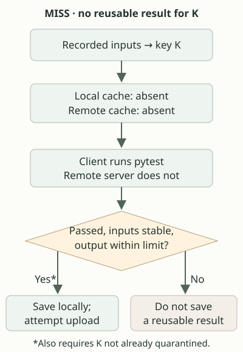
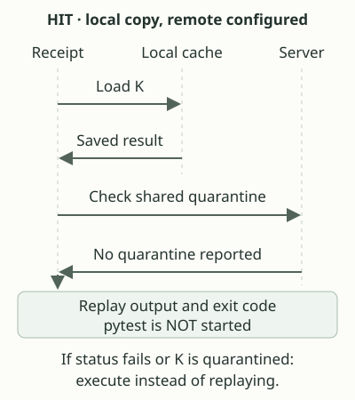
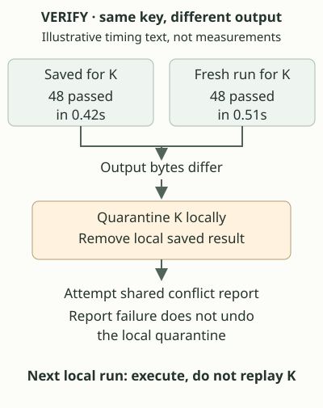
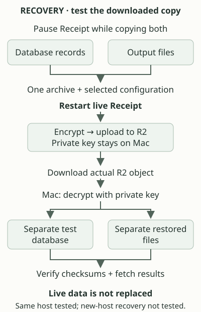

# 10. Final walkthrough: miss, hit, conflict and recovery

Follow one command through four situations:

```sh
receipt run -- uv run pytest
```

Assume the Python environment already works and Receipt is configured to use
your remote cache. The question is: do we have a saved successful result for
these recorded inputs, and are we still allowed to reuse it? The `--` ends
Receipt's options; `uv run pytest` is the command Receipt may execute. The
local cache is on your machine; the remote cache is the shared server.

## A miss: run the tests

You run the command for the first time. Receipt builds a manifest: a description
of the inputs it knows about. This includes project files, command arguments,
environment-value hashes and Python environment information. It hashes that
description into a cache key, which is the name used to look up the result.
Call our example key `K`.

Watch where pytest runs in the diagram: on the client, not the cache server.



Text equivalent: recorded inputs produce K. Neither the local nor remote cache
has a reusable result, so the client runs pytest. A successful run with stable
recorded inputs, bounded output and no local quarantine can be saved locally
and uploaded. Otherwise Receipt does not save a reusable result. Storage or
network failures can still prevent a save.

Receipt [records the inputs again](../GLOSSARY.md#stability-check) after execution. Actual excerpt from
[`fingerprint.Build` in app.go](https://github.com/sidsharma96/receipt/blob/main/internal/app/app.go#L322-L323):

```go
after, e := fingerprint.Build(ctx, dir, command, cfg.ExtraInputs, cfg.IgnoreEnvironment, o.generic)
stable := e == nil && after.Key() == key
```

`key` describes the inputs before execution; `after.Key()` describes them
afterwards. If you edit a source file while tests run, Receipt should not save
the result under the old description. Two matching scans cannot detect a file
changed and changed back between scans, or discover every external dependency.

The saved result contains the command description, stdout, stderr and exit code.
[Stdout](../GLOSSARY.md#stdout-and-stderr) is normal command output; stderr is its separate diagnostic output.
An [exit code](../GLOSSARY.md#exit-code) of zero means the command reported success. Editing a tracked
test file before the next invocation normally produces a different key, rather
than reusing K.

## A hit: replay without execution

Run the same command with unchanged recorded inputs. Receipt calculates K again
and finds the local result. When a remote cache is configured, it also checks
the server's quarantine status before trusting that local copy. Quarantine is
a warning attached to a key: different results have been reported, so stop
reusing it. The conflict section below follows how that warning is created.



Text equivalent: Receipt loads K locally, asks the server about quarantine,
and replays the output and exit code if the check allows it. Pytest does not
start. If status is unavailable or the key is quarantined, Receipt executes
instead. With no local copy, a remote hit can supply the saved result.

Actual decision from [`s.replay` in app.go](https://github.com/sidsharma96/receipt/blob/main/internal/app/app.go#L307-L309):

```go
if hit && !o.verify {
    return s.replay(prior)
}
```

`prior` is the saved result. Unless verification was requested, this returns
before reaching the code that starts the tests. The replay function writes the
saved bytes to the terminal. Actual excerpt from
[`runSession.replay` in run_session.go](https://github.com/sidsharma96/receipt/blob/main/internal/app/run_session.go#L141-L161):

```go
if _, e := out.Write(prior.Stdout); e != nil {
    return 0, e
}
if _, e := errOut.Write(prior.Stderr); e != nil {
    return 0, e
}
```

Why contact the server for a local hit? Another client may have discovered a
conflict. An old local copy should not bypass that warning. This adds a network
check, and server trouble can force execution even with a local copy available.

A hit reproduces output, not execution. It does not recreate files the tests
would write, repeat their network requests or preserve the original mixing of
stdout and stderr. In our experiments, a separate execution marker established
whether tests really ran; seeing PASS twice would not establish that by itself.

## A conflict: the same key, different observations

Suppose a test prints elapsed time. These outputs are illustrative, not measured:

```text
Saved run: 48 passed in 0.42s
Fresh run: 48 passed in 0.51s
```

Both runs passed, but their output bytes differ. An ordinary hit cannot discover
this because it does not execute the tests. Ask Receipt to run a hit again:

```sh
receipt run --verify -- uv run pytest
```



Text equivalent: verification compares a fresh execution with the saved exit
code, stdout and stderr. For this mismatch, Receipt marks K quarantined locally,
removes the local saved result and attempts a shared conflict report. Future
local runs execute instead of replaying K. A failed report does not undo the
local marker, but it can leave other clients unaware of the conflict.

Quarantine means do not reuse this key. It does not mean Receipt has determined
which run was correct. Actual marker creation from [`quarantine` in app.go](https://github.com/sidsharma96/receipt/blob/main/internal/app/app.go#L221-L229):

```go
func quarantine(dir, key string) error {
	path := filepath.Join(dir, "quarantine", key)
	if err := atomically(path, []byte("conflicting observation; do not reuse\n")); err != nil {
		return err
	}
	return syncDir(filepath.Dir(path))
}
```

The marker is a file, so it remains after this command ends. `syncDir` asks the
operating system to persist the directory change after the marker's bytes have
been written and synchronized.
That is the durability step intended to preserve the name after a crash; it
still depends on successful synchronization and the filesystem/storage honoring
that request. A verification
mismatch returns a nonzero exit code even when the fresh tests passed. If
recorded inputs change during verification, Receipt instead reports that the
comparison is inconclusive. Exceeding the output capture limit also prevents
successful byte-for-byte verification.

Why not replace the old answer? That would hide disagreement. Timing text may
be harmless, but differing output may also expose randomness, an undeclared
input or an unreliable test. Two clients publishing different observations
under the same key are another way the shared store can detect a conflict.
There is no automatic rule that makes a quarantined key trusted again.

Consider a successful local marker write and entry removal, followed by a failed
network report:

| Location after this partial failure | What remains | What the next run can do |
| --- | --- | --- |
| This client | K's quarantine marker; the reusable local entry has been removed | Execute instead of replaying K. An ordinary rerun does not clear the marker. |
| Shared server | Its earlier result, without this client's conflict report | Other clients can still reuse it unless the server learns of a conflict by another successful report or publication. |

The local success does not make the two machines agree. Retrying a report, if
performed, must still reach the server successfully; an ordinary rerun is not
a promise that the failed report is automatically repaired.

## Recovery: restore stored state, not trust

Now suppose stored server data is lost. This is not conflict resolution:
restoring a backup recovers earlier state, not proof that a result is correct.

A shared result spans database records and output files. Copying only the
database can leave records pointing at missing files. Our backup includes both,
plus the binary and selected configuration. R2 is the external object-storage
service used to hold the encrypted backup archive. Follow the copy out and back:



Text equivalent: pause Receipt, copy database and files, restart, encrypt and
upload. Download the R2 object and decrypt it on the Mac with the private recovery
key. Verify checksums, restore a separate database and files, then fetch results
from a test server. The live data is never replaced during this drill.

Actual Python restart cleanup from
[`finally` block in backup-r2-drill.py](https://github.com/sidsharma96/receipt/blob/main/deploy/digitalocean/backup-r2-drill.py#L36-L39):

```text
finally:
    run('systemctl', 'start', 'receipt')
    run('systemctl', 'is-active', '--quiet', 'receipt')
    print(f'stop/start interval: {time.monotonic() - start:.3f} seconds', flush=True)
```

The `finally` block attempts restart even if copying raises an error. It cannot
run after power loss or a forced kill. Restart happened before encryption and
upload, so the pause did not include waiting for R2.

In the completed drill, the downloaded encrypted bytes matched the uploaded
bytes. All four restored database tables matched the live contents checked at
the time, and all ten saved results were readable. A previously checked result
also matched its expected checksum. Temporary restored data was removed after
the test; the encrypted backup remains in R2 and on the Mac.

This proves that particular backup worked on the existing machine. It does not
prove new-host recovery or recovery without the private key. Changes after the
backup are absent: a credential revoked later could appear unrevoked after
restoring the old state. The [recovery record](../DIGITALOCEAN-SETUP.md#13-october-one-off-r2-backup-and-restore)
preserves exact evidence and limitations. No nightly schedule is enabled.

## Check your understanding

<!-- questions:start -->

### What does a replay not reproduce?

**Level:** Newcomer

The original test run wrote a coverage report and printed warnings mixed in with normal output. What will a replay give you?

<details>
<summary>Answer</summary>

A replay gives back only the captured output and the exit code. It does not recreate files the tests wrote, such as a coverage report or a JUnit XML file, and it does not repeat network requests. The mixing of standard output and standard error is lost too: Receipt writes all of the saved standard output first, then all of the saved standard error. Timings printed in the output are the original run's timings. If you need a test's side effects, run it with `--bypass`.

**Learn more:** [A hit: replay without execution](../guide/10-final-walkthrough-miss-hit-conflict-and-recovery.md#a-hit-replay-without-execution) · [D6. Why cache only successes, replay exact bytes and never normalise output?](../DESIGN-DEFENSE.md#d6-why-cache-only-successes-replay-exact-bytes-and-never-normalise-output)

</details>

### What a hit gives back

**Level:** Practitioner

Which results can Receipt store, and on a hit, what exactly does the user get back?

<details>
<summary>Answer</summary>

Only successful runs are stored. `Validate` rejects any result whose exit code is not 0, so a failing run always executes again. A run is also not stored when its output exceeded the capture limit of 8 MiB per stream, when the inputs changed during execution, or when the key is quarantined.

A stored result holds the manifest, stdout bytes, stderr bytes, the exit code, the run's duration and its creation time. On a hit, `runSession.replay` prints a `receipt: hit` line with the saved duration to stderr, writes the saved stdout in full, then the saved stderr in full, touches the entry's modification time, and returns the saved exit code, which is 0. The tests do not run, so any files they would have written, network requests they would have made, and the original interleaving of stdout and stderr are not reproduced.

**Learn more:** [A hit: replay without execution](../guide/10-final-walkthrough-miss-hit-conflict-and-recovery.md#a-hit-replay-without-execution) · [D6. Why cache only successes?](../DESIGN-DEFENSE.md#d6-why-cache-only-successes-replay-exact-bytes-and-never-normalise-output) · [`runSession.replay`](https://github.com/sidsharma96/receipt/blob/main/internal/app/run_session.go#L141-L161) · [`Validate`](https://github.com/sidsharma96/receipt/blob/main/internal/cache/store.go#L51-L73)

</details>

### Exact semantics of verify and refresh

**Level:** Expert

What are the exit codes of `--verify` on a hit for a match, a mismatch and changed inputs? When, exactly, does `--refresh` quarantine a key?

<details>
<summary>Answer</summary>

On a hit, `--verify` runs the tests again and scans the inputs again. If the key changed between the two scans, it prints "verification inconclusive", quarantines nothing and exits 1. If the exit code, stdout or stderr differ byte for byte, or the output exceeded the capture limit, it writes a local quarantine marker, removes the local entry, reports the conflict's hashes to the server and exits with the new run's exit code, or 1 if the new run exited 0. If everything matches it exits 0. On a miss, `--verify` behaves like a normal run.

`--refresh` skips reuse but reads the local entry for the key. It quarantines in one case only: the fresh run fails, a cached success for the same key existed locally, and the inputs did not change during the run. A successful refresh removes the old local entry and stores the new one, even if the output differs. The upload that follows can still meet a different stored result on a PostgreSQL server, which answers 409 and makes the client quarantine locally. At most one of `--bypass`, `--refresh` and `--verify` may be given.

**Common wrong answer.** "A successful refresh whose output differs from the cached result is a conflict and quarantines locally." Locally it simply replaces the entry; only a failure after a recorded success quarantines.

**Learn more:** [D6b. What do `--verify`, `--refresh` and `--bypass` do?](../DESIGN-DEFENSE.md#d6b-what-do---verify---refresh-and---bypass-do) · [`verify`](https://github.com/sidsharma96/receipt/blob/main/internal/app/run_session.go#L163-L191) · [`failed`](https://github.com/sidsharma96/receipt/blob/main/internal/app/run_session.go#L193-L214)

</details>

<!-- questions:end -->
