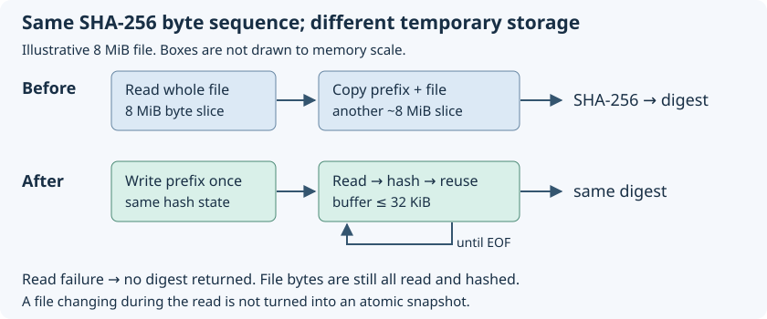
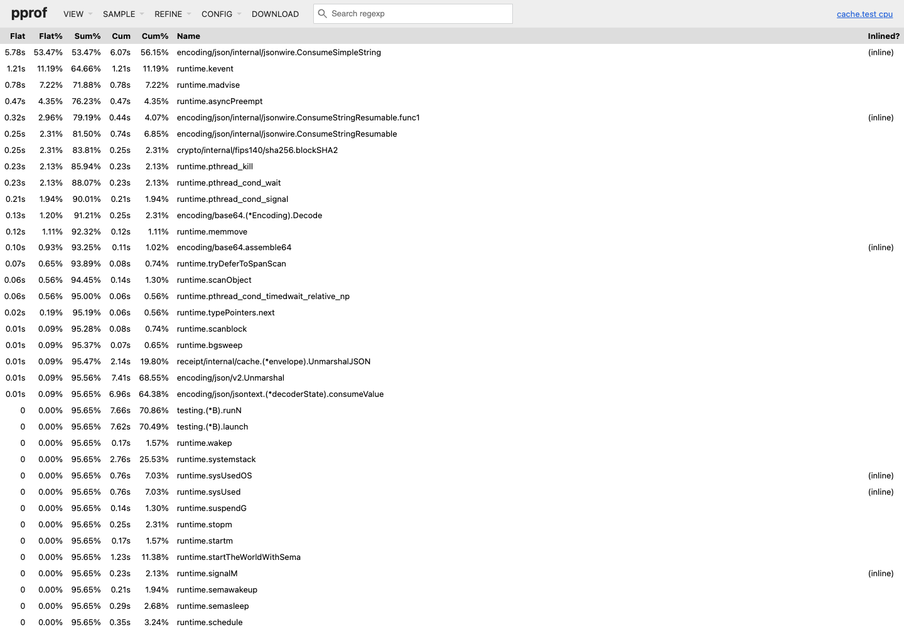
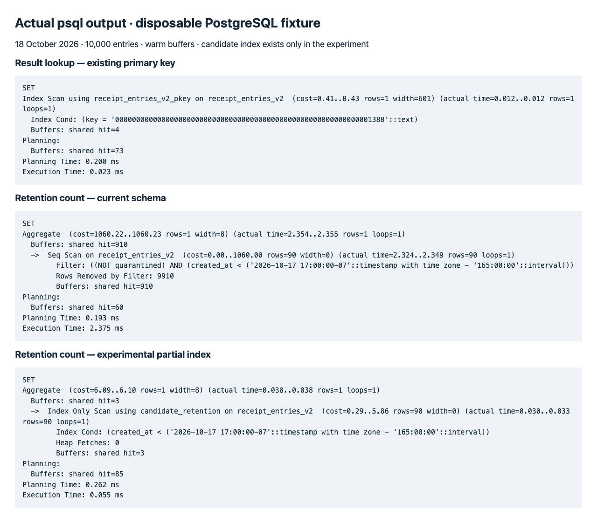

# 12. Make a cache hit cheaper

Suppose you run `receipt run -- go test -count=1 ./internal/strictjson`
twice. On the first run Receipt reads the declared inputs, looks for a saved
success, runs the tests, reads the inputs again, and saves the result if the
inputs stayed the same. On the second run it still reads the inputs. Only then
can it look up the result, validate it, print it, and update local history.
Skipping the tests does not mean skipping all work.

On 18 October 2026 we measured this command in this working checkout. Five
direct runs had a median elapsed time of **832 ms**. One miss took **1,716 ms**;
five hits had a median of **359 ms**. The median fingerprint stage was **267 ms**;
the median lookup stage was **5.94 ms**. These are separate medians, not pieces
of one representative run. The files included uncommitted profiling fixtures.
This is a warm local experiment, not an internet or production measurement.

That makes fingerprinting the first place to investigate for this user workload.
A faster database cannot help a standalone local hit. A faster hash alone will
not necessarily help either: the fingerprint stage also starts Git and toolchain
processes, opens files, and allocates memory. We must split those costs before
claiming which change will save the 267 ms.

The initial investigation added measurements without production changes. A later
18 October change implements streaming file-input hashing, explained below; the
other optimization candidates remain unimplemented. Cache key encoding and
database migrations are unchanged. The
[detailed review](../PHASE-REVIEWS.md#profiling-investigation-18-october-2026)
records the evidence and remaining gaps.

## Follow the work before choosing a tool

```text
Local hit
CLI -> Git discovery -> read/hash files -> executable + toolchain probe
    -> construct key -> read/decode saved result -> replay output
    -> touch entry + serialize/write/sync history -> return

Shared upload, with two clients
A: validate -> acquire writer lock -> check quota -> write/sync blobs -> SQL commit
B: validate -> wait for writer lock ---------------------------------> acquire
                         ^ adding workers does not shorten A's work
```

Text equivalent: every ordinary hit fingerprints first. Local replay also does
filesystem bookkeeping. Shared writers take turns across the whole storage
lifecycle, so the second writer can wait even when its key differs.

Use `--timings` first. It tells you **elapsed time**, including waiting. Use a CPU
profile next when you need to know which functions consumed sampled CPU time.
Use an allocation profile to find temporary memory churn. Use the database's
query planner only for the SQL part. These tools answer different questions.

| Question | Measurement | What it does not establish |
| --- | --- | --- |
| How long did the user wait? | wall time; Receipt stages | CPU use or which disk was slow |
| Where did this process spend CPU samples? | Go CPU profile | child-process or PostgreSQL CPU; exact cycles per function |
| How many bytes did each operation allocate? | benchmark `B/op`; allocation profile | peak resident memory |
| How much memory remained live? | `inuse_space` heap profile | all process memory, or an earlier peak |
| What was the process memory peak? | `/usr/bin/time -l` on macOS; `-v` on Linux | server plus database plus child totals |
| Which rows/pages did SQL visit? | `EXPLAIN (ANALYZE, BUFFERS)` | network delivery, Go decoding, or blob reads |

A high allocation count can waste CPU because the garbage collector must reclaim
short-lived objects. A low CPU percentage can instead mean the request is waiting
for a lock, disk, network, or subprocess. Driving CPU utilization to 100% is not
the goal. Reduce work and waiting per correct result while keeping memory bounded.

## Run the first measurement yourself

Build once, then keep the workload and files unchanged throughout the experiment:

```sh
make build
python3 scripts/measure_local.py --repo "$PWD" --receipt ./receipt \
  --repeats 5 -- go test -count=1 ./internal/strictjson
```

The helper runs the command directly, once through an empty temporary Receipt
cache, then five expected hits. It fails if a supposed hit actually executes.
`-count=1` disables Go's saved **test results**, but not its compiled-package
cache. Direct runs happen first, so warm-up and fixed ordering can bias the
comparison. Repeat with representative workloads and alternate ordering before
accepting a small improvement. Record source bytes, file counts, output sizes,
tool versions, failures, and whether caches were warm.

For a real remote run, pair `receipt run --timings` with the server's
`--request-log`. Use the response request ID to find the server event. Never add
nested spans together: `sql` can include work also reported elsewhere. A large
`db_lock` duration suggests waiting; it is not evidence that an index lookup
consumed that time. See [the stage boundaries](../MEASUREMENTS.md#read-the-timings).

## Streaming file hashing: implemented 18 October

Consider a file containing `abc` with permission bits `0600`. Receipt must hash
the bytes for `600`, then a zero byte, then `abc`. Previously it read the whole
file into memory and copied those bytes behind the prefix before hashing. Now
it feeds the prefix and successive file chunks into the **same** SHA-256 state.
A hash state remembers the work so far; dividing the input into writes does not
change the final digest. Hashing each chunk separately and combining the digests
would be a different algorithm and would change keys.

```text
Old bytes:   [6 0 0 NUL a b c] -> SHA-256
New writes:  [6 0 0 NUL], [a b], [c] -> one SHA-256 state
Result: identical digest for identical bytes and permissions
```

The two-byte chunks here are illustrative. Actual file reads use a buffer no
larger than 32 KiB. For small files the buffer uses the size hint, with a one-byte
minimum. The hint only sizes temporary storage; it never limits how much we read.
If a file grows after its size is checked, the loop still reads until EOF (end
of file). This preserves full-read behavior, not an atomic snapshot during edits.



Text equivalent: the old 8 MiB path allocated a file-sized slice and another
prefix-plus-file slice. The new path writes the prefix to the hash, repeatedly
reads and hashes through one buffer, then returns the digest. A read error stops
the operation without returning a digest. All declared file bytes still get read.

The call in [`fileInput`](https://github.com/sidsharma96/receipt/blob/main/internal/fingerprint/manifest.go#L200-L224):

```go
	digest, e := hashFile(path, fmt.Sprintf("%o\x00", info.Mode().Perm()), info.Size())
	if e != nil {
		return Input{}, e
	}
	return Input{FileInput, path, digest}, nil
```

`%o` retains the old octal permission spelling; `\x00` retains the zero separator.
The file path, input kind, deleted-file marker and manifest serialization are
unchanged. The preceding checks still refuse directories, symlinks and other
nonregular inputs. This also benefits Cargo paths already using `fileInput`.

The bounded read in [`hashFile`](https://github.com/sidsharma96/receipt/blob/main/internal/fingerprint/file_hash.go#L12-L28):

```go
	buffer := make([]byte, min(max(size, 1), 32<<10))
	// Hide File.WriteTo so io.CopyBuffer uses this bounded, size-aware buffer.
	if _, err := io.CopyBuffer(h, struct{ io.Reader }{f}, buffer); err != nil {
		return "", err
	}
	return hex.EncodeToString(h.Sum(nil)), nil
```

`h` is the SHA-256 state after writing the prefix; `f` is the open file.
`io.CopyBuffer` repeatedly reads into `buffer` and sends those bytes to `h`.
The small wrapper exposes only `Read`: otherwise Go can choose the file's
`WriteTo` method and bypass the supplied buffer. This is a local adapter, not a
new storage framework. There are no new goroutines, shared pools or locks.
Read errors propagate, and the read-only file is closed on return.

### Proving compatibility and measuring the result

An independent test reconstructs the old byte concatenation and applies SHA-256
directly. All **32 size/permission combinations** match the new input hash and
manifest key, including empty files, binary data, chunk boundaries and an 8 MiB
file. Additional tests cover misleading size hints, missing files, open/read
errors, directories and symlinks. Existing encoding and input-change tests pass.

We also built the previous commit's CLI and this implementation separately. The
old CLI populated a temporary cache for a fixed Go project; the new CLI replayed
that entry. Both `explain` commands reported the identical full 64-character key,
recorded in the [raw comparison](../measurements/streaming-2026-10-18/comparison.json).
This checks compatibility at the complete command/cache boundary, beyond the
unit-level hash comparison. Identical keys still do not prove deterministic tests.

The same prebuilt benchmark ran six times per version, alternating order:

| 8 MiB file metric | Before | After | Change in medians |
| --- | --- | --- | --- |
| Hash latency | 13.24 ms/op | 9.20 ms/op | 30.5% lower |
| Allocated bytes | 16,795,790 B/op | 33,632 B/op | 99.8% lower |
| Peak process resident memory | 44.41 MB | 22.28 MB | 49.8% lower |
| Process CPU time for fixed work | 1.965 s | 1.425 s | 27.5% lower |

CPU and peak resident memory cover a whole benchmark process: 200 timed
operations plus setup/calibration and runtime work. They are not single-call
CPU or memory attribution. Allocation bytes come from the timed operation.
Here MB means one million bytes; the input is 8 MiB (8,388,608 bytes).
The benchmark setup itself allocates the 8 MiB fixture, so process RSS is not
expected to shrink to 32 KiB. CPU time includes user and system time.

For 4 KiB files, median latency fell from **24.04 to 20.92 microseconds**, and
allocations from **10,616 to 4,956 bytes/op**. No small-file median regression
appeared in this sample. There is still allocation and hashing work per file.

For complete hits on a fixed 259-file fixture containing 9 MiB of payload, the
median Receipt duration was **240.5 ms before / 235.7 ms after**, while peak
process RSS fell from **38.33 / 29.42 MB**. The eight hit timings per version
varied widely (before 181–283 ms, after 183–493 ms). **This does not establish a
reliable end-to-end latency improvement.** The memory result and eliminated
whole-file allocations are clearer than that small difference in hit medians.
See the [measurement scope and reproduction commands](../MEASUREMENTS.md#streaming-file-hashing-18-october-2026).

### What remains expensive

Streaming still reads and hashes every byte. It can perform more read calls than
a whole-file read; cold-device I/O and syscall counts were not measured. The executable path and probe subprocesses were left unchanged in this file-input
optimization. The subsequent [Chapter 13](13-hash-executables-and-measure-probes.md)
now splits fingerprint timing and streams executable bytes except for direct
pytest, while preserving fresh probes.

Do not replace content hashing with only modification times and file sizes:
a changed file can retain both. A file-watching cache needs rules for missed
events, restarts and edits. Parallel hashing multiplies buffers and competing
reads; try bounded workers only after demonstrating a throughput need. Revisit
the 32 KiB cap if repeatable representative workloads show a better tradeoff.

## The second opportunity: avoid repeatedly parsing large output

A saved 1 MiB stdout becomes roughly 1.33 MiB when represented as base64 in JSON.
Receipt wraps that result inside another JSON object with a checksum. On decode,
strict shape checks inspect fields, then typed decoding constructs the result.
Nested objects repeat their own checks.

The current [`Object`](https://github.com/sidsharma96/receipt/blob/main/internal/strictjson/object.go#L27-L60):

```go
	if _, err := d.Token(); !errors.Is(err, io.EOF) {
		return fmt.Errorf("expected exactly one JSON object")
	}
	for _, field := range fields {
		if !field.Optional && !seen[field.Name] {
			return fmt.Errorf("missing field %q", field.Name)
		}
	}
	return json.Unmarshal(data, dst)
```

After the field-by-field pass, `json.Unmarshal` reads the object again. The
field reader also copies raw values and decodes string fields to validate their
type. This is understandable code enforcing useful rules, but large output
strings make repeated passes expensive.

The 1 MiB decode benchmark took **16.06 ms** and allocated **14.36 MiB/op**.
Encoding took **2.10 ms** and about **2.7 MiB/op**. The actual CPU-profile screen
below shows JSON string scanning at the top, with **53.47% flat samples** in
`ConsumeSimpleString`. “Flat” means inside that function; “cumulative” includes
its callees. Do not add cumulative percentages across overlapping callers.



Text equivalent: the leading function is the JSON string scanner; SHA-256 accounts
for about 2.31% flat samples in this profile. The allocation report assigns
55.49% of sampled allocated bytes to decoder-buffer fetching and 28.02% to raw
JSON value copying. Optimizing hash instructions first would miss the larger
measured cost in this fixture. Toolchain-specific symbols can change.

Try decoding validated raw fields into their typed destinations once, retaining
all duplicate/unknown-field, null, UTF-8, checksum and semantic checks. This is a
candidate, not an implemented parser rewrite. Require adversarial tests and
unchanged wire/key bytes; saving CPU by accepting ambiguous JSON is a regression.
A binary or streaming wire format could avoid base64 and copies but requires
versioning and client compatibility. Revisit it when representative output sizes
justify that migration, rather than assuming every test prints a megabyte.

To reproduce the profiles (run packages separately so each profile has one binary):

```sh
mkdir -p .tools/profiling
# Repeated timing/allocation observations, without profiling overhead:
go test ./internal/fingerprint ./internal/cache -run '^$' \
  -bench BenchmarkProfile -benchmem -benchtime=1s -count=3
# CPU and heap samples for one path:
go test ./internal/cache -run '^$' \
  -bench 'BenchmarkProfileCodec/1048576/decode$' -benchtime=5s \
  -cpuprofile=.tools/profiling/decode.cpu \
  -memprofile=.tools/profiling/decode.mem -o .tools/profiling/cache.test
go tool pprof -top .tools/profiling/cache.test .tools/profiling/decode.cpu
go tool pprof -top -alloc_space .tools/profiling/cache.test .tools/profiling/decode.mem
go tool pprof -http=127.0.0.1:8098 -no_browser \
  .tools/profiling/cache.test .tools/profiling/decode.cpu
```

Open `http://127.0.0.1:8098/ui/top` locally. The [captured source view](../assets/profiling/decode-source.png) shows the checksum line in `Decode` and JSON time attributed to an inlined call in the Go standard library; do not interpret its first source block as the whole function's cumulative cost. Use `list Decode` in interactive
pprof to attribute samples to source. A short-lived CLI may collect too few CPU
samples; the repeated benchmark solves that at the cost of representing only one
path. Go profiles exclude the test command and database processes. See
[Go's diagnostics guide](https://go.dev/doc/diagnostics).

For resident memory and process totals, run the compiled benchmark separately:

```sh
/usr/bin/time -l .tools/profiling/cache.test -test.run '^$' \
  -test.bench 'BenchmarkProfileCodec/1048576/decode$' -test.benchtime=2s
```

This run reported **33,914,880 bytes maximum resident size**, versus roughly
15 MB allocated per decode. Freed allocations do not all remain resident. The
OS also reported 13,052,477,577 cycles elapsed and 71,111,364,328 instructions
retired for the **whole benchmark process**, including calibration and runtime
work. They are not per-decode hardware counts. For attribution on macOS use
Instruments Time Profiler/Allocations; on Linux use `perf stat`/`perf record`
when hardware-counter permissions permit. Those tools were not run here.

## The third opportunity: shorten shared writer occupancy

A duplicate 1 MiB blob already exists, yet `FileBlobs.Put` creates a temporary
file, writes the bytes, syncs it, tries a hard link, discovers the existing
object, reads and verifies it, and syncs the directory. The isolated benchmark
ranged from **11.2 to 20.9 ms/op**, allocating about **2.13 MiB/op**. Sync latency
was variable, so treat this as a lead rather than a precise service estimate.

A verified-existing-object fast path could skip the redundant temporary write
and sync. It must still verify bytes, reject corruption, and preserve the
publication/cleanup coordination. An existence check alone is insufficient:
if a corrupt object exists, returning success would bless bad data. Measure
missing, duplicate and corrupt cases separately before adopting this change.

The shared fixture (128 entries, 1 KiB outputs) had a **0.753 ms** one-worker
read median, **14.55 ms** one-worker duplicate-write median, and **67.39 ms**
four-worker duplicate-write median. In the last case the database-lock call
averaged **47.99 ms**. Four workers make 32 requests; one worker makes 8.
The lock protects files and metadata together; removing it could let cleanup
delete a blob before publication finishes. Reduce redundant work inside that
protected interval first. More admission slots can increase queued work and RAM
without improving serialized throughput.

A local hit has another candidate: `replay` always calls `recordHistory`, which
serializes and durably replaces the manifest. Consider skipping an unchanged
history write or giving optional history a different durability policy. Neither
change was benchmarked here; the uninstrumented remainder of hit time also
contains startup and other bookkeeping. Do not silently weaken required entry
publication or quarantine durability to improve that remainder.

## Ask PostgreSQL how it finds a result

Imagine 10,000 result rows and one requested key. PostgreSQL can either inspect
all rows or use a sorted lookup structure, a **B-tree index**, to locate the key.
The query planner estimates the work for each legal approach. Its chosen plan
is not a promise about runtime; `ANALYZE` executes it to collect observations.

Start with a disposable database, then run the checked-in experiment:

```sh
# Set PLAN_DSN yourself to a disposable database, never the live service.
python3 scripts/profile/query_plans.py "$PLAN_DSN" .tools/query-plans
```

The script copies table definitions from the current Go migrations, creates a
unique schema, loads 10,000 entries, 100,000 evidence rows and 1,024 credentials,
refreshes statistics with `VACUUM (ANALYZE)`, records plans, and drops its schema.
The JSON bodies are synthetic placeholders, not valid Receipt results. That is
adequate for comparing relational access paths, not for measuring application
validation or realistic large-manifest/TOAST behavior. TOAST is PostgreSQL's
storage for oversized values.

The central command is:

```sql
EXPLAIN (ANALYZE, BUFFERS)
SELECT record, digest, quarantined
FROM receipt_entries_v2
WHERE key = lpad(to_hex(5000), 64, '0');
```

Read the output from the scan upward:

- `Index Scan using receipt_entries_v2_pkey`: the primary-key index located it.
- `Index Cond`: the condition used to navigate the index, rather than discard
  rows after fetching them.
- `cost=... rows=1`: estimated work units and row count, not milliseconds.
- `actual time=... rows=1 loops=1`: observed timing, rows, and repetitions.
  With many loops, per-loop numbers need interpretation before comparing totals.
- `Buffers: shared hit=4`: four block accesses satisfied by PostgreSQL's cache.
  These are not four physical disk reads or necessarily four distinct blocks.
- `Execution Time`: execution instrumentation total, excluding client network
  transfer and Receipt's decoding/filesystem work. Planning has its own time.

If estimated and actual row counts differ greatly, investigate data skew and
statistics before forcing an index. `ANALYZE table_name` refreshes statistics;
`EXPLAIN ANALYZE` measures execution. They are different commands. `BUFFERS read`
means a block was brought into PostgreSQL's buffer cache; the OS might still
have supplied it from memory. Never present that as a proven device I/O count.
The [PostgreSQL 14 explanation](https://www.postgresql.org/docs/14/using-explain.html)
describes these fields. `EXPLAIN ANALYZE` executes writes too; use isolated data
for deletion experiments. This investigation planned SELECTs only.



This screenshot is a browser rendering of captured **psql output**, not a pgAdmin
screen. Text equivalent: result lookup uses its primary key and four buffer hits;
selective retention originally scans 10,000 rows, rejecting 9,910, with 910 buffer
hits; the experimental index reaches the 90 matching rows with three buffer hits.

## Are our indexes appropriate?

Yes for the ordinary identity lookups. The migrations declare primary keys;
PostgreSQL automatically creates the corresponding unique indexes. A separate
`CREATE INDEX` statement is not required for these paths.

| Actual query shape | Existing index and observed plan | Decision |
| --- | --- | --- |
| Result/status by `key` | entries primary key; index scan | Keep; no duplicate key index |
| Credential by `id` | credentials primary key; index scan | Keep; no token-hash index needed because lookup extracts the ID first |
| Evidence by `(key,digest)` | composite primary key; index-only scan, zero heap fetches in this vacuumed fixture | Keep; leading `key` also supports searches for one key's evidence |
| Singleton policy/usage | boolean primary key on a one-row table | A sequential scan can be entirely appropriate |
| Old nonquarantined entries | no matching time index; sequential scan | Candidate partial time index for retention |
| Exact metadata-byte recount | all records must be inspected | Another key index cannot remove that work |

An index-only scan can answer from index entries when visibility information says
it need not visit table rows. Freshly vacuumed fixtures favor this; real churn can
cause heap fetches. A sequential scan is not inherently bad, especially when a
query needs most rows or the table holds one row.

The experiment added **only inside its disposable schema**:

```sql
CREATE INDEX candidate_retention
ON receipt_entries_v2(created_at)
WHERE NOT quarantined;
```

A partial index stores only rows satisfying its predicate. This matches retention's
rule that quarantined rows must remain. For the 90-row count, the text-plan runs
changed from **2.375 ms / 910 buffer hits** to **0.055 ms / 3 hits**. The index
occupied **216 KiB**. An 8,100-row count also used an index-only scan (25 hits).
Text and JSON plans are separate executions, so their timings differ.

This demonstrates a useful maintenance candidate, not a production migration.
The actual prune also deletes evidence, returns JSON sizes, updates counters, and
commits. Those steps need table access and can dominate. A count-only index benefit
does not prove the same deletion speedup. Test full prune transactions, write
amplification, vacuum behavior and lock occupancy before shipping it. Each added
index consumes memory/disk and must be maintained on writes. A GIN index on JSON
would add that cost without helping current key-based lookups, which do not filter
inside the JSON record.

## Decide what to optimize next

| Priority | Candidate | Benefit to prove | Revisit or stop when |
| --- | --- | --- | --- |
| 1, local user latency | File-input streaming implemented; Chapter 13 adds executable streaming and probe timings | allocations are reduced; prove further whole-hit gains separately | probes or tiny-file opens dominate instead |
| 2, output-heavy hits | Reduce repeated strict JSON passes/copies | lower decode CPU/allocations with identical rejection behavior | real outputs are small or parser complexity defeats maintainability |
| 3, shared contention | Verify an existing blob before rewriting it | fewer writes/syncs and shorter writer lock occupancy | duplicates are rare; verification or locking becomes dominant |
| 4, local bookkeeping | Avoid unchanged history rewrites | less optional serialization and durable I/O | history semantics or multi-process behavior cannot be preserved |
| 5, maintenance | Partial retention index | shorter full prune and less blocked traffic | maintenance is rare, selects most data, or index upkeep outweighs savings |

The quota fast path was already improved on 15 October: uploads read running
usage totals rather than inventorying the entire store. Do not propose that as
new work. Startup, stats and collection still need recounts; the synthetic
metadata recount took 14.54 ms and visited 910 cached blocks.

Bounded capture (8 MiB per output stream) and admission limits are useful but not
a hard process-memory ceiling: raw bytes, base64 JSON, decoder buffers, responses
and runtime memory can coexist. Size admission using measured peak memory at
real output distributions, not just the nominal stream cap. Avoid unbounded
queues and unlimited workers. Do not raise database connection limits to solve
a single serialized writer.

For I/O, distinguish bytes read, file opens/stats, writes, and sync calls.
Streaming saves RAM but still reads input bytes. A duplicate fast path removes
writes; batching history could remove syncs but changes durability. On macOS,
Instruments File Activity or `fs_usage` can reveal operations; Linux `strace -c`,
`pidstat -d` and `iostat` can separate syscall counts and device activity. These
were not captured here. The `time -l` decode run reported zero block I/O because
it exercised in-memory decoding; it says nothing about cache-publication writes.

Use one baseline, one change, the same fixtures, repeated samples, and correctness
checks. Compare CPU, allocation bytes, RSS, wall time, I/O and failures together.
Record regressions as well as wins. Raw observations, toolchain and measurement
limits are in [the measurement record](../MEASUREMENTS.md#profiling-investigation-18-october-2026).

## Check your understanding

<!-- questions:start -->

### Why can a cache hit still be expensive?

**Level:** Newcomer

The tests did not execute, but Alice still waited 359 ms. Which work can remain, and which measurement should she inspect first?

<details>
<summary>Answer</summary>

Receipt must discover and hash inputs, probe the toolchain, construct the key, read and validate the saved result, replay output and update bookkeeping. Start with wall time and the Receipt timing stages. In the recorded workload fingerprinting had a 267 ms median, so a database index would not address the main cost of this standalone local hit.

**Learn more:** [Make a cache hit cheaper](../guide/12-profile-before-optimizing.md)

</details>

### Is allocated memory the same as peak memory?

**Level:** Newcomer

A benchmark allocates about 15 MB each time it decodes a result. Does one hundred repetitions prove that the process needs 1.5 GB of RAM at once?

<details>
<summary>Answer</summary>

No. Allocation bytes count memory created over time; the garbage collector can reclaim earlier objects. Peak resident size measures a different quantity: memory resident in the process at its high point. Inspect both allocation profiles and process memory, and remember that separate PostgreSQL and child processes are not included in a Go heap profile.

**Learn more:** [Avoid repeatedly parsing large output](../guide/12-profile-before-optimizing.md#the-second-opportunity-avoid-repeatedly-parsing-large-output)

</details>

### Does a sequential scan prove that an index is missing?

**Level:** Newcomer

A plan says sequential scan. Should we always add an index? What did the retention experiment actually establish?

<details>
<summary>Answer</summary>

No. Reading all rows can be sensible for an exact recount, a tiny table or a broad selection. The selective retention count benefited from a partial time index: it visited three cached blocks instead of 910. That does not prove faster full deletion, which also changes evidence, reads JSON sizes and commits. Compare complete workloads and index maintenance costs before adopting it.

**Learn more:** [Are our indexes appropriate?](../guide/12-profile-before-optimizing.md#are-our-indexes-appropriate)

</details>

### Why does streaming preserve the file hash?

**Level:** Newcomer

A file contains `abc`. Receipt used to hash the permission prefix and file bytes in one slice. It now writes the prefix, then `ab`, then `c` into one hash state. Why is the digest unchanged, and why must the old file size not limit the read?

<details>
<summary>Answer</summary>

The same SHA-256 state receives the same bytes in the same order; chunk boundaries are not additional input. Computing separate chunk digests and combining them would be different. The size hint may be stale if the file grows, so it sizes the temporary buffer but does not cap the total bytes read. Receipt reads until EOF. This preserves the hash calculation for stable files without making concurrent edits an atomic snapshot.

**Learn more:** [Streaming file hashing](../guide/12-profile-before-optimizing.md#streaming-file-hashing-implemented-18-october)

</details>

<!-- questions:end -->

Current update (18 October): [Chapter 14](14-reuse-the-git-root.md) removes the
duplicate initial Git-root query. Earlier measurements in this chapter remain
historical; fresh file listing and post-run root discovery still run.
