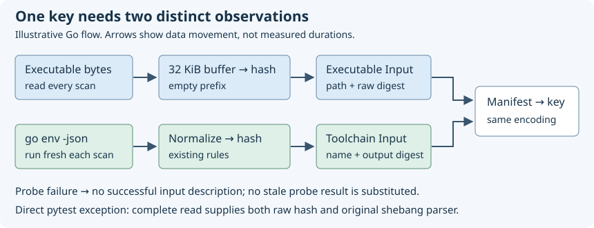

# 13. Hash executables and measure their probes

You run `receipt run --timings -- go test -count=1 ./...` and get a cache hit.
Chapter 12 reduced the temporary memory needed to hash project files. But Receipt
must also identify the program about to run and ask that program about its
runtime environment. An unchanged `go` command can use different settings; an
unchanged Python interpreter can have a different installed package set.

On 18 October 2026 we measured those remaining steps separately, implemented
streaming for executable bytes that the probe does not need to inspect, and
confirmed that old cache entries still replay. We deliberately kept probes
fresh. This chapter explains that decision and the measured limits.

Current update: [Chapter 14](14-reuse-the-git-root.md) now removes the duplicate
initial root query. The measurements below describe the executable optimization
before that change; initial CLI discovery now has one timed call rather than two.

Current update (18 October): [Chapter 15](15-measure-toolchain-probe-overhead.md)
measures fresh probe costs and reduces local Go normalization allocations. Probe
commands and freshness remain unchanged; no whole-hit speedup was established.

## Follow the executable and probe separately

A probe is a command Receipt runs to ask about the current tool environment.
`PATH` is the ordered list of directories searched to find a command such as
`go`. The manifest records both the selected executable and the probe's answer.
For a Go invocation the sequence is:

```text
Find go on PATH -> keep its absolute path -> read all its bytes -> hash bytes
    -> run go env -json -> normalize the known temporary-path field
    -> hash that JSON -> append both identities to the manifest -> key
```



Text equivalent: all executable bytes pass through the hash buffer, while fresh
probe output is separately normalized and hashed. Both records enter the manifest.
A failed probe stops successful input construction; an old probe result is not
substituted. Direct pytest retains its complete-read exception.

The executable hash identifies its bytes. The toolchain hash identifies the
probe's output. These are different inputs, not substitutes for each other.
The existing manifest names and normalization rules stay unchanged.

The `--timings` fields introduced by this change split the work without adding private paths, commands,
keys or probe output to diagnostic labels:

| Stage | Boundary |
| --- | --- |
| `discovery` | File discovery and extra inputs; standalone Build also finds the root. The current initial CLI scan reuses its root (Chapter 14). |
| `input_files` | The ordinary working-tree/extra-file read/hash loop and input appends |
| `executable` | Reading/hashing the selected command executable, including direct-pytest fallback |
| `toolchain` | The non-Cargo probe subprocess, output capture, normalization and output hash |

These intervals sit inside `fingerprint`. For example, the time spent reading an
executable is already part of the fingerprint timer; adding both would count
that reading twice. They are
elapsed time, including waiting, not CPU samples. Executable path lookup,
environment hashing, sorting and other work remain outside the child spans. The
settings loader's earlier Git-root query is outside fingerprinting. Cargo keeps
its separate `cargo_tools`, `cargo_metadata` and `cargo_sources` spans; absence of
`toolchain` in a Cargo run does not mean no Rust probing occurred.

Run the same command repeatedly on unchanged files. Compare the stage labels,
not just the total. The controlled before-change fixtures gave these medians:

| Command form | Discovery | Input files | Executable | Probe | Whole fingerprint |
| --- | ---: | ---: | ---: | ---: | ---: |
| `go test` | 29.83 ms | 7.88 ms | 7.32 ms | 35.94 ms | 83.15 ms |
| `python -m pytest` | 28.22 ms | 4.94 ms | 0.054 ms | 41.40 ms | 74.85 ms |
| Direct `pytest` script | 28.47 ms | 4.97 ms | 0.017 ms | 41.71 ms | 77.54 ms |

Each number is a separate median of six hits, so the columns do not sum to the
last column. The fixture contains 256 small input files and small Go/Python test
sources. Python was an already-installed environment with eight distributions;
this does not predict the cost of a large Python installation. Git discovery is
another substantial cost, outside this optimization's scope.

The probe is the largest measured substage in these examples. Nevertheless,
streaming the large Go executable is the safer immediate resource optimization:
we can remove its full-size allocation without changing the bytes observed or
introducing a freshness policy. A stored probe result could become stale.

## Reuse the streaming mechanism with a different prefix

Imagine hashing the same Go executable before and after this change. Previously
Receipt read the entire executable into one byte slice, then hashed that slice.
Now it sends the same bytes through the bounded helper from Chapter 12. Unlike a
working-tree file, the executable input never had a permission prefix. Adding one
now would change every affected key.

The production branch in
[`executableInput`](https://github.com/sidsharma96/receipt/blob/main/internal/fingerprint/executable.go#L11-L27):

```go
	digest, err := hashFile(exe, "", 32<<10)
	if err != nil {
		return Input{}, nil, err
	}
	return Input{ExecutableInput, exe, digest}, nil, nil
```

`exe` is the executable's path and `digest` is the resulting hash. An error
returns before an executable input is constructed. The empty string preserves
the old raw-byte hash. `32<<10` supplies the 32 KiB
buffer hint; it does not cap the number of executable bytes read. The absolute
path is still the one found through PATH, not a newly canonicalized symlink
target. Executable symlinks continue to be followed when reading, unlike the
working-tree symlink refusal policy. No file mode, modification time or size is
added to the executable identity. Every scan still reads every byte.

There are no additional workers or shared buffers. Each call owns its read
buffer and hash state. Open/read errors prevent a successful identity. This is
bounded temporary storage for one path, not a hard process-memory limit.

## Preserve the direct-pytest exception

A direct `pytest` command is often a script beginning with a line such as
`#!/absolute/path/to/python`. That first line, called a **shebang**, tells Receipt
which Python interpreter to probe. Other supported command forms already specify
the interpreter or launcher in their arguments.

The compatibility branch in
[`executableInput`](https://github.com/sidsharma96/receipt/blob/main/internal/fingerprint/executable.go#L11-L27):

```go
	if wantHeader {
		data, err := os.ReadFile(exe)
		if err != nil {
			return Input{}, nil, err
		}
		return Input{ExecutableInput, exe, Hash(data)}, data, nil
	}
```

Direct pytest therefore retains the old complete read and parser behavior. This
avoids adding a new maximum line length, changing handling of missing newlines,
or reading a header from one file version and the hash from another. Tests cover
an accepted 70,000-character interpreter path, with and without a newline, as a
parser fixture; they do not execute such a path. Invalid shebangs still fail.

```text
Executable selected
  ├─ direct pytest -> complete bytes -> raw hash + original shebang parser
  └─ other form    -> 32 KiB read buffer -> same raw hash
Both paths -> original fresh probe -> original output hash -> compatible key
```

A single-pass streaming header collector could eventually reduce memory for very
large pytest scripts. It would still need potentially unbounded first-line
storage to preserve the current accepted input contract. The measured tiny
launcher cost did not justify that extra mechanism in this change.

## Why probes still run on every scan

Suppose an executable hash remains unchanged while a package is installed into
its Python environment. Reusing yesterday's package list would describe the old
environment. Likewise, changing Go settings can change `go env -json` without
changing the launcher binary. A map keyed only by executable bytes cannot safely
cache those probe results.

The extraction adds a timing boundary but preserves the subprocess invocation in
[`runtimeProbe`](https://github.com/sidsharma96/receipt/blob/main/internal/fingerprint/executable.go#L29-L43):

```go
	defer observe.Measure(ctx, observe.Toolchain)()
	b, err := commandOutput(ctx, dir, probe...)
	if err != nil {
		return Input{}, err
	}
```

The function still captures output, applies the existing Go normalization when
appropriate, and hashes the same bytes under the same input name. It does not
cache, trim, narrow or reorder fields. A probe failure remains a probe failure;
no last-known-good output silently authorizes reuse. The context still reaches
the subprocess so cancellation is preserved. Tests demonstrate two fresh probe
outputs after an environment change and timing records on failures/cancellation.

Running the probe concurrently with executable hashing could overlap latency,
but adds process/error coordination and competing CPU/I/O work. Narrowing Go
fields changes the identity contract. Caching needs a proven invalidation model.
Those are possible future projects, not shortcuts hidden inside this change.

## What improved, and what did not

Six alternating before/after process pairs used the same 12 MiB synthetic
executable and 100 timed hash operations per process:

| Metric | Before | After |
| --- | ---: | ---: |
| Median latency per hash | 7.58 ms | 6.96 ms |
| Allocated bytes per hash | 12,591,751 B | 33,272 B |
| Peak process resident memory | 45.52 MB | 23.22 MB |
| Process CPU, user + system | 0.81 s | 0.68 s |

MB is decimal; the input is 12 MiB. Timed allocations exclude fixture setup.
Process CPU counts work on processors, including work by the operating system.
Resident memory is memory held in physical RAM; RSS is its reported size. These
process totals include setup, benchmark calibration and runtime work. This is about **99.7% fewer allocated bytes**, with **16% lower median
process CPU** and **49% lower peak RSS** in this fixture. It is not a promise of
those percentages for every executable or filesystem.

For real Go-command hits, median reported peak RAM changed from **29.66 MB to
17.82 MB**; executable time from **7.32 ms to 6.15 ms**. Whole Receipt duration
changed from **108.34 ms to 104.58 ms**, but the ranges overlap (103.80–112.99 ms
before, 100.13–124.03 ms after). Treat the whole-hit latency difference as tentative,
not a reliable speedup. Python and direct-pytest hit medians stayed near 101 ms,
with probes still around 41–43 ms. Their executable was too small for this change
to matter much, and the direct-pytest branch is unchanged.

The comparison harness populated entries using the unmodified old CLI, then
replayed them with both the instrumented baseline and optimized CLI. All **36
expected hits** skipped execution, and all three CLIs produced identical full
keys for Go, Python-module pytest and direct pytest. The raw records and exact
reproduction commands live in the [measurement reference](../MEASUREMENTS.md#executable-hashing-and-probes-18-october-2026).

## Check the compatibility boundary before accepting the result

The argument is byte-level: for stable executable content, the old and new
branches compute SHA-256 over the identical byte sequence. The path, input kind,
manifest encoding, probe commands, normalization and input names are unchanged.
That establishes unchanged keys for the same observed inputs; tests then check
the implementation at buffer boundaries and through real old-entry replay.

The tests also cover binary content, empty input, symlink identity, an executable
edit that keeps size/mtime unchanged, permission-only changes, header behavior,
probe freshness, cancellation and read/open failures. Tracing on/off produces
identical keys. File content can still change between discovery, hashing, probing
and execution: this optimization does not create an atomic snapshot. Reusing a
key still cannot prove deterministic tests or discover undeclared dependencies.

The next latency investigation should focus on subprocess startup/probe work and
Git discovery, with a representative environment. First compare different package
counts, toolchain versions, warm/cold conditions and process CPU. Only then choose
between reducing subprocess work, overlapping independent work, or introducing an
explicitly invalidated cache. Preserve fresh input observations unless that new
contract has its own evidence.

## Check your understanding

<!-- questions:start -->

### Why does an executable use no permissions prefix?

**Level:** Newcomer

Receipt now streams executable bytes through the same helper used for project files. Why must it pass an empty prefix instead of copying the project-file permissions prefix?

<details>
<summary>Answer</summary>

The previous executable identity hashed only raw executable bytes. Adding permissions would change that byte sequence and break compatibility with old keys. Reusing a helper does not make the two input formats identical; each caller must preserve its own existing format.

**Learn more:** [Executable streaming](../guide/13-hash-executables-and-measure-probes.md#reuse-the-streaming-mechanism-with-a-different-prefix)

</details>

### Why not cache the slow probe by executable hash?

**Level:** Newcomer

The Python probe costs much more time than reading the interpreter executable. Why not remember its output until the executable changes?

<details>
<summary>Answer</summary>

Packages can be installed or removed while the interpreter bytes stay unchanged. Go settings can change without changing its executable too. A probe cache would need a reliable invalidation contract for those inputs. This optimization retains fresh probes and measures their cost rather than silently reusing stale environment descriptions.

**Learn more:** [Fresh probes](../guide/13-hash-executables-and-measure-probes.md#why-probes-still-run-on-every-scan)

</details>

### Why is direct pytest an exception to streaming?

**Level:** Newcomer

The command is an executable script named `pytest`. Why does Receipt still read all of it, and what would a future streaming implementation need to preserve?

<details>
<summary>Answer</summary>

Receipt reads its shebang to choose the Python interpreter. Keeping the existing full read preserves hashing and parsing from the same bytes, including long first lines and missing newlines. A future single-pass collector would need to preserve that accepted input behavior; simply adding a short line cap or reading the header separately could change the contract.

**Learn more:** [Direct pytest](../guide/13-hash-executables-and-measure-probes.md#preserve-the-direct-pytest-exception)

</details>

<!-- questions:end -->
