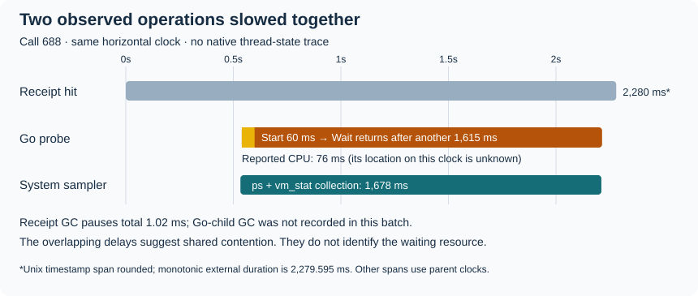

# 16. Resolve the selected Git once

You run `receipt run --timings -- go test -count=1 ./...` on a Mac. Your `PATH`
selects `/usr/bin/git`. That program is Apple's launcher: it finds the Git inside
the active developer tools, then starts it. Receipt needs Git twice on a hit:
once to find the root for configuration, and once to list files for hashing.
Previously both calls went through that launcher.

On 18 October 2026 we changed `run` and `explain` to choose discovery's Git once
per invocation. If the selected path is exactly `/usr/bin/git` on macOS, Receipt
asks `/usr/bin/xcrun --find git` for the developer Git and calls that path directly.
[Apple describes the launchers and developer-tool selection here](https://developer.apple.com/library/archive/technotes/tn2339/_index.html).
A custom Git or wrapper selected through `PATH` keeps its selected path.

## Follow one hit, then a miss

Follow the arrows in execution order. The resolver finds a program, while the
later Git commands observe the repository. These are different kinds of reuse.

```text
Before, with Apple's launcher:
settings -> /usr/bin/git -> selected Git -> root
inputs   -> /usr/bin/git -> selected Git -> fresh file list -> hash -> replay

After, in one invocation:
PATH lookup -> /usr/bin/git? -> xcrun --find git -> keep selected path
             custom path? --------------------> keep custom path
settings -> kept path -> root
inputs   -> kept path -> fresh file list -> hash -> replay

If tests execute:
execute user command -> kept path -> fresh root -> fresh file list -> hash
                     -> compare keys -> store only when stable
Next invocation -> select again
```

The root and file list still come from real Git commands. If tests create a
nested repository, the final scan must discover that changed root; keeping the
program's path does not authorize keeping its old answers. The command the user
asked Receipt to execute still goes through the normal runner. `--bypass` skips
selection entirely. Cache-management commands and standalone fingerprint callers
retain their existing behavior unless they explicitly attach a selection.

## Keep the user's choice

The guard in
[`developerGit`](https://github.com/sidsharma96/receipt/blob/main/internal/fingerprint/git.go#L38-L45):

```go
if platform != "darwin" || selected != "/usr/bin/git" {
	return selected
}
b, err := find(ctx)
if err != nil {
	return selected
}
```

`selected` is the path found by Go's ordinary `PATH` search. The exact comparison
matters: `/custom/bin/git` might be a script that sets configuration or checks
permissions before calling Git. Receipt must run that script. It also keeps a
custom symlink's spelling rather than following it to decide whether to bypass it.
On other operating systems there is no Apple resolution step.

For the eligible launcher, Receipt uses the system `xcrun`, rather than another
program named `xcrun` found through `PATH`. It inherits the existing environment,
including `DEVELOPER_DIR`, so an explicit developer-directory selection is honored.
It checks that the answer is an absolute executable path. A failed lookup or an
unusable answer keeps the original launcher; it does not pick another installed
Git. If that launcher then fails, the existing discovery error behavior applies.
Cancellation still reaches subprocesses. No global environment variable changes.

The small value kept in the context is a path string and any initial lookup error.
A context carries invocation settings and cancellation through related calls.
It is not a process-wide cache: another call to the CLI selects again. Within an
invocation, the chosen path is fixed, but executable bytes can still be replaced.
Changing the active developer tools while a test is running is outside the stable
selection assumption. We do not pin an open executable or create a filesystem
snapshot.

## Call that path without changing recorded inputs

The launch boundary in
[`commandOutput`](https://github.com/sidsharma96/receipt/blob/main/internal/fingerprint/manifest.go#L78-L95):

```go
c := exec.CommandContext(ctx, path, args[1:]...)
c.Args[0] = args[0]
c.Dir = dir
b, err := c.Output()
```

`path` names the selected program. The argument list retains the original `git`
name and its flags, and `dir` remains the requested working directory. Git's
configuration and environment still apply. Selection is not serialized into the
manifest: the root, files, environment hashes, command executable identity,
probes and key format are unchanged.

Differential tests compare the full manifests and keys with and without selection,
from the repository root and a nested directory. Their fixture includes deleted
tracked files, ignored and extra inputs, spaces and a newline in filenames.
Existing CLI tests also preserve the custom wrapper's root/list call counts and
refuse storage after tests create a nested repository. The measured new binary
replayed entries created by the old binary, with equal full keys before and after
all measurements. Compatible keys establish input encoding compatibility; they
do not establish deterministic test output.

## Measure the resolver too

The earlier investigation called a preselected path. This experiment compares
actual old and new production binaries, including selection on every invocation.
The new `git_selection` timing span includes `PATH` lookup and, on this machine,
`xcrun`. It is inside total Receipt duration but outside fingerprint/discovery.
Do not add nested timing spans together or count just the faster file-list call.

| Warm hit, arithmetic means | Before | After | Saving |
| --- | ---: | ---: | ---: |
| Go elapsed | 103.04 ms | 91.70 ms | 11.34 ms (11.0%) |
| Go process-tree CPU | 97.20 ms | 88.02 ms | 9.18 ms |
| Go peak RSS | 17.641 MB | 17.717 MB | **increased 0.076 MB** |
| Generic elapsed | 57.56 ms | 44.06 ms | 13.50 ms (23.5%) |
| Generic process-tree CPU | 52.39 ms | 42.98 ms | 9.41 ms |
| Generic peak RSS | 17.599 MB | 17.714 MB | **increased 0.116 MB** |

The resolver cost about 11.00 ms on Go hits and 11.34 ms on generic hits.
It consumes part of the savings from bypassing two launcher resolutions. Initial
file-list discovery alone fell 17.72 to 7.25 ms for Go; that single stage is not
the whole optimization. We measured a latency/CPU improvement, not a RAM saving.

A CPU millisecond is time the process tree spent executing on CPUs; elapsed time
also includes waiting. Peak RSS is the operating system's maximum resident-memory
report from `/usr/bin/time -l`, not total allocations or simultaneous memory summed
across every process. Smaller startup work does not imply a proportional peak-RAM
reduction.

The experiment used three blocks of balanced randomized ABBA/BAAB quartets:
old/new/new/old or its reverse. Averaging the two observations of each binary
reduces a steadily changing background load's effect. A separate old/old control
measures noise when there is no code difference. All 600 measured calls were
hits, and no outlier was removed. The fixture held 256 files of 4 KiB plus a tiny
Go test; caches and binaries were outside the repository. These are warm local
measurements on one Apple M1, not cold-disk or fleet-wide capacity results.

The 95% resampling intervals for mean elapsed savings were 9.03–14.02 ms for Go
and 9.76–19.09 ms for generic. We resampled groups of five neighboring quartets
within their blocks to retain some short-term dependence. These intervals describe
this run under that statistical model; they do not cover every source of system
noise. The old/old elapsed difference was −2.36 ms, with an interval −6.88 to
1.63 ms that includes zero. It is a useful noise check, not a correction to
subtract from the main result. Every block showed a positive old/new saving.
The largest individual new Go hit still took 292.60 ms. Routine savings do not
prove that rare startup delays or non-Git waits have disappeared.

The [measurement record](../MEASUREMENTS.md#invocation-local-git-selection-18-october-2026)
contains intervals, controls, raw records and reproduction commands. The
[nine-question review](../PHASE-REVIEWS.md#selected-git-resolution-18-october-2026)
records verification and remaining cases.

## Why stop at selecting the executable?

Caching Git's file list could save another process, but tests or another editor
can create files. Keeping that answer would hide new inputs. Caching runtime
probe output has a similar freshness problem. Neither follows from this change.
A permanently saved developer path would avoid resolution cost on later runs,
but could ignore a changed developer directory. A hardcoded Xcode path would also
break users of the standalone Command Line Tools or another Xcode installation.

One selection per invocation fits the two Git calls on a hit and four on a miss
without retaining repository observations. Revisit it if Apple's launcher changes
semantics, a supported user selection produces different output, resolution cost
outgrows the saved startup work, or callers need to change tools within an
invocation. Go probes and hashing still have their own variable costs; this is
not a fix for every 300 ms outlier.

## What the next Go investigation found

On 19 October, we looked inside `go env -json`. Before it returns the compiler
flags, Go asks the C compiler about itself. On this Mac that starts
`/usr/bin/clang`. A cache is meant to let later Go processes reuse the compiler
identity after checking whether the compiler file changed.

Follow this illustrative record through Go's actual format. NUL means a zero
byte separating fields; `stat description` stands for recorded file metadata.

```text
Writer: filename NUL stat description NUL compiler-ID bytes
Reader removes compiler-ID bytes:
        filename NUL stat description NUL
Reader splits at every NUL:
        [ filename, stat description, empty field ]
Three fields → cannot form pairs → reject cache → start Clang again
```

[Go's reader](https://go.dev/src/cmd/go/internal/work/exec.go#L2722) uses
`strings.Split`, which retains that final empty field. Its following
`len(stats)%2 != 0` check rejects the odd count. We observed that exact three-field
rejection on consecutive warm calls. This matches the already reported
[Go issue 81553](https://github.com/golang/go/issues/81553), which also describes
advancing one field instead of two when validating several filename/stat pairs.
This is Go's compiler cache, a different store from Receipt's saved test results.

An isolated diagnostic build removed the trailing separator before splitting
and advanced by pairs. In 60 randomized pairs, standalone `go env` averaged
29.30 → 11.54 ms elapsed and 27.46 → 9.73 ms process-tree CPU. Reported peak RSS
averaged 16.722 → 16.042 MB. The original started one compiler child every time;
the experiment started none. All settings matched after the recognized temporary
scratch suffix was normalized. These are rebuilt diagnostic Go binaries with
one warm isolated build cache, not a production Receipt benchmark.

We also obtained a valid **Go runtime trace**. In its 54.24 ms specimen, Go spent
about 28.18 ms in the system call that waits for the compiler child to finish.
That explains what Go was waiting for in that call. It does not tell us whether
Clang was doing work or waiting on the OS. Runtime tracing begins at main and
cannot explain earlier process startup. The OS recorder still crashed while
saving, so it supplies no verified thread-state evidence.

A separate 1,200-call diagnostic hunt peaked at 106.52 ms; no call reached its
200 ms threshold. That call combined 33.84 ms before the first marker and
52.44 ms around the compiler child. Its GC pauses were only 0.070 ms. We have
identified repeated work and a concrete waiting dependency, **not reproduced
or explained the original 300 ms event**.

The parser change is an experiment in an isolated Go copy. It is not installed
and Receipt's fresh probe is unchanged. A correct toolchain fix must also handle
changed compilers, malformed cache data and developer-tool selection; matching
settings on one stable setup does not prove those cases. The
[measurement record](../MEASUREMENTS.md#inside-the-go-environment-probe-19-october-2026)
contains the reproducible tools, raw metrics and remaining limits, with a
[full review](../PHASE-REVIEWS.md#go-probe-localization-19-october-2026).

## A longer local run reproduced the stalls

In a later run on 19 October, call 688 spent **1,675 ms** inside the Go probe,
while the OS reported **75.588 ms of CPU time** for that child. CPU time counts
execution on processors; elapsed time also includes waiting and delays before
the parent can observe completion. This difference is evidence of a delay, not
an exact stopwatch for a particular OS wait.

Follow the two lanes below. Receipt starts Go, its Start call returns after
60 ms, and Wait returns another 1,615 ms later. Separately, the machine sampler
needs 1,678 ms to collect process and memory counters over almost the same
interval. Neither lane records the native thread's reason for waiting.



The text equivalent is: the whole hit took 2,280 ms; the Go probe occupied about
539–2,214 ms of that interval, and the system sample occupied about 533–2,211 ms.
Receipt's recorded garbage-collection pauses totaled 1.02 ms. That cannot explain
this hit's long delay. **Go-child GC was not recorded in this batch**; the earlier
Go runtime trace remains separate evidence from a different, shorter call.

### Why run thousands of calls?

We ran the current Receipt hit path 5,000 times locally with stock Go, in five
blocks of 1,000. Each call used the same small Go fixture and already saved test
result. Five warmups preceded each block; two seconds separated blocks. The
fixed plan kept going after outliers instead of stopping at the first one.

| Block | Go median, ms | Go maximum, ms | Go calls ≥200 ms |
| --- | ---: | ---: | ---: |
| 1 | 48.51 | 1,675.04 | 7 |
| 2 | 34.23 | 160.27 | 0 |
| 3 | 33.75 | 65.16 | 0 |
| 4 | 33.87 | 148.09 | 0 |
| 5 | 38.78 | 135.44 | 0 |

All seven ≥200 ms probes occurred within 15 seconds, at zero-based indices
666–727; three exceeded 300 ms. The last 4,000 had none. Thus “one stall per
1,000 calls” is not a dependable schedule: machine conditions can produce a
burst, then a long quiet period. The observed 7/5,000 fraction describes this
session, not a stable probability for another machine or tomorrow's run.

The whole-hit mean was 103.48 ms, with median 89.95 ms. Go's median reported CPU
was 33.695 ms and median peak resident memory was 16.01 MB; the largest stall
reported 16.24 MB. Resident memory means pages held in RAM, not all memory ever
allocated. These are descriptive costs, **not a before/after optimization**.
Every call replayed a hit; stock and diagnostic full keys matched before and
after. No new production optimization or Go patch was installed.

### What the slow calls had in common

The largest call also slowed Git selection, Git commands and executable hashing.
For example, executable hashing took 220.44 ms against a session median of
6.27 ms, and file listing took 97.43 ms against 5.78 ms. The problem is broader
than one extra computation in Go. Parent-observed child intervals include
parent scheduling and output-copy completion, so they do not isolate Go's
startup instructions alone.

The overlapping memory snapshots show the OS compressing and decompressing many
pages. Compression packs memory contents into less RAM; decompression restores
them before use. Between two snapshots roughly 2.71 seconds apart around the
largest event, the counters increased by 145,141 compressions and 187,074
decompressions, plus 220 swap-ins. A swap-in brings a page back from swap storage.
These are **machine-wide cumulative work counts**, not Go's allocations or the
amount of RAM held at once. A page may be processed repeatedly.

This makes shared machine contention a stronger lead: several operations slowed
while memory and background applications were active. It does **not** identify
which application or resource caused the stall. The fifth block also had
substantial compression without a ≥200 ms Go probe. Five of seven slow probes
had the usual 65 major-fault counter, and their involuntary context switches
ranged from 235 to 799. Neither counter supplies a universal signature. A context
switch records the OS moving execution between tasks, not how long a task waited.

### What would distinguish the remaining explanations?

The next comparison should repeat the same workload during a quiet desktop
period and interleave sampler-on/off blocks. That separates a possible observer
effect—measurement changing the workload—from changes in ordinary background
activity. Keep the fresh Go probe and tool selection unchanged. A droplet run
would test a different OS and toolchain context; it would not explain this Mac's
specific wait.

The sampler targeted one-second intervals but normally took 34 ms to collect
and once took 1,678 ms. It has gaps and adds work; it is not an OS scheduler trace.
To distinguish “Go could run but was not scheduled” from “Go or its compiler was
waiting for a resource,” we still need native thread-state evidence for a matching
stall. The earlier Instruments save crash remains unresolved. We have reproduced
the same class of delay and narrowed its surroundings, not recovered the cause
of the historical call. Fixing Go's repeated compiler probe may reduce ordinary
cost, but this run does not prove it would remove the long waits.

The [measurement record](../MEASUREMENTS.md#five-thousand-local-receipt-hits-19-october-2026)
contains all compact call metrics, reproduction commands and observation limits.
The [dated nine-question review](../PHASE-REVIEWS.md#five-thousand-hit-local-stall-hunt-19-october-2026)
records the tooling and verification.

## Check your understanding

<!-- questions:start -->

### Does selecting Git once keep its old file list?

**Level:** Newcomer

Tests create a new file. Does keeping the selected Git path let Receipt reuse
the pre-test file list?

<details>
<summary>Answer</summary>

No. The saved value identifies the program to run. After execution Receipt asks
that program for the root and file list again, then reads and hashes the inputs.
A new invocation chooses its program again too.

**Learn more:** [16. Resolve the selected Git once](../guide/16-resolve-selected-git.md)

</details>

### Which Git paths may bypass the Apple launcher?

**Level:** Practitioner

Your PATH selects `/custom/bin/git`, a wrapper around Apple's Git. Should Receipt
follow that wrapper to choose a faster executable?

<details>
<summary>Answer</summary>

No. The wrapper may implement user behavior. Only the exact selected path
`/usr/bin/git` on macOS is eligible for system xcrun resolution. Other selected
paths, including custom symlinks, keep their spelling and behavior. Resolver
failure retains the original launcher.

**Learn more:** [16. Resolve the selected Git once](../guide/16-resolve-selected-git.md)

</details>

### Which cache rejected the compiler record?

**Level:** Practitioner

The Go investigation found a filename, a stat description and an empty third
field after splitting a record. Which cache was involved, and why did Go start
Clang again?

<details>
<summary>Answer</summary>

It was Go's compiler-identity cache, not Receipt's saved test-result cache. The
writer's final NUL separator made strings.Split retain an empty field. The reader
expected filename/stat pairs, rejected the odd count and queried Clang again.
The diagnostic correction demonstrated the repeated-work cause on a stable
fixture; it did not reproduce or explain the earlier 300 ms event.

**Learn more:** [What the next Go investigation found](../guide/16-resolve-selected-git.md#what-the-next-go-investigation-found)

</details>

### Does a faster mean prove startup outliers are fixed?

**Level:** Expert

The new binary has a lower mean latency with a positive savings interval. Does
that establish that the rare 300 ms delay cannot happen again?

<details>
<summary>Answer</summary>

No. The controlled run estimates routine warm-hit cost on one host. A confidence
interval from those observations does not bound every scheduler, filesystem or
probe delay. The new binary still had slow hits. Diagnosing a particular rare
wait requires evidence covering that call's stage and time interval; mean savings
do not identify its kernel cause.

**Learn more:** [16. Resolve the selected Git once](../guide/16-resolve-selected-git.md)

</details>

### Do overlapping delays prove the same cause?

**Level:** Expert

A Go probe takes 1.675 seconds and a separate system sample takes 1.678 seconds
over nearly the same interval. Memory-compression counters also increase.
Have we proved that compression caused Go to wait?

<details>
<summary>Answer</summary>

No. The overlap suggests shared machine contention, but neither clock records
the native thread's waiting reason. The counters are machine-wide and span a
wider snapshot interval; the sampler itself adds work. A quiet-period comparison
with interleaved sampler-on/off blocks can test the association and observer
cost. A matching native thread-state trace is needed to identify the wait.

**Learn more:** [A longer local run reproduced the stalls](../guide/16-resolve-selected-git.md#a-longer-local-run-reproduced-the-stalls)

</details>

<!-- questions:end -->
