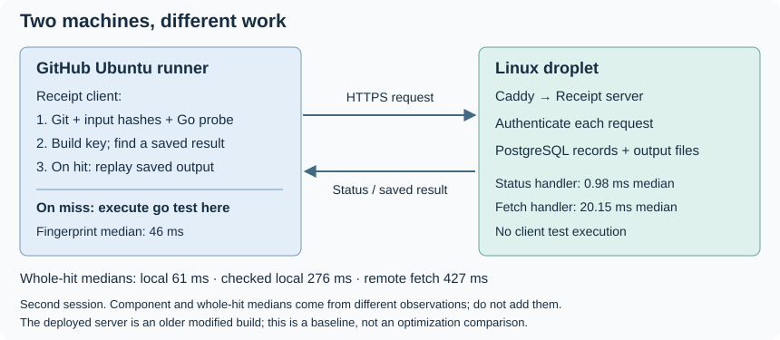

# 17. Measure the Linux client and cache server

Current follow-up: [Chapter 18](18-trace-go-http.md) now traces Receipt’s actual
Go HTTP client and matches 60 requests to exact server log entries. It separates
connection setup, body transfer and validation, and identifies DNS tail delays.
The measurements below remain the earlier baseline, not a speedup comparison.

GitHub starts an Ubuntu runner—a temporary Linux machine—for our test job.
That runner builds Receipt and
launches `receipt run --remote https://receipt.sidsharma.dev -- go test -count=1 ./...`.
Receipt reads the checkout, hashes its inputs and checks Go's settings **on the
runner**. It then asks the droplet, our rented cache-server machine, for a saved
result. On a miss, the runner executes Go tests; on a hit, it prints saved output instead.

The binary has the same division of work when launched from a laptop. The
`--remote` option chooses where to ask for saved results, not where to execute
the command. The droplet runs `receipt serve`: it authenticates requests, queries
PostgreSQL and reads or writes output files. Remote execution is not implemented.

Follow the request arrow to the server and the result arrow back. Notice that
Go tests stay on the left when there is a miss.



Text equivalent: the runner collects inputs and builds a key, sends an HTTPS
lookup to the droplet, then replays a hit locally. If no usable result is
available, it runs the tests locally. The droplet stores reported successes;
it does not receive the test command for execution.

The launch comes from [`subprocess.run` in self_test.main](https://github.com/sidsharma96/receipt/blob/main/deploy/ci/self_test.py#L82-L86):

```python
        args = [CLIENT, 'run', '--cache-dir', str(HOME / 'receipt')]
        if ready:
            args += ['--remote', REMOTE]
        started = time.monotonic()
        result = subprocess.run(args + ['--'] + COMMAND, cwd=ROOT, env=env)
```

CLIENT is the binary built on the GitHub runner. ROOT is its checkout directory,
and COMMAND is `go test -count=1 ./...`. Adding the server URL changes the cache
lookup; subprocess.run still starts Receipt in that runner's directory. Our
workflow also keeps a separate job that always runs tests with PostgreSQL and
race detection. A cache hit is not the only correctness check.

## Measure three different kinds of hit

A fresh CI runner normally has no local Receipt entry. To understand that case
without confusing it with a repeated local invocation, the new manual workflow
measured three paths separately on two disposable GitHub Ubuntu runners:

| Hit path | What it does | Runner 1 median | Runner 2 median |
| --- | --- | ---: | ---: |
| Local | Read the local result; no shared server configured | 59 ms | 61 ms |
| Checked local | Read local result; ask the shared server whether it is quarantined | 194 ms | 276 ms |
| Remote fetch | Start with an empty local cache; fetch and save the shared result | 295 ms | 427 ms |

A median is the middle duration after sorting the measurements. It describes a
typical call without letting a few very slow calls dominate the number. In the
table, “quarantined” means a key has conflicting reported results and must not
be reused, even if this runner still has a local copy.

Each runner recorded 300 local hits, 60 checked-local hits and 30 remote fetches,
in three blocks with a rotating case order. All **780 measured calls** were
successful hits, without an execution stage. The same existing CI helper prepared
the checkout, dependencies and environment; this was not the small Mac fixture.
Preparation, warmups and separate diagnostics are outside those counts.

The capture uses the pinned Linux Go tools and settings from our cached CI.
The Mac investigation used a different toolchain setup; exact versions and
configuration are in the measurement reference.
Here the Go toolchain-probe stage's median was about **5–6 ms**, and its maximum
stayed below 9 ms across both sessions. This does not establish that Linux can never stall;
it does show that the Mac's long Go waits are not the current measured bottleneck.

## Separate collecting inputs from reaching the server

The client spent about 45–46 ms in fingerprinting, the stage that describes the
current inputs. Reading and hashing declared files took about 28 ms; hashing the
Go executable took about 9 ms; Git discovery took about 3 ms. These are measured
stage durations, not CPU samples of individual functions.

This workload includes all nonignored repository files plus explicitly declared
external inputs. At the measured revisions, committed files occupied about
15.45 MB, including 14.85 MB of documentation. The dependency directory and
client binary are additional inputs, and the Go executable is hashed separately.
We must not simply stop hashing documentation or binaries to improve a number:
that would change which input changes invalidate a result and needs its own
correctness decision.

Local-hit median CPU for Receipt and its child programs was about 62–64 ms,
with reported peak resident memory about 14.7 MB. CPU time adds execution across processors, so it can exceed
the roughly 59–61 ms elapsed time on a two-CPU runner. Remote fetches used about
86–89 ms CPU and 16.4 MB peak resident memory. These are OS process-accounting
measurements, not hardware cycles, allocation totals or a sum of every process's
simultaneous RAM.

The larger remote delays are mostly outside fingerprinting. In the second
session, a checked-local hit spent about 220 ms in lookup and a remote fetch
about 374 ms. Meanwhile, the droplet's median status handler took **0.98 ms**
and a successful fetch about **20 ms**. These clocks cover different boundaries;
subtracting the middle server duration from the middle client duration would
not isolate network time: those two measurements may describe different requests.
The gap does make connection and transfer costs important to investigate.

Twenty separate curl requests provided a narrower diagnostic. For status,
median time from process request to completed TLS setup was about 136 ms, and
to completed response about 201 ms. For a 57,821-byte fetch response, those
medians were about 137 ms and 351 ms. The response interval after the first byte
was substantial too. TLS is the encrypted connection setup before the HTTP
exchange. curl uses different DNS/TLS code from Go, so this supports the transport
lead without assigning those exact timings to Receipt.

## Check the database before adding indexes

An index helps PostgreSQL locate a matching row without inspecting every row.
We ran actual read-only query plans on the droplet for result lookup, status
lookup and authentication. All three used the existing primary-key indexes,
returned one row and needed two shared-buffer hits in those specimens. A buffer
hit means PostgreSQL found a requested data block in its memory cache. These
queries reported no physical block reads; that is a warm-query observation, not
a promise about a first request after restart. Reported query execution times
were about **0.06 ms**.

That is not the full cost of a server request. The program must also transfer
and decode metadata—the saved description of inputs and results—verify output
and encode its response. The observed fetch
handlers took about 20–23 ms, even though measured SQL spans were around 1 ms
and output-file spans around 0.1 ms. The remaining handler work needs a matching
CPU profile before attributing it to a specific function. An extra index would
not remove connection setup, metadata decoding or response transfer.

There is also a deployment boundary: the server reports an older base revision
with `modified=true`, and its schema lacks the storage-accounting table in current
source. The embedded revision cannot identify its exact source tree. We measured
that deployed binary as it stood; we did not replace it. Before claiming a new
server optimization helps production, establish which build is deployed and
compare the intended versions explicitly.

## Choose the next work from the path users take

At this baseline stage, the next step was to investigate HTTPS connection setup and result
transfer using tracing inside Receipt's actual HTTP client. Chapters
[18](18-trace-go-http.md) through [22](22-explain-network-latency.md) now record
that follow-up; the current recommendation is in Chapter 22. The local
comparison already shows why another small Go-probe optimization cannot account
for the much larger remote cost. Persistent connections across invocations,
server placement and compression are possible experiments, not implemented
solutions or proven savings.

For client CPU and I/O, profile the input-reading/hash stage and metadata decoding
on this Linux workload. Physical disk-input counters were zero on these warm
runs, but read/stat/open calls still occurred: reading OS-cached bytes is still
work. RAM did not show a problem in this small baseline; it was not a capacity
or memory-pressure test.

Keep the shared-status check and declared-input coverage while investigating.
Skipping the check could replay a quarantined local result; ignoring inputs
could replay a result for changed files. A faster incorrect hit is not a valid
optimization. The next change should demonstrate a benefit on the relevant
Linux path and preserve these policies.

The [measurement reference](../MEASUREMENTS.md#linux-ci-client-and-deployed-cache-baseline-19-october-2026)
contains every call, resources, transport timings, plans, source revisions and
scope limits. The [dated review](../PHASE-REVIEWS.md#linux-ci-and-droplet-baseline-19-october-2026)
records the full nine-question analysis and verification. This chapter adds a
Linux baseline, not a production optimization or deployment.

## Check your understanding

<!-- questions:start -->

### Where does a CI cache miss execute?

**Level:** Newcomer

A GitHub runner launches Receipt with the droplet URL through --remote. No
usable saved result exists. Which machine executes go test?

<details>
<summary>Answer</summary>

The GitHub runner does. --remote selects the shared cache server, not a remote
execution machine. The runner collects inputs, looks up a result and executes
the test command there on a miss. The droplet stores and returns reported results.

**Learn more:** [17. Measure the Linux client and cache server](../guide/17-measure-linux-client-and-server.md)

</details>

### Why can a local copy still incur HTTPS cost?

**Level:** Practitioner

A local result already exists, but Receipt also has a shared remote configured.
Can it skip the network request just because those output bytes are on disk?

<details>
<summary>Answer</summary>

No. It checks whether the shared key is quarantined before local replay. Without
that check it could reuse a result other clients have reported as conflicting.
A standalone local hit and a checked-local hit therefore have different costs.

**Learn more:** [17. Measure the Linux client and cache server](../guide/17-measure-linux-client-and-server.md)

</details>

### What does a fast indexed plan fail to measure?

**Level:** Expert

The droplet shows an indexed result lookup around 0.06 ms, but the remote-fetch
client takes hundreds of milliseconds. Does another database index solve that gap?

<details>
<summary>Answer</summary>

The plan covers PostgreSQL execution for that query and selected row; it does
not cover the full HTTP connection, metadata processing or result transfer.
The current point lookups already use primary-key indexes. Measure the other
boundaries before changing indexes; the tiny warm dataset does not establish
large-table or high-concurrency performance.

**Learn more:** [17. Measure the Linux client and cache server](../guide/17-measure-linux-client-and-server.md)

</details>

<!-- questions:end -->
