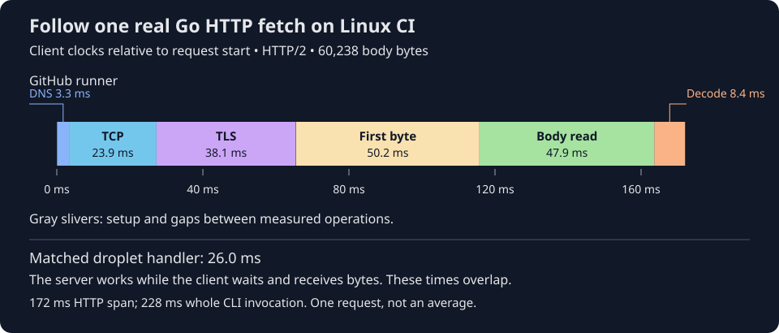

# 18. Trace the actual Go HTTP client

A GitHub runner starts Receipt with an empty local cache. Receipt builds the
input key, then asks the droplet for a saved result. In one measured fetch,
the HTTP part took **172 ms** and the entire CLI invocation took **228 ms**.
The droplet's matching handler took **26 ms**. Where did the rest go?

Follow the colored client timeline. DNS finds the server's address. TCP opens a
connection. TLS establishes encryption and verifies the server's certificate.
Receipt sends the request, waits for the first response byte, reads the saved
result and validates it. These are actual clocks from one Go request, not curl
estimates or a sum of unrelated averages.



Text equivalent: this request spent 3.3 ms resolving DNS, 23.9 ms connecting,
38.1 ms on TLS, 50.2 ms from request written to first response byte, 47.9 ms
reading the body and 8.4 ms decoding it. Small setup gaps complete the 172 ms
HTTP span. The body contained 60,238 bytes. The matching 26 ms server duration
overlaps the client's waiting and receiving; **do not add it** to the timeline.

This investigation adds diagnostic tools and evidence. It does not implement a
production speedup or change the deployed service. [Chapter 17](17-measure-linux-client-and-server.md)
explains where the runner and server execute and preserves the earlier baseline.

## Trace the client we actually use

Receipt already uses Go's HTTP client. In
[`Remote.requestPath`](https://github.com/sidsharma96/receipt/blob/main/internal/cache/http.go#L33-L59):

```go
	c := r.Client
	if c == nil {
		c = &http.Client{Timeout: 10 * time.Second, CheckRedirect: func(*http.Request, []*http.Request) error { return http.ErrUseLastResponse }}
	}
	return c.Do(req)
```

If no client was supplied, Receipt creates one with a ten-second deadline and
refuses redirects. Its transport is Go's default transport, which handles
connections and TLS. A transport can retain a connection for later requests
**within the same process**. It cannot keep that connection usable after the
CLI exits. All 60 traced invocations here used HTTP/2 and reported a fresh,
unreused connection. Merely keeping one http.Client in a variable would not
share connections across independent invocations.

We used a **build overlay**: Go compiled a temporary replacement of http.go into
a separate diagnostic binary. The normal source and stock binary stayed intact.
The replacement attached [httptrace callbacks](https://pkg.go.dev/net/http/httptrace)
to the existing request context. A callback is a function Go calls when a
particular event occurs, such as completing DNS or receiving the first header
byte. It records a clock without replacing authentication, certificate checking,
timeouts, redirects or the transport.

Go can call these callbacks from different goroutines, which are concurrent
units of execution. The diagnostic collector uses a mutex so only one callback
changes its event slice at a time. The slice is capped at 64 events per request.
It does not record addresses, request headers, tokens, keys or response bodies.
It keeps a format-checked server request ID so we can join the response to its
exact droplet log entry. [The diagnostic fragment](https://github.com/sidsharma96/receipt/blob/main/scripts/profile/http_trace.go.inc)
and [overlay builder](https://github.com/sidsharma96/receipt/blob/main/scripts/profile/http_trace.py)
are outside production packages.

Receiving headers does not mean receiving the complete result. The ordinary
[`Remote.Get`](https://github.com/sidsharma96/receipt/blob/main/internal/cache/http.go#L62-L86):

```go
	b, e := io.ReadAll(io.LimitReader(resp.Body, MaxEntryBytes+1))
	if e != nil {
		return v, e
	}
	v, e = Decode(b)
```

ReadAll collects response bytes, subject to the existing size limit. It can wait
for more bytes. Decode checks the saved result's structure and integrity after
the bytes are available. The overlay places separate clocks around these calls.
It records body bytes returned by net/http, which are not necessarily wire bytes
if transport decompression occurs. We did not measure compression or packets.

## What the Linux measurements show

The manual [workflow run](https://github.com/sidsharma96/receipt/actions/runs/39372867217)
used Ubuntu 24.04, image 20261012.334.1 and Go 1.22.12 linux/amd64. After preparing
the existing self-CI workload, it alternated ordinary and diagnostic builds in
three blocks. Each block measured ten checked-local and ten remote-fetch hits
per build, with one excluded warmup per build/case. That is **120 measured hits**:
30 per build/path, with no failed hit, fallback test execution or removed outlier.
Every remote fetch began with an empty local cache outside the checkout.

| Actual Go phase, median | Checked local: status request | Remote fetch: saved result |
| --- | ---: | ---: |
| DNS | 2.20 ms | 2.12 ms |
| TCP connection | 24.05 ms | 23.99 ms |
| TLS handshake | 38.22 ms | 38.64 ms |
| Request written → first response byte | 25.83 ms | 49.03 ms |
| Read response body | No body | 47.84 ms |
| Decode and validate saved result | Already read locally, outside HTTP | 8.74 ms |
| Full HTTP span through body close | 91.42 ms | 171.45 ms |
| Exact matching server handler | 1.06 ms | 24.85 ms |

These are medians of individual spans; they are not additive. A phase includes
whatever CPU work and waiting happens inside its boundaries. TLS, for example,
includes cryptographic/certificate work as well as network exchange. First-byte
waiting includes server work, proxies and network travel. Body reading includes
transfer, buffering and client processing. These clocks alone do not establish
TCP congestion, packet loss or an HTTP/2 flow-control cause.

All 60 traced request IDs matched read-only droplet logs. The server stayed on
the same PID, process-start identity and binary hash. It is still the older
modified build recorded in Chapter 17; we did not redeploy it. For these exact
fetches, median logged SQL time was 1.09 ms, authentication 0.67 ms and file work
0.10 ms. Those do not account for the entire handler; uninstrumented encoding
and writing remain possibilities, not measured explanations. The earlier tiny,
warm point-query plans already used primary-key indexes. This evidence does
not support adding an index to fix the transport cost.

The HTTP span also excludes other client work. Checked-local lookup spent a
median 8.81 ms outside that span, including reading/validating its local entry
before asking shared status. Remote-fetch lookup spent 2.40 ms outside it,
including local publication after Get returns and diagnostic output. These are
residual intervals, not isolated function profiles. Fingerprinting remained
about 46 ms for both paths.

## A concrete source of variance: DNS

Of the 60 traced calls, **six DNS lookups exceeded 50 ms**. Five were status
requests and one was a fetch. Status DNS had a 2.20 ms median but an 85.56 ms
maximum; fetch DNS reached 72.51 ms. TCP and TLS were much steadier in this run.
That identifies a varying boundary. It does not prove which resolver, queue,
packet retry or scheduling event caused the DNS delay.

The earlier separate curl run had roughly 64 ms TCP connection time; this Go
run had roughly 24 ms. Different jobs can receive different network paths or
placement. We did not record enough topology to distinguish those explanations.
We also changed diagnostic repository inputs between experiments. Therefore
**228 ms here versus 427 ms earlier is not a product speedup**. The useful
comparison is the adjacent stock/traced calls on this runner.

## What tracing itself costs

| Whole CLI, 30 calls per row | Median latency | Mean CPU time | Mean reported peak RAM |
| --- | ---: | ---: | ---: |
| Stock checked-local | 153.30 ms | 82.86 ms | 16.26 MB |
| Traced checked-local | 154.45 ms | 83.48 ms | 16.33 MB |
| Stock remote-fetch | 228.79 ms | 87.23 ms | 16.49 MB |
| Traced remote-fetch | 228.35 ms | 88.21 ms | 16.55 MB |

CPU time sums user/system work of the CLI and its children, not CPU cycles or
pure network time. RAM is GNU time's per-invocation peak resident-set report,
converted to decimal MB, not retained heap size. Both builds ran under GNU time
and Receipt's stage timer, so their shared observer cost is not calibrated here.

For each adjacent pair, subtracting stock from traced gave median latency
differences of +0.96 ms checked-local and +1.18 ms fetch. Mean CPU differences
were +0.61 and +0.98 ms, and mean peak-RAM differences were +0.069 and +0.063 MB.
The fetch's slightly lower traced marginal median is not evidence of negative
overhead: paired differences and independent medians describe different things.
Pairwise latency differences ranged from −72 to +83 ms for status and −62 to
+43 ms for fetch. Network variation prevents treating those deltas as a precise
instrumentation tax. Linux reported zero input blocks for every measured call,
with 120 output blocks per checked hit and 240 per fetch. These are OS-accounted
block operations, not counts of file opens or physical disk transactions.

## Why the keys still match

The self-CI configuration explicitly hashes `/tmp/receipt-self-client`, the stock
Receipt binary. Replacing that declared file with the traced binary would
correctly change the key. Instead, the experiment keeps that input unchanged and
launches the diagnostic binary from a separate temporary directory. The test
command, checkout, environment and all declared inputs stay fixed.

Both builds produced the same full 64-character key before and after all calls:

```text
18cedbe1ebeada55f7c2dde23c3af322289e03ca57850a1ec05659d733f5d114
```

All 120 calls replayed the same stdout hash and exited successfully. Cache-package
race tests ran against the overlay on Linux; additional diagnostic tests checked
body preservation, authorization, concurrent bounded events and connection reuse
within one process. This establishes compatibility for this declared fixture.
It does not permit ignoring a changed production dependency, prove identical
outputs for every future input, or establish deterministic test execution.

## What to focus on next

First investigate **the cost of a fresh HTTPS exchange and response transfer**
under controlled placement. Connection setup recurs on every CLI invocation,
and body transfer is a larger fetch span than decoding in this workload. A
controlled compression experiment could test whether fewer transferred bytes
help; a placement comparison could test whether a shorter network path helps.
Neither saving is implemented or guaranteed. Keep certificate checks,
authentication and the shared quarantine check intact.

A persistent local client could reuse connections, but introduces a long-lived
process, credential lifecycle, cancellation and failure-recovery policy. Creating
another client object or tuning a pool inside a process that immediately exits
cannot achieve cross-invocation reuse. Revisit persistence only if repeated
invocations justify those costs. Revisit DNS with resolver/packet evidence if
its tail matters to the target latency. Revisit Decode with CPU profiles if its
roughly 9 ms cost or larger payloads become material. Measure the server's
remaining handler work before changing its implementation.

The [measurement reference](../MEASUREMENTS.md#go-http-tracing-results-19-october-2026)
links raw numeric evidence and the [nine-question review](../PHASE-REVIEWS.md#actual-go-http-trace-19-october-2026)
records verification and untested failure conditions. This is one warm sequential
Linux job, not a cold-start, concurrency, outage or capacity study.

## Check your understanding

<!-- questions:start -->

### Why does the next CLI invocation need another connection?

**Level:** Newcomer

Receipt fetches a result, exits, then starts again. Can its old Go HTTP connection pool serve the new process?

<details>
<summary>Answer</summary>

No. The pool belongs to that process. When Receipt exits, that process and its connections go away. A new invocation must establish its own connection. Keeping a process alive could allow reuse, but it would add lifecycle and security decisions.

**Learn more:** [18. Trace the actual Go HTTP client](../guide/18-trace-go-http.md)

</details>

### Does reading a response body measure JSON validation?

**Level:** Practitioner

The client has received the response headers. It reads the body bytes, then calls Decode. Are those one operation?

<details>
<summary>Answer</summary>

No. Reading may wait for bytes to arrive. Decode then checks the saved result structure, checksums and relationships. Separate boundaries show whether the client waits for transfer or spends time validating bytes already in memory.

**Learn more:** [18. Trace the actual Go HTTP client](../guide/18-trace-go-http.md)

</details>

### Can we add the server handler time to client HTTP phases?

**Level:** Expert

An exact request ID matches a server handler duration to a traced client request. Is the server duration an extra piece to add to DNS, TCP, TLS, first-byte waiting and body reading?

<details>
<summary>Answer</summary>

No. The client waits while the server works, and server writes can overlap client response transfer. Adding both would count overlapping elapsed time twice. Matching IDs identifies the same request, but does not turn two clocks into an additive timeline.

**Learn more:** [18. Trace the actual Go HTTP client](../guide/18-trace-go-http.md)

</details>

<!-- questions:end -->
