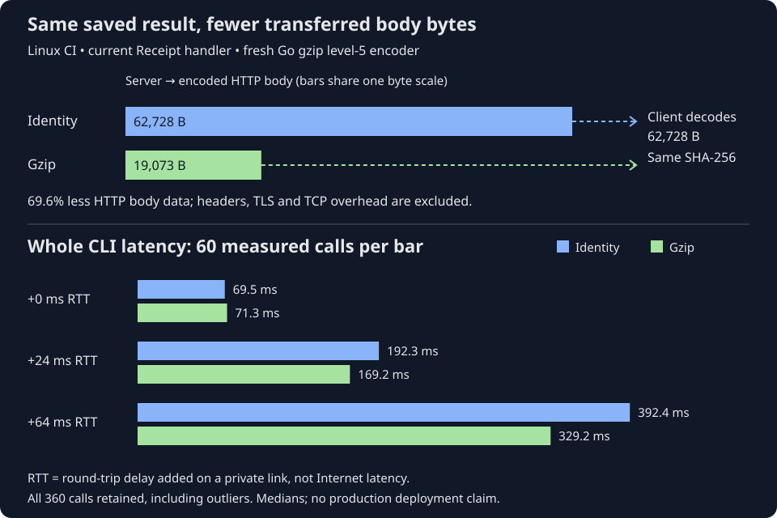

# 19. Compare gzip and uncompressed responses

Actual-deployment follow-up: [Chapter 20](20-test-gzip-on-caddy.md) now compares
the real Caddy/Receipt/PostgreSQL endpoint from Linux CI. Its short network path
shows a large body-byte reduction but a much smaller latency difference and
higher observed Caddy CPU. The temporary profile was restored afterward.

Receipt fetches a saved result over a link with about 24 ms round-trip delay:
a message and its reply need about 24 ms to travel out and back.
Sending its plain response body took 62,728 bytes. Sending the same result with
gzip took 19,073 bytes. The client reconstructed the same original bytes and
validated the same saved result. Median whole-command time fell from **192 ms
to 169 ms**, while the server spent about **1.4 ms more CPU per request**.

That is the tradeoff this chapter measures: do extra computation to send fewer
bytes. Gzip is a lossless compression format, meaning decompression recovers the
original bytes exactly. HTTP calls the uncompressed representation **identity**.
Neither representation changes which test inputs the saved result describes.

Follow both arrows to the client. Different-sized response bodies reconstruct
the same 62,728-byte result. The lower chart shows median whole-command latency,
not a sum of separately measured stages.



Text equivalent: identity sends 62,728 body bytes; gzip sends 19,073, a 69.6%
reduction. Both decode to the same result hash. Without added network delay,
median CLI times were 69.5 ms identity and 71.3 ms gzip. With 24 ms added
round-trip delay, they were 192.3 and 169.2 ms; with 64 ms, 392.4 and 329.2 ms.
All 360 measured calls remain in the evidence, including slow outliers.

This is a controlled Linux CI experiment, not a production deployment. The
live droplet and Caddy configuration are unchanged. [Chapter 18](18-trace-go-http.md)
measured the real Go client's Internet requests; this follow-up isolates the
compression choice under repeatable network conditions.

## Follow the same result through two representations

The experiment starts with the real self-CI result for `go test -count=1 ./...`.
Two temporary HTTPS servers use the same Receipt Disk store and Handler, the
same saved entry, the same certificate and the same server binary. One enables
compression; the other returns identity responses. The client is Receipt's real
HTTP client in a diagnostic build, with its usual size limit and result checks.
Every measured invocation starts a new process and an empty local cache.

The client uses Go's default gzip negotiation: Go asks whether the server can
send gzip. When the server returns gzip, Go decompresses the body as Receipt
reads it. The fixture compresses only successful entry GETs requested with gzip.
Token authorization remains active. The fixture measures empty-cache fetches
only; it does not model production credential lookup or shared quarantine.
Production authorization and quarantine policies are unchanged.

The difference is in the fixture's
[`response.Write`](https://github.com/sidsharma96/receipt/blob/main/scripts/profile/gzipserver/compression.go#L60-L75):

```go
	writer := io.Writer(&w.encoded)
	if w.compressor != nil {
		writer = w.compressor
	}
	n, err := writer.Write(p)
```

Here p contains the ordinary result bytes produced by Receipt. Without a
compressor, writer sends them directly through the encoded-body counter. With a
compressor, writer first packs them into gzip, then the smaller representation
passes through that same counter. The encoder is closed after the handler so
its final compressed bytes and checksum are also counted. Both paths hash the
original bytes. The client independently hashes the bytes after decompression.

The counter measures **HTTP body bytes**, excluding response headers, TLS
records, TCP/IP headers and retransmissions. It does not measure total packets
or billable network traffic. At the client, the normal ReadAll size limit wraps
the decompressed body. A small compressed body does not grant permission to
accept an arbitrarily large decoded result.

## Control the network rather than compare unrelated runners

Both servers run in an isolated Linux network namespace: a separate network
configuration inside the disposable CI machine. A virtual cable called a veth
pair connects that namespace to the client. Linux netem delays packets on each
end of that cable. The runner's Internet connection is not shaped.

We tested 0, 12 and 32 ms added one-way delay, corresponding to roughly 0, 24 and
64 ms added round-trip delay. A round trip is the time for a message to go out
and a reply to come back. Actual median TCP connection spans were about 0.2,
24.2 and 64.2 ms, confirming the intended conditions. There was no bandwidth
cap or configured packet loss. The URL uses a private IP, so this experiment
has no DNS lookup cost.

For each condition, three blocks alternated twenty identity/gzip pairs. Each
variant had two excluded warmups per block and a fresh server process per block.
That gives 60 measured fetches per variant per condition: **360 total**, plus
36 excluded warmups. The order reverses between adjacent pairs. Server ports
are fixed by variant; they are not randomized. Both use the same verified test
certificate, with its public certificate explicitly declared among the inputs.
No certificate verification is disabled.

This setup measures current Receipt's disk-backed handler and standard-library
gzip level 5, allocating a fresh encoder per response. It does **not** reproduce
the deployed PostgreSQL service or Caddy's compression implementation and encoder
reuse policy. A real Internet path can also lose or reorder packets and vary
with placement. Consequently these numbers support a compression candidate,
not a promised production saving.

## When fewer bytes help latency

| Added round-trip delay | Identity median CLI | Gzip median CLI | Median paired gzip minus identity |
| --- | ---: | ---: | ---: |
| 0 ms | 69.49 ms | 71.31 ms | +1.49 ms |
| 24 ms | 192.34 ms | 169.24 ms | −23.08 ms |
| 64 ms | 392.38 ms | 329.19 ms | −63.18 ms |

Read “median” as the middle value after sorting the measurements. A paired
difference compares neighboring calls: for illustration, 170 ms gzip minus
190 ms identity is −20 ms. The negative sign means gzip finished sooner.
Those example numbers explain the calculation; the table contains the measurements. The paired statistic differs from subtracting
the two independent medians; it compares each nearby pair first.

The body-read measurements locate the main difference. At 24 ms added round-trip
delay, median body reading fell from **48.02 to 24.05 ms**. At 64 ms, it fell
from **128.04 to 64.08 ms**. Connection and TLS medians were nearly identical
between variants. The network needs fewer bytes delivered before reading can
finish. The timing pattern is consistent with saving an exchange on the delayed
link, but we did not capture packets to establish congestion-window or flow-control
mechanisms. Validation still took roughly 7 ms for both representations.

With no added delay, transfer itself was already quick. Gzip added computation
and buffering without enough waiting to eliminate. Fewer transferred bytes do
not automatically mean a faster invocation on every network.

## CPU and RAM are part of the price

CPU time measures how long a process and its threads work on CPUs, separately
from waiting. Client CPU here includes the CLI and its child probes. Server CPU
is measured over each twenty-call interval after warmups and divided by twenty;
it includes TLS, handler work, compression, runtime work and diagnostics.

| Added RTT | Client mean CPU, identity → gzip | Server mean CPU per call, identity → gzip |
| --- | ---: | ---: |
| 0 ms | 62.56 → 63.13 ms | 9.36 → 10.90 ms |
| 24 ms | 66.64 → 66.78 ms | 9.85 → 11.25 ms |
| 64 ms | 66.96 → 67.55 ms | 10.30 → 11.42 ms |

In this job the client used about 0.14–0.59 ms more mean CPU and the server about
1.12–1.54 ms more per request. These are observed differences, not CPU-cycle
counts or a calibrated cost for every payload. Both paths also run the same
hashing and diagnostic observers; their common overhead is not calibrated.

Resident RAM is memory currently held in physical RAM for a process. Its peak
is the highest reported value during the run, rather than the sum of all
temporary memory requests. Client mean reported peak resident RAM stayed around 16.5 MB. Server peak RAM
averaged roughly 15 MB across three fresh processes per variant/condition.
Gzip's server readings were slightly lower, despite its encoder buffers. That
is not evidence that compression saves memory: peak resident pages are different
from allocations or retained heap, and there are only three server peaks per
condition. The exact numbers and accounting boundaries are in the
[measurement reference](../MEASUREMENTS.md#gzip-comparison-results-20-october-2026).

## Keep the outliers visible

Four calls had 73–361 ms inside cache lookup but outside the measured HTTP span.
For example, an identity invocation with no added delay took 461 ms, while its
HTTP span took only 21 ms. Its cache lookup had another 361 ms outside that span.
The remainder includes local cache access/publication and diagnostic work; we
have not traced which exact operation waited. A syscall or function trace is
needed before assigning the delay to file synchronization or any other cause.

Those calls remain in every mean, percentile and paired comparison. At zero
added delay, identity's mean was 81.56 ms versus gzip's 71.27 ms, but its median
was 69.49 ms versus gzip's 71.31 ms. Calling that a ten-millisecond compression
win would mistake unevenly distributed lookup stalls for transfer savings.
At 24 ms, one gzip outlier likewise reduced the apparent mean saving. At 64 ms,
all three block mean paired differences were close to a 63 ms saving. Three
blocks on one runner still do not characterize all future CI machines.

## Prove compatibility at both boundaries

Both representations reconstructed the same 62,728 bytes, with SHA-256:

```text
c8c667503eacca2f81b830b49f751cedd5d8cdbe65a35ea6d0d677a714d99031
```

Every response passed normal Receipt validation and replayed the same stdout
hash with exit code zero. All four stock/traced keys, before/after the complete
experiment, matched:

```text
7426222aec4aae7c08a50e0fe69143b148867cf4cd7afbba049c30fcd42192af
```

The test certificate adds a declared fixture input and a common trust-file path
to the environment. That creates a new fixture key relative to the earlier
baseline, which we seed locally before comparing variants. The stock client
binary stays a declared input; the diagnostic build runs separately, as in
Chapter 18. Neither encoding choice changes those declarations. This proves
compatibility for this fixture; it does not permit omitting changed production
dependencies or prove deterministic outputs for all future test executions.

A truncated or invalid gzip stream returns a read error instead of a reusable
result. The normal client cannot publish that response as a successful hit;
its ordinary fallback path executes the test command. At the failed GET, the
server entry is unchanged and the damaged response has not supplied a reusable
local result. Fallback execution can later publish a successful observation under
the normal conflict rules; a retry can fetch again if the key remains usable.
Fixture tests exercise
invalid/truncated gzip, equal validated results, request negotiation and status
preservation; this successful-hit measurement does not time the fallback path.

## What this changes about the next decision

For this result and the delayed link, the latency reduction comfortably exceeds
the added CPU time. Gzip is therefore a promising next deployment experiment.
On the low-delay link, identity remains faster for a typical call. A smaller or
less compressible result could also leave little benefit.

That deployment-specific comparison was subsequently completed in
[Chapter 20](20-test-gzip-on-caddy.md). The original next-step proposal was to use the intended Caddy build,
its gzip implementation and real authentication/storage path, with the same
before/after checks and bounded measurements. Caddy supports negotiated gzip,
but its implementation is not this fixture's standard-library encoder. Keep
connection placement and source fixed during that comparison. A persistent
connection could target setup time too, but introduces a separate process
lifecycle and memory cost. Compression does not remove initial DNS, TCP or TLS.
Precompressing saved responses could avoid repeated server work at the cost of
extra stored data and publication logic; it remains deferred.

[Run 39467320436](https://github.com/sidsharma96/receipt/actions/runs/39467320436)
and the [full nine-question review](../PHASE-REVIEWS.md#controlled-gzip-comparison-20-october-2026)
record the evidence and verification. This phase implements the reproducible
comparison and documents its results. Production compression remains unconfigured.

## Check your understanding

<!-- questions:start -->

### Does gzip change the saved test result?

**Level:** Newcomer

Receipt sends the same result once as plain JSON and once compressed with gzip. After decompression, what should the client see?

<details>
<summary>Answer</summary>

Exactly the same bytes. Compression changes how the response travels, not the saved result or the test inputs. Receipt still validates the decompressed result before replaying it.

**Learn more:** [19. Compare gzip and uncompressed responses](../guide/19-compare-gzip-responses.md)

</details>

### Why measure both CPU and transferred bytes?

**Level:** Practitioner

Gzip sends fewer bytes. Does that alone prove it makes every Receipt hit faster and cheaper?

<details>
<summary>Answer</summary>

No. The server spends CPU compressing, the client spends CPU decompressing, and encoder buffers consume memory. A fast local link can have little transfer time to save. Measure latency and resources at both ends under the network conditions that matter.

**Learn more:** [19. Compare gzip and uncompressed responses](../guide/19-compare-gzip-responses.md)

</details>

### Does controlled delay prove the live Caddy deployment is faster?

**Level:** Expert

The experiment adds delay to an isolated Linux link and measures a gzip improvement. Can we report the same saving for the production droplet?

<details>
<summary>Answer</summary>

No. The fixture uses the current Receipt disk handler and a standard-library gzip encoder. Production has Caddy, PostgreSQL, a real network path and an older modified server build. Controlled results isolate a mechanism; deployment-specific results need another measured comparison.

**Learn more:** [19. Compare gzip and uncompressed responses](../guide/19-compare-gzip-responses.md)

</details>

<!-- questions:end -->
