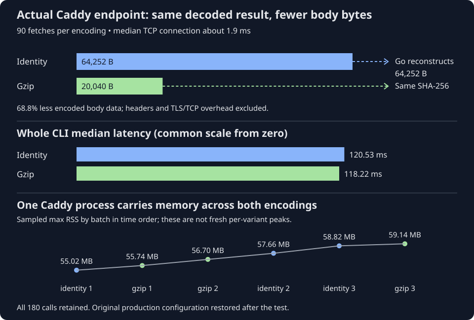

# 20. Test gzip on the actual Caddy deployment

A Linux CI runner asks the real cache endpoint for a saved result. Caddy is the
program in front of Receipt: it accepts the encrypted connection and forwards
the request to Receipt. This role is called a reverse proxy. Caddy writes
64,252 response-body bytes without compression. With gzip, it writes about
20,040 bytes. Go reconstructs the original 64,252 bytes, and Receipt validates
and replays the same result. This time the runner's connection path is short:
median TCP connection time is about **1.9 ms**.

On this path, median whole-command latency was **120.53 ms uncompressed** and
**118.22 ms gzip**. That is a small observed difference, alongside a substantial
**68.8% reduction in encoded body bytes**. Caddy's observed CPU budget was higher
for gzip. The temporary configuration was restored after the test; compression
has not been adopted as the production default.

Follow both response arrows to the client. The encoded bodies differ in size,
but the reconstructed result has the same hash. Notice how close the latency
bars are, and how the same Caddy process carries memory through both variants.



Text equivalent: identity writes 64,252 body bytes; gzip writes 20,040–20,045.
Both decode to the same original result. Median CLI latency is 120.53 versus
118.22 ms. Caddy's sampled maximum resident RAM increases chronologically from
55.02 to 59.14 MB across identity and gzip batches. Those readings belong to
one running process, not fresh independent processes for each encoding.

[Chapter 19](19-compare-gzip-responses.md) tested a controlled delayed link and a
fixture compressor. This chapter measures the deployed Caddy/Receipt/PostgreSQL
path over the Internet. Different runner placement and a different payload mean
we compare variants within this run, not absolute totals against earlier jobs.

## Change response encoding at the proxy

The request reaches the existing Caddy endpoint over verified HTTPS. Caddy
forwards it to the existing Receipt service. Receipt checks the credential,
reads its saved result through the deployed storage path and returns JSON.
Caddy either sends those body bytes directly or compresses them for a client
that accepts gzip. Go decompresses gzip before Receipt checks the result.
Neither encoding changes the command that the saved result describes.

The experiment used the actual Caddy 2.11.7 binary, existing certificate, Receipt
service and PostgreSQL. Receipt stayed on the older modified build documented
in [Chapter 17](17-measure-linux-client-and-server.md). It was not rebuilt or
replaced. No credential or database configuration changed.

The temporary [profile's `encode` block](https://github.com/sidsharma96/receipt/blob/main/deploy/digitalocean/Caddyfile.gzip-profile#L6-L11):

```caddyfile
	encode @entries gzip {
		match {
			status 200
			header Content-Type application/json*
		}
	}
```

The entries matcher above this block selects GET requests under /v1/entries/.
The response match requires successful JSON. Authentication failures, status
checks and other responses keep their ordinary status/body behavior. The gzip
client retains Go's normal negotiation. The identity client explicitly asks
for Accept-Encoding: identity, meaning an uncompressed representation. Both use
the same URL and backend; the identity build is not routed to a different server.

This is a reviewable experiment profile, separate from the ordinary deployment
Caddyfile. The operator helper backed up and validated the configuration before
reloading it. A timed rollback provided a fallback. At completion, the helper
restored the original bytes, verified the original file hash and active service,
and stopped resource sampling. Its loaded configuration also matched the restored
source through a private admin-API check. Both the sampler and rollback timer were confirmed
inactive. Caddy and Receipt binaries and process identities stayed unchanged.

If applying the profile fails, the helper attempts to restore the original
configuration. If another operator changes the file meanwhile, restoration
refuses to overwrite that different configuration. That protects the other edit,
but requires operator attention; the timer is not a guarantee against every
partial failure or concurrent change.

## Count the body before and after decompression

Go's body reader sees decompressed bytes. It cannot tell us the compressed
body size just by counting its own reads. Caddy's access log supplies the encoded
body-byte count, and its response request ID identifies the exact request.
We join that record to the Go trace and Receipt's handler log.

Before journal output, the temporary log format removes the entire request
object and response-header object. It copies only the response request ID and
encoding explicitly. Exported data has fixed status, clocks, byte counts and
IDs; no tokens, URLs, addresses or body content are published. The client hashes
its decoded body independently and still uses ordinary bounded reading and
result validation.

All 180 measured requests matched across the three records. Identity bodies were
always 64,252 bytes. Gzip bodies ranged from 20,040 to 20,045, with median 20,040.
Different valid gzip streams can reconstruct the same original bytes; we did
not investigate why these stream lengths differed by five bytes. The decoded
hash was identical in every case.

These counts cover HTTP **body** bytes. They exclude response headers, TLS
records, TCP/IP overhead and retransmissions. A 68.8% body reduction is not a
claim of 68.8% fewer packets or billable network bytes.

## Measure batches and expose the uncertainty

Three blocks each measured thirty identity and thirty gzip fetches. The order
was identity/gzip, gzip/identity, then identity/gzip. Each case had two excluded
warmups, an idle gap before measurement and another gap afterward. All measured
calls started fresh CLI processes with empty local caches. There were **90 calls
per encoding**, with no failed hit, test execution fallback or removed outlier.

The gaps let us bracket separate server resource windows. They also mean this
is a batched comparison, not randomized adjacent requests. Changing network
conditions can differ between the batches even with their order reversed.

Read “identity” as uncompressed. The median is the middle measured duration;
the mean is the total duration divided by the number of calls, so unusually
slow calls pull it upward. The 95th percentile describes the slow end: roughly
95% of calls finish within that duration. Here “Decode” means converting JSON
bytes into a checked Receipt result.

| Metric | Identity | Gzip |
| --- | ---: | ---: |
| Median whole CLI | 120.53 ms | 118.22 ms |
| Mean whole CLI | 125.30 ms | 118.52 ms |
| 95th percentile whole CLI | 160.82 ms | 130.64 ms |
| Median body read | 3.55 ms | 1.68 ms |
| Median Decode | 9.45 ms | 9.16 ms |
| Mean client CPU | 90.86 ms | 90.59 ms |
| Mean client reported peak RAM | 16.52 MB | 16.53 MB |

Body delivery improved by about 1.86 ms, while connection medians were nearly
equal. That is consistent with a transfer saving on this short path, but a
packet trace would be needed to establish exact TCP or HTTP/2 mechanics.
Decode still processes the same reconstructed result. Its small timing
difference and the slightly lower gzip CPU mean do not establish a CPU saving.
CPU is summed process/child work, not measured cycles or elapsed network waiting.

The mean and tail figures require particular care. Three identity calls in the
first block had DNS spans over 50 ms, reaching 123.68 ms. Gzip's maximum DNS span
was 20.36 ms; both medians were about 2.10 ms. These outliers remain in the data.
Compression does not eliminate DNS lookup. Therefore the 6.77 ms mean difference
and lower observed gzip tail cannot be assigned entirely to compression.

Per-block median differences also varied: gzip was about 0.83, 5.70 and 0.57 ms
faster. The aggregate median difference is descriptive evidence from this run,
not a guaranteed saving for the next runner. Earlier jobs had roughly 24 or
64 ms connection spans; we did not capture enough topology to explain their
placement relative to this runner.

## Server CPU and RAM have different measurement boundaries

The server sampler reads each service's CPU accounting and memory every 100 ms.
For each thirty-call batch, its window surrounds the matched Caddy events with
one second of padding, rounded outward to samples. All six windows had **zero
unmatched Caddy requests**. Background runtime and database work can still occur.

| Observed server-window CPU per measured hit | Identity | Gzip |
| --- | ---: | ---: |
| Caddy | 3.45 ms | 5.09 ms |
| Receipt | 22.42 ms | 21.93 ms |
| PostgreSQL | 1.68 ms | 1.74 ms |

These are service CPU deltas divided by measured hit count. Caddy's budget was
higher in all three gzip windows, with a mean difference around 1.64 ms/hit.
That supports an added proxy CPU cost, but does not isolate the compressor from
TLS, proxying, logging, runtime work or the padded interval. The backend's small
CPU difference is not evidence that gzip optimizes Receipt's computation.

Client peak RAM stayed essentially unchanged. Server RAM is harder to attribute:
the same Caddy process serves both encodings and can retain buffers and other
state. Its sampled maximum RSS rose through 55.02, 55.74, 56.70, 57.66, 58.82 and
59.14 MB as batches alternated. Identity batches inherit state from earlier gzip
requests. We cannot subtract two such readings and call that gzip's allocation
cost. RSS (resident set size) counts memory currently in physical RAM. Allocation
bytes count memory requested over time; retained heap is memory the program
still keeps. A process can reuse a buffer across many requests, so these
measurements need not rise together. The
[reference](../MEASUREMENTS.md#actual-caddy-gzip-results-20-october-2026) keeps
process and service-group memory scopes separate.

The deployed handler's median duration was about 25 ms in both variants, with
Caddy around 27 ms. Those server durations overlap the client's waiting; do not
add them to client latency. This experiment does not identify the individual
backend functions responsible for its CPU work, especially because the deployed
modified binary is older than current source.

## Compatibility and partial failure

The stock, identity and gzip builds all produced the same full key before and
after the experiment:

```text
3c576cd8c993be38c46dc198e43ca5b1ba34eb64699a3bbe08ecc6932cc8db9e
```

All 180 decoded bodies had 64,252 bytes and SHA-256:

```text
7f645f7cfde5b7ac850d24cc993ac7ec4e1e72283a9f6a89b37051dfd5a48b5a
```

Normal Receipt validation succeeded, every exit code was zero and replay stdout
hashes matched. As in earlier diagnostic builds, the declared stock binary stays
fixed while traced builds execute separately. The recorded inputs and command
remain identical between encodings. This is compatibility evidence for this
fixture, not a promise of deterministic output for every command or permission
to omit changed dependencies.

If decompression or result validation fails, that response is not a usable hit
and cannot supply a successful local entry. The failed GET does not modify the
server entry. Normal fallback can execute tests and later publish a successful
observation under existing conflict rules; a later retry can fetch if the key
remains usable. Existing error behavior is preserved; this successful-hit run
does not time outages, revoked credentials, corrupt gzip or fallback execution.

Current follow-up: [Chapter 21](21-profile-application-cpu.md) samples the actual
server and isolates application decoding/allocation costs. It does not adopt
gzip or replace the deployed backend.

## What this tells us to do next

The actual deployment confirms a large body-byte saving and working client
compatibility. On this runner's short path, the observed latency benefit is small
and the Caddy CPU budget is higher. That is a bandwidth/CPU tradeoff, not an
established reduction in total CPU or RAM use. A farther client can have more
transfer waiting to eliminate, as the controlled experiment showed, but its
exact production saving still needs measurement.

The next adoption decision should consider client placement, payload sizes,
server CPU budget and concurrent load. Repeated runs from controlled regions
would separate network variation from compression. Allocation profiles or
separately restarted instances would answer a different RAM question. Persistent
connections target setup time but add lifecycle and resident-process costs.
Precompression could reduce repeated server work while adding storage/publication
logic. None of those alternatives is implemented here.

[Run 39471579585](https://github.com/sidsharma96/receipt/actions/runs/39471579585)
and the [full nine-question review](../PHASE-REVIEWS.md#actual-caddy-gzip-comparison-20-october-2026)
retain the complete evidence, rollback verification and limitations. This phase
completed a temporary live comparison and restored the original configuration;
the ordinary deployment file remains unchanged.

## Check your understanding

<!-- questions:start -->

### Why count bytes at Caddy as well as the client?

**Level:** Newcomer

Go automatically decompresses a gzip response before Receipt reads its body. Does the client body length tell us how many compressed body bytes crossed the link?

<details>
<summary>Answer</summary>

No. The client sees the original decoded bytes. Caddy counts the encoded body it writes; matching the response request ID joins that byte count to the client result. Neither count includes all TLS, TCP or network headers.

**Learn more:** [20. Test gzip on the actual Caddy deployment](../guide/20-test-gzip-on-caddy.md)

</details>

### Can pooled server memory belong to only one variant?

**Level:** Practitioner

One long-running Caddy process serves identity, then gzip, then identity again. Can the final identity memory reading be treated as a fresh process with no gzip buffers?

<details>
<summary>Answer</summary>

No. The process can retain buffers and other state from earlier requests. Its sampled memory describes that running process, not an independent allocation cost for the current encoding. Fresh processes or allocation profiles answer different memory questions.

**Learn more:** [20. Test gzip on the actual Caddy deployment](../guide/20-test-gzip-on-caddy.md)

</details>

### Does a server CPU window isolate compression work?

**Level:** Expert

Thirty measured gzip requests fall inside a server CPU accounting window. Does dividing that window CPU by thirty give the exact compression CPU per request?

<details>
<summary>Answer</summary>

No. The window also includes TLS, proxying, background runtime work and possibly unrelated traffic. It provides an observed resource budget for that interval. Request-ID matching can identify extra HTTP traffic, but does not erase other background work.

**Learn more:** [20. Test gzip on the actual Caddy deployment](../guide/20-test-gzip-on-caddy.md)

</details>

<!-- questions:end -->
