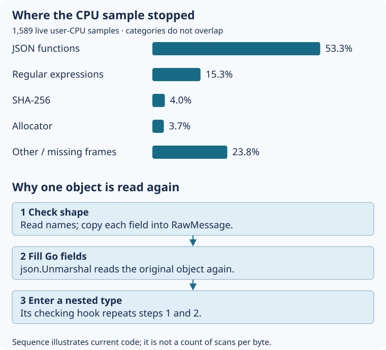

# 21. Find the application work inside a cache hit

A Linux runner asks Receipt for a saved test result. The server finds the row,
reads its output files and returns JSON. The client checks that JSON before it
replays the output. A fast database lookup does not make those later checks free.

We sampled the **actual running server**, without replacing or restarting it.
A CPU sample observes which function a thread is running at that instant. Its
call stack also records the functions that called it.
Of 1,589 samples of user-space CPU execution, 1,095 contained
`strictjson.Object`: about **69%**. This function checks the fields of a JSON
object before decoding it into a Go value. Response encoding appeared in about
10% of samples. These include called functions and overlap; they are not slices
that can be added together or percentages of wall-clock latency.

The result tells us where to investigate application work. It does not establish
that 69% of the work can be removed. Checking untrusted data remains necessary.
The older deployed executable is a modified build whose exact source is unknown;
its sampled function names establish the live path, while current-source
benchmarks let us inspect the same mechanism separately.

## Watch the same JSON pass through two readers

Suppose a manifest contains one input named `example.go`. Its input object has
three fields: kind, name and hash. Receipt must reject a repeated name such as
two `hash` fields, an unknown field, or a wrongly typed value. Ordinary Go JSON
decoding does not enforce the full Receipt contract.

First, `strictjson.Object` reads the field names and checks their allowed forms.
For every field, [`readField`](https://github.com/sidsharma96/receipt/blob/main/internal/strictjson/object.go#L63-L83)
reads a temporary copy of the field's JSON. The relevant lines in
[`readField`](https://github.com/sidsharma96/receipt/blob/main/internal/strictjson/object.go#L63-L83):

```go
	var raw json.RawMessage
	if err := d.Decode(&raw); err != nil {
		return fmt.Errorf("field %q: %w", name, err)
	}
```

For `name`, that temporary value is a short JSON string. For `manifest`, it can
be almost the whole saved result. `RawMessage` holds JSON bytes rather than a
fully decoded manifest. After checking shape, [`Object`](https://github.com/sidsharma96/receipt/blob/main/internal/strictjson/object.go#L27-L60)
returns `json.Unmarshal(data, dst)`: another read of the original object to fill
Go fields. Nested types call their own checking hooks, so their objects repeat
this sequence. There are also semantic checks: for example, a hash must contain
exactly 64 lowercase hexadecimal characters, and a result key must match its
manifest.



Text equivalent: 53.3% of live samples stopped directly in JSON functions, 15.3%
in regular-expression functions, 4.0% in SHA-256, 3.7% in the allocator and 23.8%
elsewhere, including missing frames. These leaf categories are disjoint. The
execution sequence is shape-check and copy field JSON, decode the object into
Go fields, then repeat shape checking when a nested type's hook runs. This is a
mechanism illustration, not a measured number of scans for every byte.

In the server trace, `Postgres.Get` appeared in about 81% of sample stacks. Its
JSON decoding leads into the strict object checker. This is CPU attributed to
code called by the storage method; it does **not** mean PostgreSQL query
execution consumed 81% of request time. Waiting for SQL is not captured as
running user CPU in this experiment.

## Measure temporary memory separately

The isolated Linux experiment takes a real self-CI result already available in
memory. It repeatedly calls the existing decoder, without a network request or
file read inside the timed operation. A separate operation rebuilds the server's
metadata representation and decodes it. That representation uses Go JSON output,
not the original PostgreSQL JSONB bytes, so its time is not a measurement of the
whole deployed storage method.

The final fixture contains **65,789 bytes and 396 inputs**. Across five
unprofiled benchmark repetitions on a two-vCPU Ubuntu runner:

| In-memory operation | Median time | Bytes allocated/op | Allocations/op |
|---|---:|---:|---:|
| Decode | 8.20 ms | 2,068,199 | 22,994 |
| MetadataDecode | 7.50 ms | 1,984,453 | 23,078 |
| Encode | 1.08 ms | 260,735 | 43 |

Decode therefore requested about **2.07 MB across 23,000 allocations** to check
a roughly 66 KB response. It does not retain 2.07 MB afterward. The separate
allocation profile attributes about 41% of sampled allocated bytes to decoder
buffer refill and 17% to RawMessage copies. That supports investigating repeated
parsing/copying before changing collector settings. These are isolated operation
costs, not an end-to-end remote-hit improvement.


Allocation bytes mean the total memory requested during an operation. They are
not the amount that stays resident afterward. A decoder can allocate, discard
and replace several buffers while processing one small response. The garbage
collector later recovers unreachable objects; the allocator and collector also
consume CPU.

Recognized garbage-collection worker, assist or start functions appeared in
43 live sample stacks, **2.7%**. Assisting means a running goroutine helps the
collector before it can continue allocating. This sample group is not a pause
trace and does not bound all collection work, especially with incomplete stack
unwinding. It gives no evidence that the earlier macOS startup stalls were GC
pauses. For this Linux cache-hit workload, parsing and repeated checking are
more prominent CPU targets than those recognized GC stacks.

Transport follow-up: [Chapter 22](22-explain-network-latency.md) reproduces
300–383 ms Linux fetches and explains costs outside these application profiles.

## Choose a change without weakening the checks

The largest measured area is strict JSON processing. A candidate is a shape
checker that walks the original bytes without allocating a `RawMessage` for
every field. It would still need to handle escaped names, invalid UTF-8,
duplicates, wrong case, null policy, number/string types and nested objects.
Replacing this code safely requires differential tests against the existing
checker and the JSON contract, including malformed inputs. The profile supports
investigating that design; it does not prove the new parser would be correct or
how much whole-command latency it would save.

A narrower candidate replaces the fixed lowercase SHA-256 regular expression
with an exact length-and-byte check. Regular-expression matching appeared in
about 16% of live stacks, including called functions. That total is not a promise
that one replacement removes all of it. The replacement must preserve exactly
which strings are accepted, including rejection of uppercase and non-ASCII text.

Caching a fully encoded response could avoid more repeated work, but introduces
retained memory and invalidation rules. A quarantined key or revoked credential
must still stop reuse. Dropping validation or accepting plain JSON decoding is
not an equivalent optimization. The diagnostic plain-input benchmark deliberately
omits guarantees and serves only as a cost comparison. These alternatives are
retrospective comparisons, not earlier recorded design decisions.

**No production optimization is implemented in this chapter.** No validation,
key format, wire encoding, credential or deployment configuration changed. The
next implementation should preserve acceptance/rejection behavior and compare
CPU, allocation, retained memory and latency on the same workload. Revisit the
priority if larger outputs, contention, client placement or different manifests
make another stage dominant.

## Repeat the investigation

For the live executable, an operator with existing server access can attach a
bounded Linux capture. This command samples user-space CPU and records function
call stacks; it does not open a public profiling endpoint:

```sh
sudo perf record -e cpu-clock:u -F 997 -g --call-graph fp \
  -p RECEIPT_PID -o /run/receipt-cpu.data -- sleep 120
sudo perf report -i /run/receipt-cpu.data --stdio --call-graph none
```

Replace `RECEIPT_PID` with the current service PID. Use a private output directory,
limit the capture, record binary identity and remove temporary capture data after
export. This phase used a systemd runtime limit as an additional bound and ended
the capture early after CI completed. CPU sampling perturbs execution and misses
waiting, kernel CPU and potentially truncated frames.

Dispatch the repository's **Application CPU and allocation profiles** workflow
on trusted main to repeat the isolated experiment. Its artifact contains
unprofiled benchmark repetitions and separate CPU/allocation profiles. It excludes
the fixture, credentials and test executable. Download the artifact and inspect,
for example, `go tool pprof -top Decode.cpu.pprof` or
`go tool pprof -alloc_space -top Decode.alloc.pprof`. Allocation profiles estimate
bytes allocated over many operations, not a single process's peak RAM.

The [measurement reference](../MEASUREMENTS.md#application-cpu-and-allocation-profiles-20-october-2026)
and [nine-question review](../PHASE-REVIEWS.md#application-cpu-and-allocation-profiles-20-october-2026)
preserve the two build identities, sample limitations and verification. Earlier
network and gzip results remain historical measurements with different scopes.

## Check your understanding

<!-- questions:start -->

### Is allocated memory the same as peak RAM?

**Level:** Newcomer

A decoder receives a small response but allocates several times its size while working. Does that mean all of those bytes stay resident after the operation?

<details>
<summary>Answer</summary>

No. Allocation bytes count memory requested over the operation. Some objects become unreachable and can be collected while others replace them. Peak resident RAM, retained heap and total allocation answer different questions.

**Learn more:** [21. Find the application work inside a cache hit](../guide/21-profile-application-cpu.md)

</details>

### Does storage-method CPU mean database waiting?

**Level:** Practitioner

A CPU stack contains Postgres.Get and strictjson.Object. Is that evidence that PostgreSQL query execution used that CPU?

<details>
<summary>Answer</summary>

No. The storage method also decodes and validates metadata in the Receipt process. A sampled call stack includes callers and their running children. Waiting for a database response is not running user CPU; separate timing and database evidence are needed.

**Learn more:** [21. Find the application work inside a cache hit](../guide/21-profile-application-cpu.md)

</details>

### Can inclusive profile percentages be added?

**Level:** Expert

A sample contains both the strict JSON checker and a regular-expression matcher called underneath it. Can their inclusive percentages be added to estimate removable overhead?

<details>
<summary>Answer</summary>

No. That would count the same execution sample twice. Inclusive groups overlap, and necessary validation is included in the measured work. A proposed change needs its own compatibility and before/after evidence; a profile alone cannot predict the saving.

**Learn more:** [21. Find the application work inside a cache hit](../guide/21-profile-application-cpu.md)

</details>

<!-- questions:end -->
