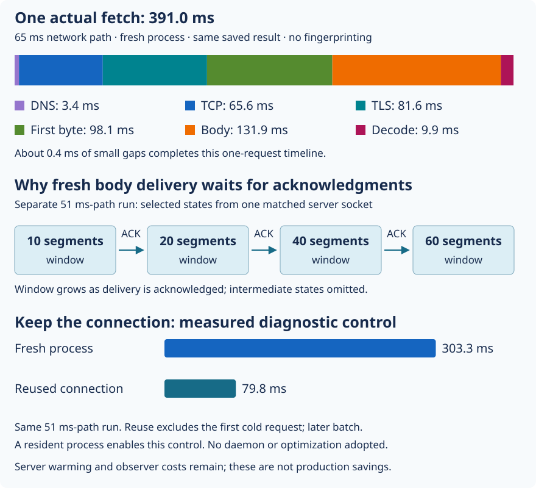

# 22. Explain the slow network hits

A Linux CI process asks Receipt's real server for an existing result. One fresh
fetch takes **391 ms before repository fingerprinting**, even though the result
is only 65,789 bytes. Fingerprinting means collecting and hashing the command's
inputs; that usual CLI work is outside this experiment. Why can fetching a
small result take this long?

Follow this measured request from the client to the server and back:

1. **Find the address (DNS), 3.4 ms.** The client asks which network address
   belongs to the server's name.
2. **Open a connection (TCP), 65.6 ms.** The machines exchange setup messages
   before sending the request over a reliable byte stream.
3. **Establish encryption and check identity (TLS), 81.6 ms.** The client checks
   the server's certificate and establishes an encrypted connection.
4. **Send the request and wait for the first response byte, 98.1 ms.** This
   includes network travel and the server's work finding and preparing the result.
5. **Collect the response body, 131.9 ms.** The body is the saved result's bytes,
   sent after the response headers. Receiving the first byte does not mean the
   whole result has arrived.
6. **Check the result, 9.9 ms.** Receipt validates the received bytes before reuse.

Small gaps complete 391 ms. The server works while the client waits or receives
bytes; its time is already inside this timeline and must not be added again.
A **round trip** is a message's journey out and a reply's journey back. On this
path it takes roughly 65 ms. Several stages require such an exchange, which is
why even a small result can take hundreds of milliseconds.

The figure separates this request from group medians (the middle measured
durations). Its connection-reuse comparison belongs to a second run; it is not
a before/after deployment result.



Text equivalent: the first run has a roughly 65 ms network round trip. Its fresh
fetch median is 383.4 ms. On a separate roughly 51 ms path, fresh fetches have a
303.3 ms median; an already established connection has a 79.8 ms median. Selected
server connection records show the limit on data awaiting acknowledgment
growing from 10 to 20, 40 and 60 segments, the pieces TCP sends. The body-delivery
section below explains why that limit creates waiting. The figure labels the two runs separately.
Reuse was tested by keeping a diagnostic process alive for later requests.
Receipt does not yet provide such a background helper.

Five independent investigation threads reviewed the exact Go client source,
Linux TCP behavior, Caddy and historical records. Their proposals fed two
read-only Linux CI jobs. All 216 fetches returned the same body and decoded
result; 24 additional calls checked shared status. Nothing was executed or
published through the cache. The production service/configuration stayed intact.

## DNS: an answer for IPv6 can hold up IPv4

Before connecting, Go asks for both an IPv4 address, called an A record, and an
IPv6 address, called an AAAA record. The reviewed
[Go 1.22.12 lookup loop](https://github.com/golang/go/blob/go1.22.12/src/net/dnsclient_unix.go#L624-L815)
collects both completions. A quick usable IPv4 answer does not finish that loop
while the IPv6 question remains outstanding.

A resolver answers DNS questions. It may reuse a saved answer or ask another
resolver upstream. The second runner uses a local resolver named systemd-resolved
at 127.0.0.53, an address on the runner itself. After
the initial lookup before its answer was locally cached, IPv4 answers usually return from that local service
quickly: the captured A-query median is **0.17 ms**. Every captured AAAA question
is forwarded upstream. The slowest captured upstream AAAA response takes
**98.57 ms** and says there is no AAAA answer. That is a valid empty result,
not an IPv6 TCP connection failure. Go still needs to receive it.

For two instrumented AAAA reads above 50 ms, Go finishes reading only about
**0.07–0.08 ms after the packet arrives**. In those samples, the missing time
was before packet arrival, not a 100 ms Go scheduling delay. The first cold A
lookup also needed an upstream request and took about 91 ms. This does not make
every historical DNS spike an AAAA problem: the original runs lack those packets.

We do not know why the upstream resolver took that long or why these empty AAAA
responses were forwarded repeatedly instead of answered locally. We have located
the visible delay, not diagnosed the recursive resolver's internals. Changing
DNS cache policy or address selection needs a separate experiment. Permanently
pinning an IP or dropping IPv6 would introduce failover and future-address costs.

## TCP: the connection timer is measuring a real round trip

The client sends a connection-opening message named SYN. The server replies
with SYN-ACK, and the client acknowledges that reply. This exchange is the TCP
handshake. We captured packet headers—the routing and control information
around transmitted data—to compare those messages with Go's connection timer. In the
first run, the median packet interval is **64.88 ms** and the Go connection span
is about **65.02 ms**. Their per-request difference has a **0.14 ms median**.
The second run has a roughly 51 ms path. These packets strongly support actual
transport/remote-kernel waiting rather than tens of milliseconds of client code.

The old 24 ms and 1.9 ms jobs remain separate observations. Different runner
placement or routing is plausible, but geographic distance was not measured.
Historical records show one successful connection attempt per request, without
evidence that address-family fallback caused those stable baselines. Packet
retransmissions or scheduling can still affect other requests.

## TLS: certificate trust has a per-process startup cost

After TCP, the client establishes encryption. It needs a list of trusted certificate issuers to check the server's
identity. A fresh Linux Go process reads that list from local certificate files. [System roots initialization](https://github.com/golang/go/blob/go1.22.12/src/crypto/x509/root.go)
uses `sync.Once`, which makes initialization happen once within that running
program. Starting another CLI process requires initializing its own list. The
[Unix loader](https://github.com/golang/go/blob/go1.22.12/src/crypto/x509/root_unix.go)
reads certificate bundles/directories and builds an in-memory trust pool.

A standalone root-load control costs about **7.4–9.4 ms elapsed**, allocates
**3.13 MB**, and makes about **31,000 memory requests (allocations)** on these runners.
Total allocation counts temporary memory too; it is not memory retained forever. Loading
the same normal trust store before the handshake reduces its measured TLS CPU
and latency. It moves work outside that timer; it does not eliminate the work.
In the 51 ms-path public control, cold TLS is about 64 ms; after preloading it is
about 57 ms. These public requests receive HTTP 401, meaning authentication is required.
They test encrypted connection setup but never reach authenticated cache handling.

<details>
<summary>Optional: what the machine-code samples tell us</summary>

Certificate checking also requires computation. Two small sets of CPU samples
repeatedly found arithmetic for P-384, an elliptic-curve cryptographic algorithm
used to verify certificate signatures. The useful distinction here is that the
client is doing arithmetic, rather than waiting for another network message. We inspected
[the actual second probe's machine code](https://github.com/sidsharma96/receipt/blob/f87c9b5eb6ee5ba74ac1837181189732ceaebf7b/docs/measurements/network-deep-dive-2026-10-20/tls-assembly.json):
`MULQ` multiplies integer parts and carry-handling instructions combine the
results. This is computation, not a hidden network sleep. The profiles contain
only 20–24 CPU samples each, so they identify a function family without precise
instruction-level costs. They do not justify replacing cryptographic code.

</details>

A warm full handshake still opens TCP and verifies certificates, but the process
has already loaded its trust list. A resumed TLS session opens TCP but uses a
ticket, state issued by the server on an earlier connection, to reduce setup work. Reusing an
already established connection avoids both setup operations. Our controls verify
actual resumption/reuse flags; they are different mechanisms. None shares state
across independent CLI processes automatically, and verification remains enabled.

## First response: network travel plus real backend work

Receipt assigns each request an ID. Matching that ID in the client record and
server log lets us compare the same request on both sides. The server's handler
is the code that processes the request and prepares its response.
In the 65 ms-path fresh fetch group, the median handler is **27.10 ms**; the
median of each request's first-byte interval minus its own handler is **65.21 ms**.
The much smaller status handler leaves a similar network-sized residual.
The second run gives the same pattern around its 51 ms path.

The remainder after that subtraction is not an exact network timer: proxy buffering, scheduling and
handler/write boundaries remain inside it. But the matching and status control
make network travel plus backend work a strong explanation. The backend's
[JSON CPU profile](21-profile-application-cpu.md) explains substantial local work.
Its query, file and lock clocks do not show comparable large waits in these
sequential hits. Caddy, the proxy accepting public connections, can reuse its separate connection
to Receipt on the same server machine (a loopback connection);
a fresh public client does not inherently require a fresh upstream connection.

Synchronous request logging can delay buffered output after the recorded handler
ends. An isolated blocked-writer experiment demonstrates that possibility, but
these timings do not identify it as the main production cause. SQL indexes,
proxy flush tuning and logging changes need evidence from their own boundaries.

## Reads: fresh TCP delivery waits for acknowledgments

Receipt collects response bytes before checking them. In
[`Remote.Get`](https://github.com/sidsharma96/receipt/blob/main/internal/cache/http.go#L62-L82):

```go
	b, e := io.ReadAll(io.LimitReader(resp.Body, MaxEntryBytes+1))
	if e != nil {
		return v, e
	}
	v, e = Decode(b)
```

`resp.Body` supplies incoming bytes. `LimitReader` allows at most one byte beyond
the accepted limit so oversized responses can be detected; `ReadAll` collects
those bytes into `b`. A read error returns before `Decode` runs. Only after
reading finishes does `Decode` check the result. Thus waiting for bytes and
checking bytes are separate stages. In the 65 ms-path
fresh group, collecting bytes takes **129.97 ms**, but consumes only about
**1.69 ms of client process CPU**. Checking the result then takes about 10 ms.
On the 51 ms path, body collection takes **101.71 ms**, about two round trips,
with roughly 1.14 ms CPU. JSON checking cannot explain that separate read wait.

Imagine the server has sent the first pieces of our result. It cannot send an
unlimited amount while waiting to hear whether those pieces arrived. TCP's
**congestion window** limits how much sent data can still be awaiting a receipt,
called an acknowledgment or ACK. As ACKs return, TCP can increase that limit.
A fresh connection therefore can need more than one exchange to deliver a body.

The server's operating system records show fresh connections starting with a
window of ten segments, then growing during delivery. Captured headers show
separated bursts of data. This gives us evidence for the waiting sequence:

```text
Server                         Client
send initial pieces ---------> receive pieces
wait for receipts <----------- acknowledge arrival
increase send allowance
send more pieces ------------> receive more of the result
```

This is an illustration of the mechanism, not a packet-by-packet reconstruction.
To connect our packet evidence to the right server record, we could not rely on
port numbers: network address translation (NAT), which rewrites addresses or
ports between networks, changed the client ports. Instead we matched the initial
TCP sequence number, which identifies a position in the byte stream. All 101
new diagnostic connections matched. The exact matching procedure remains in the
[measurement record](../MEASUREMENTS.md#network-stage-deep-dive-20-october-2026).

Keeping the connection changes this behavior: warmed body-read medians are
**1.08 ms and 0.27 ms** in the two runs, with identical bytes. A fresh HTTP/1.1
control still waits about two round trips, weakening an HTTP/2-specific theory.
Go 1.22's HTTP/2 receive limits also exceed this single response substantially.
The growing window and comparisons strongly support delivery waiting for
acknowledgments during TCP startup. They do not prove every gap comes solely from congestion control;
encryption groups bytes into records, the proxy chooses when to write, and TCP
can space out sends or delay acknowledgments. Those also shape the bursts.

## What to focus on next

A fresh fetch pays roughly five round-trip-sized waits: TCP setup, TLS exchange,
request/first-response travel and about two more during body delivery. The local
TLS and validation work then adds to that cost. This accounts for the reproduced
300–383 ms request class without inventing a long application sleep.

**Recommendation, 20 October 2026: compare client/server placement first.**
Take the same saved result and client build, and compare repeated fresh fetches
from controlled runner locations to the same endpoint. Record connection time,
whole-fetch time, errors and matching result bytes. A shorter network path could
reduce several waits in one fetch without introducing a background process.
Our runs motivate that experiment; they do not prove a particular region is
faster. Geography and routing were not controlled in the earlier comparisons.
Any eventual server move needs a separate deployment and data-migration decision.

This priority assumes the target remains fresh CI jobs with few cache operations.
Revisit it if runner placement cannot be controlled, the improvement is unstable,
or the workload becomes many operations in one job. For that last case, a bounded
batch mode is worth comparing: one process handles several operations, keeping
its connection between them. The first operation still pays setup; later ones
may benefit. On the second diagnostic run, fresh fetches had a **303.3 ms median**
and established-connection fetches a **79.8 ms median**. That is promising evidence
for reuse, not a prediction of whole-job savings from a feature we have built.

A continuously running helper could share connections between independent CLI
invocations, but we would need to decide who starts and stops it, how it refreshes
credentials, and what callers do when it fails. Batching has a bounded job
lifetime, though it still needs cancellation and per-operation failure rules.
Go's transport already supports retaining connections within a process; merely
saving `http.Client` in a variable cannot preserve a connection after exit.
Neither batch mode nor a persistent helper is implemented.

The other candidates solve narrower problems. [JSON checking](21-profile-application-cpu.md)
is a measured CPU cost, but reducing its roughly 8–10 ms client decode time does
not remove the much longer network waits. It becomes a stronger priority for a
nearby cache or CPU-limited server. DNS work targets occasional slow replies;
fixing those would not remove the ordinary TCP and transfer costs. Gzip reduces
body bytes, but [Chapter 20](20-test-gzip-on-caddy.md) shows why its benefit must
be weighed against extra server CPU on the actual path. These are current,
retrospective comparisons, not claims that an optimization has shipped.

The [measurement record](../MEASUREMENTS.md#network-stage-deep-dive-20-october-2026)
and [nine-question review](../PHASE-REVIEWS.md#network-stage-deep-dive-20-october-2026)
retain runs, source versions, observer effects and remaining limits. These are
sequential diagnostics with altered process/connection lifetimes, not a shipped
optimization, capacity test or exact reconstruction of every earlier slow call.

## Check your understanding

<!-- questions:start -->

### Can an empty IPv6 answer delay an IPv4 connection?

**Level:** Newcomer

Go gets an IPv4 address quickly but is still waiting for the IPv6 DNS reply. Can lookup time include that wait even when the eventual connection uses IPv4?

<details>
<summary>Answer</summary>

Yes. The reviewed lookup collects both A and AAAA completions. The AAAA reply may validly contain no address. Waiting for it is different from attempting and failing an IPv6 TCP connection.

**Learn more:** [22. Explain the slow network hits](../guide/22-explain-network-latency.md)

</details>

### Did preloading certificates eliminate their cost?

**Level:** Practitioner

A process loads the normal trust store before starting the TLS timer. TLS becomes faster. Has the process necessarily become equally faster overall?

<details>
<summary>Answer</summary>

No. Loading moved outside the timer. Include its CPU, memory and elapsed time before claiming an overall improvement. A later request in a resident process can reuse initialized state, but a new process has to initialize again.

**Learn more:** [22. Explain the slow network hits](../guide/22-explain-network-latency.md)

</details>

### Why does a port-only packet join fail across NAT?

**Level:** Expert

The runner records one source port, but the server observes another. Does that prove the packet and server socket cannot belong to the same connection?

<details>
<summary>Answer</summary>

No. Network address translation can rewrite the port. This investigation matched the server SYN-ACK initial sequence number plus one to the initial server send state. The match identifies a connection; a reused connection still needs request IDs and boundaries to distinguish its requests.

**Learn more:** [22. Explain the slow network hits](../guide/22-explain-network-latency.md)

</details>

<!-- questions:end -->
